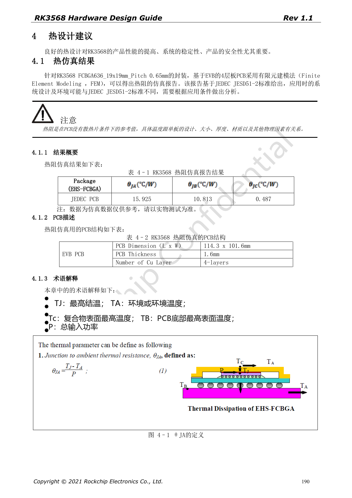
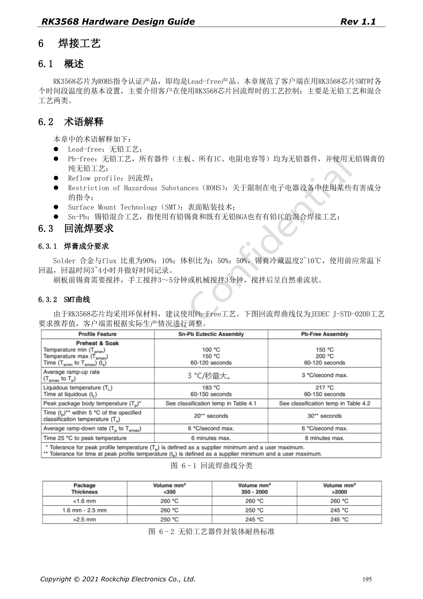
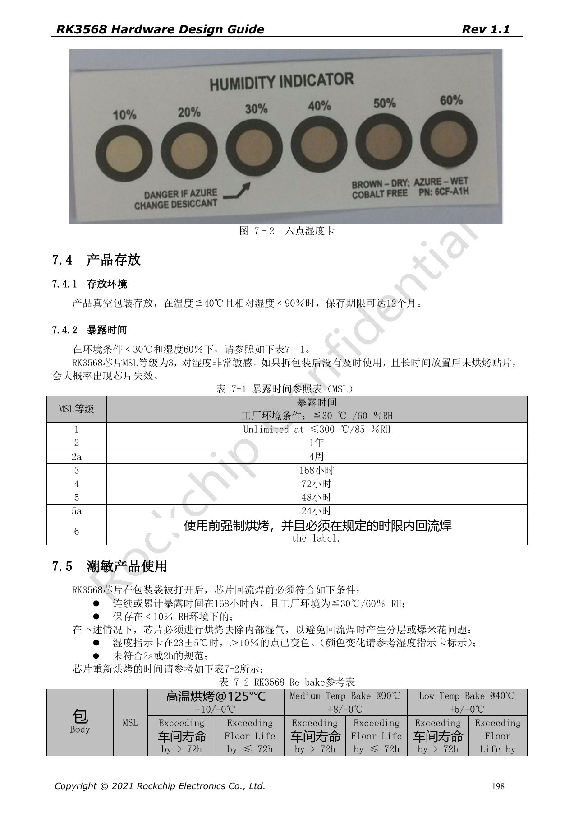

# RK3568 量产硬件检查：热设计、ESD、焊接与存储

本系列依据 RK3568 Hardware Design Guide V1.1（中文，2021-06-08）及独立的 High Speed PCB Design Guide V1.0.0（英文，2021-04-12），围绕具体工程问题重组。ArmSoM [Sige3](https://www.armsom.org/sige3) 采用 RK3568B2，可结合其[板卡文档](https://docs.armsom.org/armsom-sige3)学习与评估本系列设计问题。芯片级参考电路不等同于 Sige3 的实际原理图或全部引出接口；SDK/BSP、内核、硅版本、固件与外设组合须逐项核对。数值是原稿参考，未经 ArmSoM 硬件验证。

**CN V1.1 §4–7 · PDF 190–199**

## 热阻是参考条件下的结果

原稿热仿真针对 FCBGA636、19×19mm、0.65mm pitch，基于 114.3×101.6mm、1.6mm 厚、4 层 EVB PCB，且没有散热片。不能把该结果作为任意载板与外壳的结温保证。表 4-1 已通过原图核对：θJA=15.925°C/W、θJB=10.813°C/W、θJC=0.487°C/W。它们是厂商仿真参考，不是本项目实测。

## 散热要覆盖 SoC 以外器件

原稿建议 SoC 与 RK809-5 相距 20–50mm，增加铜与地过孔，避免高功耗器件局部集中；大电流电源铜皮需满足载流要求。项目应按真实 CPU/GPU/NPU、视频与 IO 同时工作负载测试外壳内温升，并记录环境、固件、频率与限温行为。PMIC、电感、背光电源也需测温，不能只看 SoC 传感器。

## ESD 是回流路径问题

保护器件靠近外部接口或放电入口，表层地保持良好回流，不让信号割断连接器附近大面积地。Reset、时钟、中断等敏感信号距板边原稿要求 ≥5mm，nPOR 的 100nF 贴近引脚并提供短地路径。金属外壳、屏蔽罩、连接器与电源接地共同决定放电路径；本指南不能替代整机 EMC/ESD 测试。

## MSL3 与回流前管理

RK3568 在原稿中为 MSL3，≤30°C/60%RH 的累计暴露参考为 168 小时。真空包装保存条件为 ≤40°C、<90%RH、最长 12 个月；实际还要服从包装标签。受潮后的再烘烤表按封装厚度 ≤1.4mm、超期是否 >72h 分列，不能混用 125°C、90°C、40°C 的时间。原稿 MSL1 行出现“≤300°C”，明显疑点保留在校对记录，不作为存储条件。

## 原稿参数与约束

| 项目 | 原稿参考 |
| --- | --- |
| MSL3 暴露时间 | 168h at ≤30°C /60%RH |
| 封装厚度 | ≤1.4mm |
| 再烘烤 125°C +10/−0°C | >72h: 9h; ≤72h: 7h |
| 再烘烤 90°C +8/−0°C | >72h: 33h; ≤72h: 23h |
| 再烘烤 40°C +5/−0°C | >72h: 13d; ≤72h: 9d |

## 原稿配图

下列为原稿页面截图，供核对电路、图例与上下文，正文及参数表保留为可编辑文字。中文主指南没有对应英文整稿，因此其截图在四语中均保留中文；独立英文 PCB 稿的截图明确标为英文来源。PDF 页码均为物理页码。

中文硬件设计指南 · PDF 190

中文硬件设计指南 · PDF 195

中文硬件设计指南 · PDF 198

## 继续阅读与开发资料

- [RK3568 硬件设计系列：10 个电路、PCB 与量产主题](/zh/articles/rk3568-hardware-design-series/)
- [RK3568 PCB 设计：叠层、扇出、回流与接口约束](/zh/articles/rk3568-pcb-stackup-return-path-design/)
- [ArmSoM Docs](https://docs.armsom.org/)
- [ArmSoM](https://www.armsom.org/)
