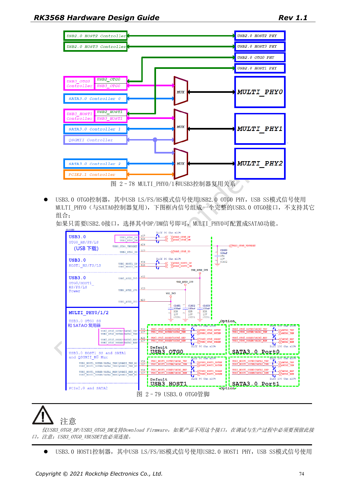
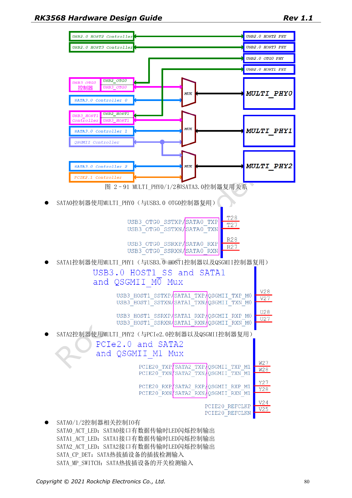
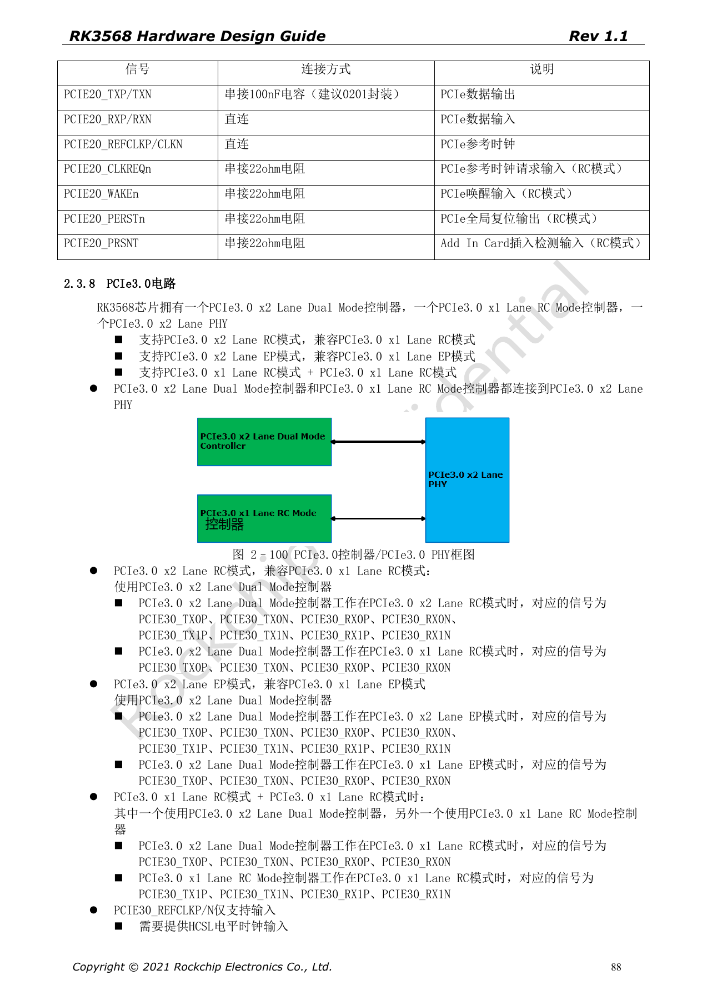

# RK3568 高速扩展：USB、SATA、PCIe 复用与时钟

本系列依据 RK3568 Hardware Design Guide V1.1（中文，2021-06-08）及独立的 High Speed PCB Design Guide V1.0.0（英文，2021-04-12），围绕具体工程问题重组。ArmSoM [Sige3](https://www.armsom.org/sige3) 采用 RK3568B2，可结合其[板卡文档](https://docs.armsom.org/armsom-sige3)学习与评估本系列设计问题。芯片级参考电路不等同于 Sige3 的实际原理图或全部引出接口；SDK/BSP、内核、硅版本、固件与外设组合须逐项核对。数值是原稿参考，未经 ArmSoM 硬件验证。

**CN V1.1 §2.3.4–2.3.8 · EN PCB §1.1–1.6**

## 先画出 PHY 分配矩阵

MULTI_PHY0 在 USB3 OTG0 与 SATA0 之间选择；MULTI_PHY1 在 USB3 HOST1、SATA1、QSGMII/SGMII 之间选择；MULTI_PHY2 在 PCIe2.0、SATA2、QSGMII/SGMII 之间选择。不能把这些控制器数量全部相加成为可同时使用的端口。USB3 的 SuperSpeed 与对应 USB2 PHY 必须按原图配对；OTG0 的 DP/DM 与 VBUSDET 是下载保留路径。

## PCIe2 与 PCIe3 的时钟方向不同

PCIe2.0 为 x1 RC，REFCLK 默认输出，也可输入。PCIe3.0 使用两 Lane PHY，可配置 x2 RC、x2 EP 或两个 x1 RC；其 REFCLK 仅输入，需要符合 PCIe3.0 要求的 HCSL 时钟。CLKREQn/WAKEn 用功能脚，同一接口不能混用 M0/M1/M2；PERSTn 可用 GPIO，使用功能脚时也要匹配组。标准插槽控制信号为 3.3V，需与 IO 域匹配。

## 耦合电容与阻抗分接口管理

英文 PCB 稿给 USB3 TX 100nF、SATA TX/RX 10nF、PCIe2 TX 100nF、PCIe3 TX 220nF，容差均 ±20%，优先 0201。USB 数据为 90Ω±10%，SATA 为 100Ω±10%，PCIe 数据为 85Ω±10%，PCIe REFCLK 为 100Ω±10%。不能用一条“所有高速差分 100Ω”的规则覆盖。PCIe3 建议布线后仿真，检查连接器、过孔、耦合电容和全通道损耗。

## 验证必须包含真实组合

先冻结控制器、PHY、时钟、IO 组、电源与 DTS 的配置表，再做枚举、目标速率、休眠唤醒和持续传输。SATA Port Multiplier 的原稿指标是每端口最多 5 设备，不代表任何驱动与扩展板都已验证。英文 PCIe 表的“Max inter-pair skew <6inches”与总长同值，本文保留这一原稿表述，不把它解释成精确等长目标。

## 原稿参数与约束

| 项目 | 原稿参考 |
| --- | --- |
| USB3 | 90Ω±10%; <12mil; <6in; 100nF±20% |
| SATA3 | 100Ω±10%; <12mil; <6in; 10nF±20% |
| PCIe2 | 85Ω±10%; <12mil; <6in; 100nF±20% |
| PCIe3 | 85Ω±10%; <12mil; <6in; 220nF±20% |

## 原稿配图

下列为原稿页面截图，供核对电路、图例与上下文，正文及参数表保留为可编辑文字。中文主指南没有对应英文整稿，因此其截图在四语中均保留中文；独立英文 PCB 稿的截图明确标为英文来源。PDF 页码均为物理页码。

中文硬件设计指南 · PDF 74

中文硬件设计指南 · PDF 80

中文硬件设计指南 · PDF 88

## 继续阅读与开发资料

- [RK3568 硬件设计系列：10 个电路、PCB 与量产主题](/zh/articles/rk3568-hardware-design-series/)
- [RK3568 启动存储：eMMC、FSPI、NAND 与 SDMMC 电路](/zh/articles/rk3568-storage-emmc-fspi-sdmmc-hardware/)
- [RK3568 以太网硬件：双 GMAC、RGMII 与 QSGMII](/zh/articles/rk3568-ethernet-rgmii-qsgmii-hardware/)
- [ArmSoM Docs](https://docs.armsom.org/)
- [ArmSoM](https://www.armsom.org/)
