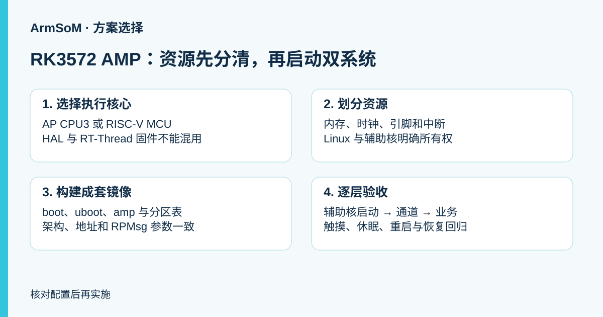

**RK3572 AMP 的第一项工作是资源归属，不是把 RT-Thread 编译出来。** Android 和辅助核固件必须对内存、外设、中断和启动入口达成一致，才能把界面与网络留给 Android，把特定控制任务交给辅助核。

本文以用户提供的 **RK3572 EVB1、Android 16、Linux 6.12** 项目记录为参考，整理成 ArmSoM 项目评估流程。它不是某款 ArmSoM RK3572 产品的已验证镜像教程；文中的地址、路径和配置属于该示例基线。截图在恢复章节截断，缺失部分不补造。



## 1. 四种组合先选定一种

| 组合 | 辅助执行资源 | 固件 | Android 侧要求 |
| --- | --- | --- | --- |
| 1 | AP CPU3 | Rockchip HAL | 从 Linux 的 SMP 资源中移出该核 |
| 2 | AP CPU3 | RT-Thread | 同上，且匹配 AP 架构与启动入口 |
| 3 | RISC-V MCU | Rockchip HAL | AP 核仍供 Android；外设另行划分 |
| 4 | RISC-V MCU | RT-Thread | 本文主线，独立辅助核固件 |

AP 版本与 MCU 版本不能仅因都叫 `amp.img` 就互换。原示例的 AP 路径为 `rk3572-64/Image/amp.img`，MCU 路径为 `rk3572-mcu/Image/amp.img`。U-Boot 的 AP 启动与 MCU standalone 路径也不同。

RPMsg 是处理器间消息机制；它不自动保护所有共享资源。Linux 文档也强调辅助处理器可能访问物理内存与外设，因此要限制暴露给应用的通道和消息权限。[Linux RPMsg](https://docs.kernel.org/staging/rpmsg.html)

## 2. 固定仓库、工具链与构建范围

准备同一发布基线的 `u-boot`、`rkbin`、`kernel-6.12`、`device/rockchip` 和 `rt-thread-rk3572`。Android 的 `build.sh` 不等于 RT-Thread 构建器，辅助固件需要独立编译。

下面是 MCU 主线示例。先把工具链路径替换为本机真实绝对路径，并确认编译器版本满足 SDK 要求：

```bash
cd rt-thread-rk3572/bsp/rockchip/rk3572-mcu
export RTT_EXEC_PATH=/absolute/path/to/riscv-toolchain/bin
test -x "$RTT_EXEC_PATH/riscv64-unknown-elf-gcc"
scons --menuconfig
scons -j8
./mkimage.sh
```

`RT_USING_RPMSG_LITE` 用于消息链路；测试命令可能由 `RT_USING_COMMON_TEST` 以及 GPIO/WDT 相关选项控制。`.config`、`rtconfig.h` 和实际编译产物要一致。原示例通过 `mkimage.sh` 把 `rtt.bin` 包装为 FIT 格式的 `Image/amp.img`，MCU 加载地址为 `0x45000000`；不要将这个地址直接用于其他 BSP。

## 3. 保留内存必须双方一致

下表来自原项目的资源布局，供逐项核对，不是可直接套用到任意板卡的分配表。

| 区域 | 基址 | 预留大小 |
| --- | --- | --- |
| mcu_reserved | 0x45000000 | 2 MiB |
| amp_shmem_reserved | 0x45200000 | 2 MiB |
| rpmsg_reserved | 0x45400000 | 2 MiB |
| rpmsg_dma_reserved | 0x45600000 | 2 MiB |
| amp_reserved | 0x45800000 | 32 MiB |
| amp_uart_reserved | 0x47800000 | 128 KiB |

`amp_reserved` 的结束地址是 `0x47800000`，不包含该地址，因此与下一块首尾相接。原 AP CPU3 示例入口是 `0x46400000`；这与 MCU 入口不同。

原 RPMsg 节点只映射 vring 所在的 `0x20000` 字节区域，并通过 `memory-region` 引用单独 DMA 池。预留区域、映射大小与有效负载容量不是同一个概念：

```dts
rpmsg: rpmsg@45400000 {
    compatible = "rockchip,rpmsg";
    mbox-names = "rpmsg-rx", "rpmsg-tx";
    mboxes = <&mailbox0 0 &mailbox3 0>;
    rockchip,vdev-nums = <1>;
    rockchip,link-id = <0x03>;
    reg = <0x0 0x45400000 0x0 0x20000>;
    memory-region = <&rpmsg_dma_reserved>;
    status = "okay";
};
```

`rockchip,link-id`、mailbox、共享地址和辅助固件的 rpmsg-lite 设置必须一致。这里的 `0x03` 是原示例值，不由通道名推算。核对 DTS 合并后的结果及链接脚本，防止两端各自编译成功却访问不同区域。

## 4. Android 内核与板级配置

原项目使用非 GKI 基线；以下配置不能解读成所有 AMP 平台都只能关闭 GKI。对目标 SDK 先确认官方支持组合：

```makefile
BOARD_BUILD_GKI := false
PRODUCT_KERNEL_CONFIG += rockchip_amp.config
BOARD_WITH_SPECIAL_PARTITIONS += amp:4M
```

内核示例配置：

```text
CONFIG_ROCKCHIP_AMP=y
CONFIG_MAILBOX=y
CONFIG_ROCKCHIP_MBOX=y
CONFIG_RPMSG=y
CONFIG_RPMSG_VIRTIO=y
CONFIG_RPMSG_NS=y
CONFIG_RPMSG_ROCKCHIP_MBOX=y
CONFIG_RPMSG_TTY=y
CONFIG_VIRTIO=y
```

原 DTS 在 `rk3572-android.dtsi` 之后引入 `rk3572-amp.dtsi`。仅对 AP CPU3 组合，原示例将相应 CPU 节点关闭：

```dts
&cpu_l3 {
    status = "disabled";
};
```

不要把这段应用到 MCU 组合后又无故减少 AP 核。`nproc` 还受在线状态与进程亲和性影响，不能单独作为所有权证明，应结合最终 DTS、CPU online 列表和启动日志。

## 5. 外设、中断与 GPIO 的归属

把某个外设交给辅助核时，同时检查 Linux 节点、时钟、复位、pinctrl、DMA 和中断。只关闭一个驱动节点，不代表其他资源已全部释放。

原分支的 `amp-irqs` 使用全局 GIC 中断 ID；对 DTS 中类型为 SPI 的相对编号，需要按该绑定规则处理 `+32`，且只能转换一次。它不是 Linux 动态分配的虚拟 IRQ 号，不能直接抄 `/proc/interrupts` 左侧数字。

GPIO 的特殊问题是中断线可能以 bank/输出为归属单位，而不是任意单个引脚。原作者报告 MCU 初始化抢占 GPIO bank 后 Android 触摸失效，并给出延迟申请中断的修正方向。本次没有拿到完整补丁，**不把截图代码片段包装成已验证的通用驱动修复**。实际项目要先列出该 bank 上所有 Linux 与 MCU 用户，再核对驱动支持的共享/独占规则。

## 6. 将辅助固件纳入可重复构建

原示例 Android 构建入口如下；参数含义与输出目录必须先在当前脚本中核实：

```bash
./build.sh -ACKUu
ls -lh rockdev/Image-rk3572_a16/
sha256sum rockdev/Image-rk3572_a16/amp.img
```

| 产物 | 核查重点 |
| --- | --- |
| `boot.img` | 内核、DTS、AMP 和 RPMsg 资源与选定组合一致 |
| `uboot.img` | 支持对应固件类型及加载方式 |
| `amp.img` | 架构、FIT 元数据、入口和共享内存契约 |
| `parameter.txt` | 分区大小、布局与实际打包规则 |
| `update.img` | 最终包含正确版本的所有配套镜像 |

如果打包脚本会重建 `rockdev`，只手工拷贝一次 `amp.img` 容易在下次构建丢失。应把拷贝与缺失即失败的检查写进构建链，并记录哈希。原资料展示的“缺失则跳过”片段适合调试观察，量产打包不应静默漏掉必要固件。

## 7. 部署前检查与分层验证

以下查询不会写分区；日志读取可能需要开发镜像权限，失败应记录：

```bash
adb shell cat /sys/devices/system/cpu/online
adb shell ls -l /dev/ttyRPMSG0
adb shell dmesg | grep -Ei 'amp|rpmsg|mailbox'
adb shell cat /proc/interrupts
adb shell ls -l /dev/block/by-name/
```

首次部署或修改分区表时，使用已核对板型、存储介质、loader、签名和分区布局的成套固件，并先保存数据与恢复方案。原资料使用的整包命令如下，**它会写入固件，不是诊断命令**，只能在目标开发设备已确认且进入对应升级模式后执行：

```bash
./upgrade_tool uf update.img
```

本文不提供固定 `/dev/block/sda13` 或固定 LBA 写入法，也不补写缺失的 Maskrom 恢复步骤；路径与分区变化会使它们失效。独立升级 `amp` 也要求已有布局不变、镜像配套且可恢复。

验收按顺序进行：U-Boot 确认辅助固件加载 → 辅助串口或日志正常 → RPMsg 名称与端点建立 → 小消息往返与长度检查 → 实际业务 → 触摸/网络/存储并发 → 重启、掉电、休眠与恢复。原示例的 `/dev/ttyRPMSG0` 是观察点，不是所有镜像必然出现的节点。

不要把成功启动称为“硬实时性能已验证”。实时性需要记录负载、测量方法、最大延迟与异常恢复。可参考 [ArmSoM AMP 文档](/zh/articles/022-rockchip-amp/)理解基础机制，但其中其他 SoC 的配置不能直接替代 RK3572。[本篇原资料](https://mp.weixin.qq.com/s/LZsdrAUAg8sIBmwEcc1PAw)

## 适用产品与继续阅读

ArmSoM 项目可从 [Sige7](https://www.armsom.org/sige7)、[AIM7](https://www.armsom.org/aim7)、[LM7](https://www.armsom.org/lm7) 的 RK3588 平台，或 [CM5](https://www.armsom.org/cm5)、[Sige5](https://www.armsom.org/sige5) 的 RK3576 平台开始评估。接口与系统支持请分别查阅 [Sige7 文档](https://docs.armsom.org/armsom-sige7)、[CM5 文档](https://docs.armsom.org/armsom-cm5)、[Sige5 文档](https://docs.armsom.org/armsom-sige5)。产品链接用于选型，不代表这些板卡已验证本文全部 SDK 组合。
