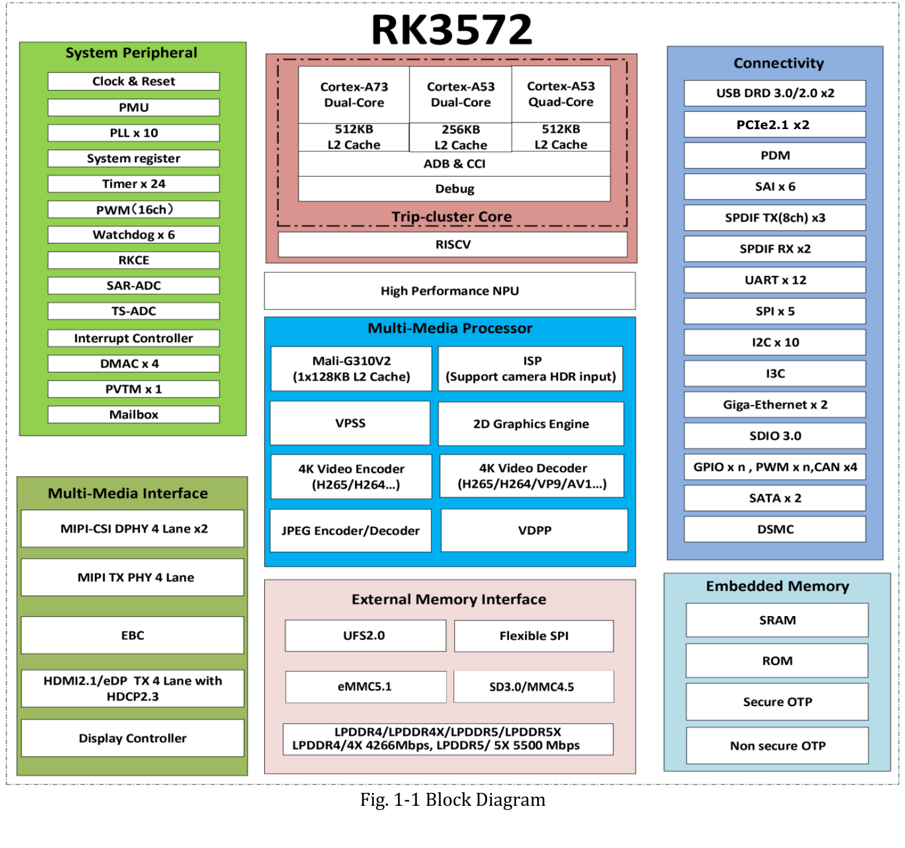

## 适用范围

本文面向 RK3572 自研主板与 ArmSoM Zero5 项目评估，依据 RK3572 硬件设计指南 V1.1 和本次硬件资料包。芯片接口不等于板卡已引出接口；Zero5 的最终配置、可用系统和内核版本须以对应硬件版本的正式产品文档为准。本文未进行 ArmSoM 硬件实测。

RK3572 的选型价值在于 CPU、NPU、多媒体和接口的组合。设计前应先把“芯片能力”“PHY 复用”“板级实现”分开，再决定内存、存储和接口方案。本页升级到 V1.1，保留原文章地址，便于已有引用继续使用。

## V1.1 相对 V1.0 改了什么

| 项目 | 规格与边界 |
|---|---|
| GPU API | Vulkan 1.2 → Vulkan 1.4 |
| LPDDR4 / LPDDR4X | 新增限制：rank 数为 2 时，不支持 R17。不能把容量上限当作任意颗粒组合都受支持。 |
| VideoPort1 | 2048 × 1080 @ 60 Hz, 8-bit |

本次依据为 `Rockchip RK3572 Datasheet V1.1-20260413.pdf`，共 47 页。旧文章依据 V1.0（2026-03-24，51 页）；页数变化不代表芯片功能被等比例删减。新版本的数值和适用条件优先，旧地址中的 v10 仅作为历史 URL 保留。

*RK3572 芯片功能框图*

## CPU、GPU、NPU 与内存

| 项目 | 规格与边界 |
|---|---|
| CPU | 2 × Cortex-A73 + 6 × Cortex-A53; ARMv8-A |
| CPU clusters | 2 × A73 / 4 × A53 / 2 × A53；L2 分别为 512 / 512 / 256 KB |
| GPU | Mali-G310V2 MC1; OpenGL ES 3.2; OpenCL 3.0 Full Profile; Vulkan 1.4 |
| NPU | 4 TOPS (INT8 Sparse); INT4/INT8/INT16; FP4/FP8/FP16/BF16; W4A16 |
| DRAM | LPDDR4/4X-4266; LPDDR5/5X-5500; 32-bit; ≤16 GB; ≤4 ranks |
| MCU | RISC-V Nuclei N320; 24 KB ILM; 8 KB I-cache; 8 KB D-cache |

4 TOPS 必须与 INT8 Sparse 口径一起阅读，不能直接等同于任意模型的吞吐率。16 GB 是寻址能力，不是 Zero5 的确定内存选项。模型速度、内存带宽、散热与系统功耗需要在具体板卡、固件和模型上验证。

## 视频编解码、显示与图像输入

| 项目 | 规格与边界 |
|---|---|
| H.265 / VP9 / AV1 / AVS2 decode | 8K @ 30 / 4K @ 120 |
| H.264 decode | 4K @ 60 |
| H.264 / H.265 encode | 4K @ 40 |
| JPEG | 4K @ 60 |
| ISP | 12 MP |
| VideoPort0 | 4096 × 2160 @ 60 Hz; 10-bit |
| VideoPort1 | 2048 × 1080 @ 60 Hz; 8-bit |
| HDMI / eDP | HDMI 2.1 / eDP 1.3 Combo PHY; HDMI ≤4K @ 60 |
| MIPI DSI | 4 lanes; 2.5 Gbit/s/lane |
| MIPI CSI | 2 × 4-lane D-PHY; DVP |

最高解码能力、显示接口带宽和多个输出同时工作是三个不同问题。V1.1 框图仍使用“4K Video Decoder”标签，而正文列出 8K@30；这里保留正文格式与帧率，不把框图标签当作额外限制。硬件设计指南中“两屏异显 4096×2160@60 + 2560×1600@60”的示例，与数据手册 VideoPort1 上限存在差异；未据此承诺该组合可运行，须按正式芯片规格和实际 BSP 再核对。

## 存储、外设和封装

| 项目 | 规格与边界 |
|---|---|
| Storage | eMMC 5.1; UFS 2.0 HS-G3 ×2; SDMMC; FSPI 1/2/4/8-bit |
| Network | 2 × GMAC |
| USB | 2 × USB 3.0 / USB 2.0 DRD |
| Low-speed I/O | 12 × UART; 10 × I2C; 5 × SPI; 4 × CAN; 16 × PWM |
| Package | FCCSP550L; 14.3 × 15.5 mm; ball 0.25 mm; pitch 0.42 / 0.52 / 0.65 mm |
| Assembly | MSL 3; SnAgCu |
| Junction temperature | <125 °C |
| Thermal coefficients | θJA / θJB / θJC / ψJT: TBD |

接口数量必须结合复用图理解。V1.1 数据手册列出两组 PCIe/SATA/USB 组合接口和一组 PCIe/SATA 组合接口，描述三组复用 PHY，而非三个独立控制器；指南以两个 PCIe 控制器、两个 SATA 控制器和三个共享 PHY 说明连接。本系列的电路设计采用指南的控制器映射，不把不同 MUX 位置相加成独立端口。热参数仍为 TBD，不能编造热阻推算散热器。

## ArmSoM 产品与下一步

正在评估小尺寸 RK3572 产品，可先查看 ArmSoM 的 Zero 版型规划，再整理需要保留的显示、存储、网络和供电接口。规划文章不代表已上市型号或最终原理图。已有量产项目的产品选择与接口核对，请使用官网产品目录和 Docs。

- [RK3572 / ArmSoM Zero 产品规划](/zh/articles/rockchip-rk3572-armsom-zero-preview/)
- [ArmSoM](https://www.armsom.org/category/all-products) · [ArmSoM Docs](https://docs.armsom.org/)

## 本系列阅读路径

- [RK3572 数据手册 V1.1：规格、接口与版本变化](/zh/articles/rk3572-datasheet-v10/)
- [RK3572 硬件设计指南：从资料选用到首板验证](/zh/articles/rk3572-hardware-design-series/)
- [RK3572 最小系统：24 MHz 时钟、复位、启动与串口调试](/zh/articles/rk3572-minimum-system-bringup/)
- [RK3572 电源设计：电源域、RK806-5 与双 PMIC 方案](/zh/articles/rk3572-power-domains-pmic/)
- [RK3572 DDR 设计：LPDDR4X、LPDDR5 电路与 PCB 约束](/zh/articles/rk3572-ddr-circuit-pcb/)
- [RK3572 DDRBIN 配置：DDR 模板、ADC 选择与多配置固件](/zh/articles/rk3572-ddrbin-adc-configuration/)
- [RK3572 存储与启动设计：eMMC、UFS、FSPI 的连接与供电](/zh/articles/rk3572-storage-boot-design/)
- [RK3572 USB 与 Type-C：烧录口、角色切换及供电检测](/zh/articles/rk3572-usb-typec-power-design/)
- [RK3572 PCIe 与 SATA：Combo PHY 复用、时钟和布线](/zh/articles/rk3572-high-speed-interface-design/)
- [RK3572 显示与摄像头：HDMI、eDP、MIPI 和电平匹配](/zh/articles/rk3572-display-camera-design/)
