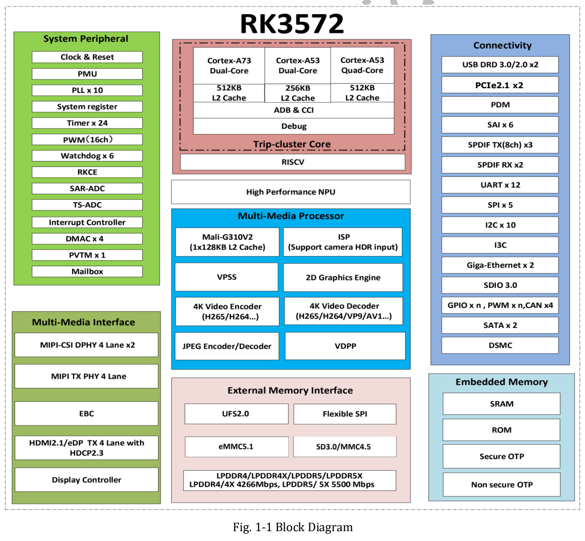
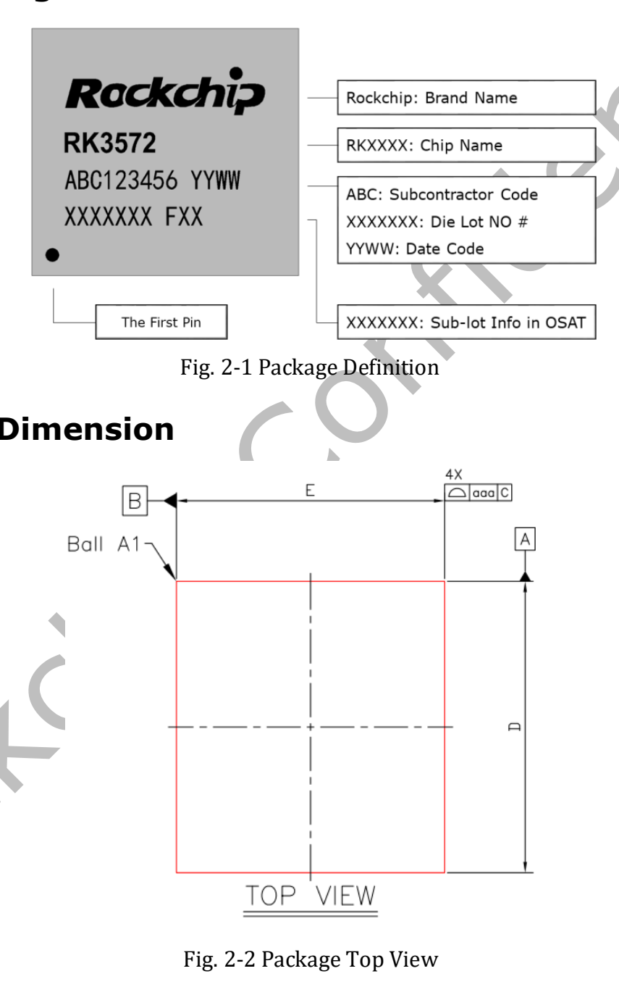
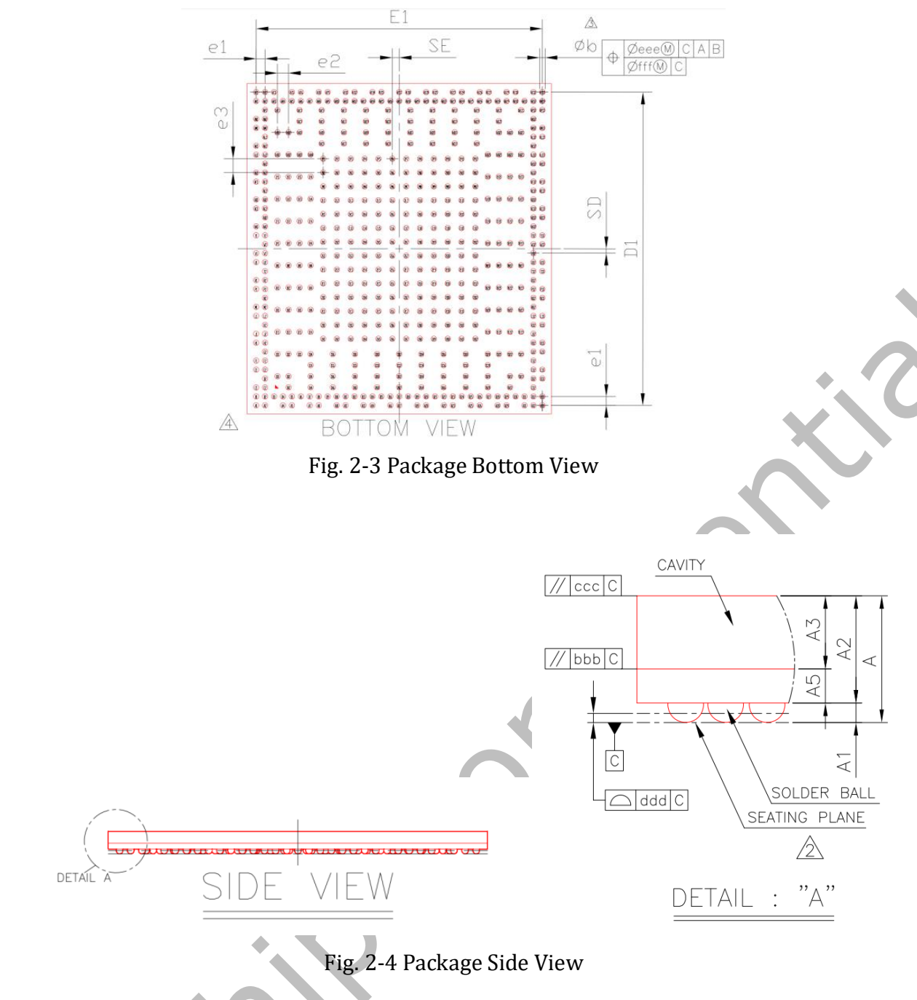
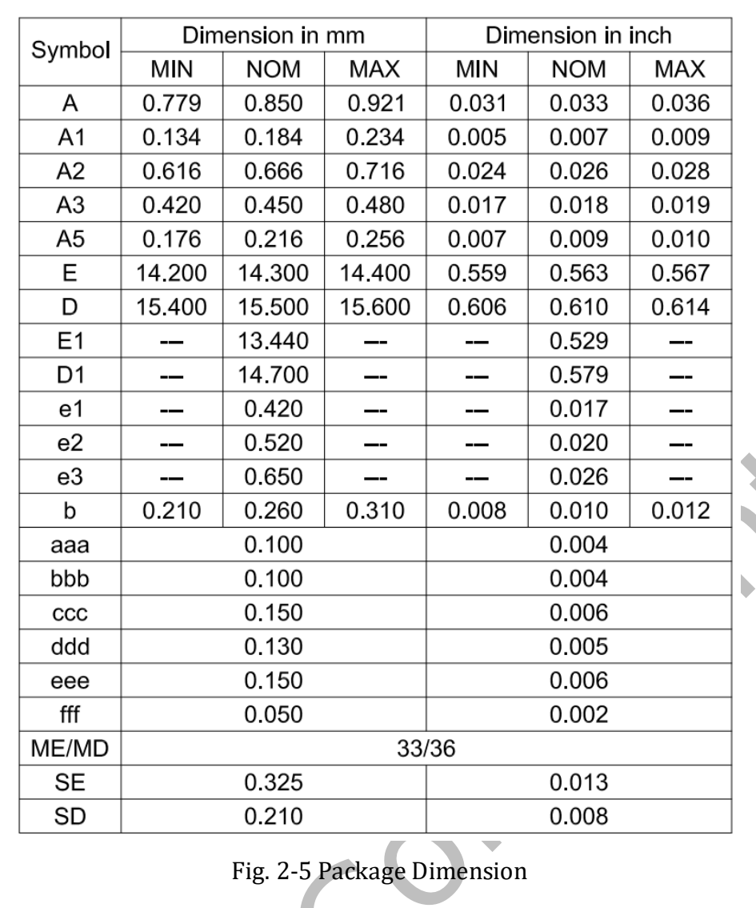

RK3572 将八核 CPU、NPU、图像处理和视频编解码整合在一起，为紧凑型 AIoT 设备提供芯片平台。本文依据 **RK3572 Datasheet V1.0，共 51 页，初始修订日期 2026-03-24** 整理，重点解释参数的适用条件。

[下载原始 RK3572 Datasheet V1.0（PDF，约 2.33 MiB）](/assets/rk3572-datasheet/RK3572-Datasheet-V1.0.pdf)

这是 datasheet 阅读与选型解读，不是 51 页逐字译本。原始文件完整保留，电气设计与引脚定义请回查原稿。本文也不将 V1.0 宣称为最新版本。

## CPU、内存与 AI 计算

| 项目 | V1.0 规格 | 原稿位置 |
|---|---|---|
| CPU | 2× Cortex-A73 + 6× Cortex-A53，Armv8-A | 第 7–8 页 |
| 集群 | A73 双核、A53 四核、A53 双核；L2 分别为 512kB、512kB、256kB | 第 7–8 页 |
| 内存 | LPDDR4/4X-4266、LPDDR5/5X-5500；32-bit；最高 16GB 地址空间 | 第 8 页 |
| GPU | Mali G310V2 MC1；OpenGL ES 3.2、OpenCL 3.0 Full Profile、Vulkan 1.2 | 第 13 页 |
| NPU | 4 TOPS INT8，脚注注明 Sparsity（稀疏计算） | 第 13 页 |
| 运算格式 | INT4/INT8/INT16、FP4/FP8/FP16/BF16，W4A16 非对称 MAC | 第 13 页 |

**4 TOPS 必须保留稀疏计算口径。** 它不是所有模型的稠密吞吐，也不是端到端帧率。模型结构、稀疏性、量化、算子与 runtime 都会影响结果。支持某种数值格式也不等于该格式都能达到 4 TOPS。

内存控制器支持的类型和地址空间不代表未来 ArmSoM 板卡一定采用最大容量。实际内存、存储和接口取决于产品设计及交付型号。

## 芯片框图

原稿框图写“4K Video Decoder”，概述写最高 8K@30fps；本文保留两处原始表述，具体模式以详细功能规格及实际 BSP 验证为准。

框图展示 CPU、GPU、NPU、视频与外设的组织关系。接口数量和复用关系仍需结合详细章节、引脚清单和最终板卡原理图，不能把图上所有控制器直接算成成品可同时使用的端口。

## 视频与相机处理

第 7 页概述列出 H.265、VP9、AV1、AVS2 等格式，最高解码能力为 8K@30fps 或 4K@120fps；H.264 解码最高为 4K@60fps。H.264/H.265 编码最高为 4K@40fps，JPEG 编解码最高为 4K@60fps。具体格式、profile、位深及组合限制应继续核对功能章节，不能认定所有格式都同时达到最高指标。

ISP 为 12MP 级，列有 HDR、3A、CAC、降噪、锐化、去雾和镜头畸变校正等处理。实际相机效果还取决于传感器驱动、镜头和 IQ 标定。RGA v2.5 可用于适配的缩放、旋转和格式处理，CPU 则承担应用逻辑；这为本地视觉分析、交互屏和紧凑型智能终端提供开发方向，而非本文已经测得的性能结果。

## 封装与生产信息

原稿列出 FCCSP550L，芯片本体为 14.3 × 15.5 mm、焊球尺寸 0.25 mm，间距为 0.42/0.52/0.65 mm 混合。MSL 为 3，焊球材料为 SnAgCu。图中的公差、方向及单位必须结合原图读取；这些是芯片封装信息，不是开发板尺寸。

## 电气和热设计需要注意什么

绝对额定值与推荐工作条件是两套不同的表。第 41 页起给出绝对额定值，第 42 页起给出推荐工作条件。设计电源与 IO 时应使用对应电压域的条件，不能把绝对上限作为正常目标，也不能默认 GPIO 可承受 5V。

第 51 页要求结温低于 125°C；这不是环境工作温度承诺。θJA、θJB、θJC 和 ψJT 在 V1.0 中均为 **TBD**，不能据此给出整机热阻、功耗或免散热结论。实际板卡需进行电源、温升和持续负载验证。

## 如何快速查阅 51 页资料

| PDF 页码 | 内容 |
|---|---|
| 7–23 | 芯片概述、功能与框图 |
| 24–26 | 订货、标记、封装、MSL 和焊球材料 |
| 27–40 | 引脚清单 |
| 41–50 | 电气条件、IO、LPDDR、PLL、PHY、ADC |
| 51 | 热管理与待定热参数 |

此前官方发布资料介绍 Vulkan 1.4，这份较早的 V1.0 datasheet 写 Vulkan 1.2。两者来源和时间不同，本文不静默合并；实际 API 能力还需按最终 BSP 和 GPU 驱动验证。

## ArmSoM 的 RK3572 产品计划

ArmSoM 计划基于 RK3572 推出树莓派 Zero 版型产品，让开发者更容易评估紧凑型视觉、交互与边缘 AI 应用。具体型号、内存、接口、系统支持、价格和上市时间尚未在本文公布，Zero 版型也不代表已确认引脚或系统兼容。

[了解 RK3572 与 ArmSoM Zero 产品规划](/zh/articles/rockchip-rk3572-armsom-zero-preview/) · [ArmSoM 官网](https://www.armsom.org/)
