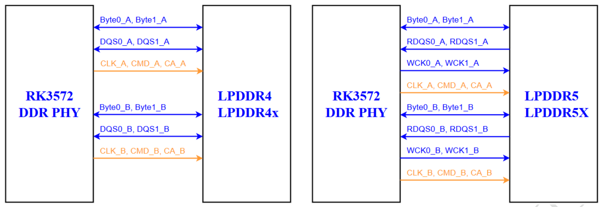
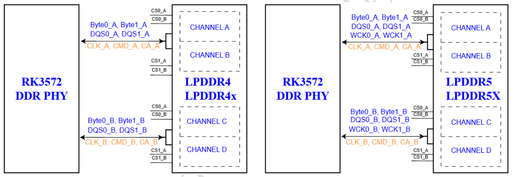
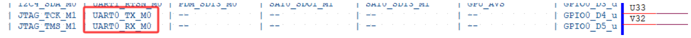
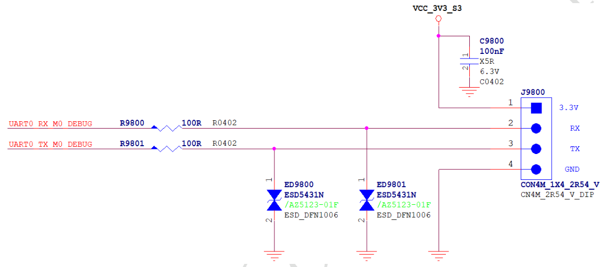
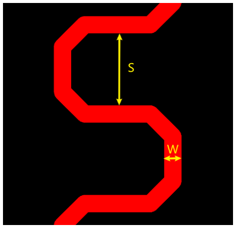
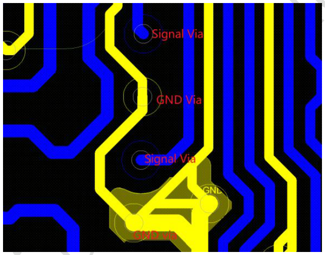
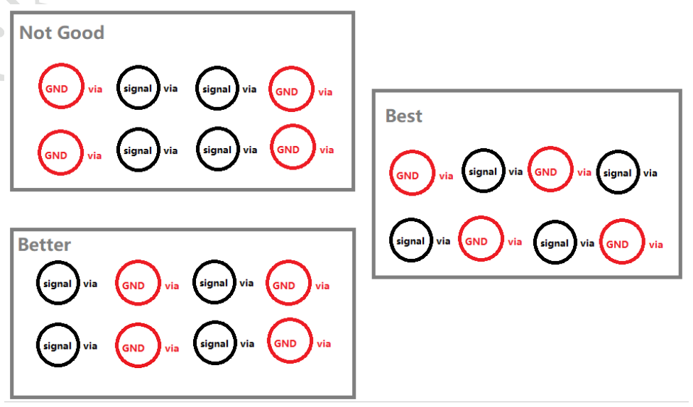

## 适用范围

本文面向 RK3572 自研主板与 ArmSoM Zero5 项目评估，依据 RK3572 硬件设计指南 V1.1 和本次硬件资料包。芯片接口不等于板卡已引出接口；Zero5 的最终配置、可用系统和内核版本须以对应硬件版本的正式产品文档为准。本文未进行 ArmSoM 硬件实测。

RK3572 的 DDR 设计必须同时确定颗粒组织、电路连接、PCB 模板和 DDRBIN。仅确认“LPDDR5、8 GB”还不够：rank、封装、字节映射、供电和训练参数都影响能否可靠启动。建议从匹配的原厂 DDR 模板开始，修改后再按实际层叠校核时序和电源完整性。

## 1. 总线宽度、容量与拓扑

| 项目 | 要求 |
|---|---|
| Controller | 32-bit; 1 channel; ≤4 ranks; ≤16 GB |
| LPDDR4 / LPDDR4X | ≤4266 MT/s |
| LPDDR5 / LPDDR5X | ≤5500 MT/s |
| LPDDR4 / LPDDR4X, V1.1 | 两个 rank 时不支持 R17 |

上限不等于任意容量、封装和 rank 组合都可用。参考图中的“64-bit DRAM”描述封装组织与连接方案，不会把 RK3572 控制器变成 64-bit。两颗 DRAM 的参考方案要求容量一致；型号、封装和 CS 组织应与模板及 DDRBIN 配套。

*32-bit DRAM 点对点连接*

*另一种 DRAM 封装拓扑*

## 2. 哪些信号可以交换

| 项目 | 要求 |
|---|---|
| Byte lanes | 仅 byte 0↔1、byte 2↔3；不得跨组 |
| DQ | 可在同一 byte 内交换，保持映射记录 |
| DM / CLK / CS / WCK / DQS | 不能按 DQ 的方式任意交换 |
| CA_A0–CA_A5 | 组内可交换；CA_A6 不在此范围 |
| 4 ranks | 各 rank 的映射必须一致 |

## 3. 电源与 ZQ：不要混淆 SoC 和 DRAM 端

| 节点 | LPDDR4 | LPDDR4X | LPDDR5 / 5X |
|---|---|---|---|
| DRAM VDD1 | 1.8 V | 1.8 V | 1.8 V |
| DRAM VDD2 / VDD2H | 1.1 V | 1.1 V | 1.05 V |
| DRAM VDD2L | — | — | 0.9 / 1.05 V |
| DRAM VDDQ | 1.1 V | 0.6 V | 0.5 V |
| PHY VDDQ / CKVDDQ | 0.75 V | 0.6 V | 0.5 V |
| PHY VDDQH | 1.1 V | 1.1 V | 1.05 V |

上表为指南对应供电示例，具体颗粒仍以其数据手册为准。SoC 端 ZQ 使用 120 Ω、1% 电阻接 DDRPHY_VDDQ_S0；DRAM 端 ZQ 使用 240 Ω、1%：LPDDR4 接 VDD2，LPDDR4X/LPDDR5 接 VDDQ。LPDDR4 的 ODT_CA 接 VDD2。阻值与连接方向都要逐网检查，不能把两端 ZQ 当成相同电路。

*RK3572 DDR ZQ 引脚*

*DRAM ZQ 与 ODT 参考连接*

## 4. LPDDR5 的 CK、WCK 与 RDQS

LPDDR5 将命令时钟 CK 与数据时钟 WCK 分开，WCK 可为 CK 的 2 倍或 4 倍；读数据还使用 RDQS。布线分组、等延时与训练配置必须按这一结构处理，不能套用 LPDDR4 的全部规则。最低功耗保持状态仍需要 DDRPHY_VDDQH；关闭其他电源前应核对内存自刷新和恢复流程。

## 5. PCB 阻抗与等延时约束

| 项目 | 要求 |
|---|---|
| DQ / DM / CA | 40–45 Ω ±10%；优先 40 Ω |
| CLK / DQS / WCK | 90 Ω differential ±10% |
| DQ/DM ↔ DQS/WCK | ≤45 ps / ≤90 mil |
| CA/control ↔ CLK | ≤45 ps / ≤90 mil |
| 差分对内偏差 | ≤1 ps / ≤5 mil |
| LPDDR5: DQS/WCK ↔ CLK | ≤130 ps / ≤550 mil |
| LPDDR4: DQS ↔ CLK | ≤90 ps / ≤410 mil |

表中 ps 与 mil 为指南给出的两套约束表达，不应据此推导通用换算率；实际延时取决于层叠、介质和过孔。优先按飞行时间校核，并计入过孔延时。普通信号间距至少 2W；时钟或选通信号相对其他线建议至少 3W，最低 2W。蛇形线 S 至少 3W，避免靠密集折返制造形式上的等长。

*蛇形线的间距约束*

## 6. 参考平面、回流过孔与电源完整性

*换层附近的回流过孔*

*信号与回流过孔排列*

信号换层时，指南要求附近回流过孔中心距离不超过 25 mil，并为信号提供相邻回流路径。保持连续地参考，走线距参考平面边缘至少 12 mil；DRAM 接地过孔数量至少按 0.8 个/地引脚检查。时钟屏蔽地过孔间距不大于 400 mil。删除不需要的过孔焊盘时，仍应保留制造和可靠性要求。

| 电源网络 | 100 kHz–30 MHz | 30–100 MHz |
|---|---|---|
| LPDDR4X VDD2 / VDDQ; LPDDR5 VDDQ / VDD2H | ≤0.03 Ω | ≤0.04 Ω |
| LPDDR5 VDD2L | ≤0.075 Ω | ≤0.08 Ω |

上述 PDN 阻抗目标要连同封装、去耦器件和 PCB 仿真评估。电源层不能被密集信号过孔切断；电容地端就近回流，0603/0805 电容按指南至少配置两个相关电源/地过孔。首板验证覆盖冷启动、重复重启、容量识别、内存压力、温度变化和休眠恢复；单次进入系统不代表 DDR 设计通过。

## ArmSoM 产品与下一步

正在评估小尺寸 RK3572 产品，可先查看 ArmSoM 的 Zero 版型规划，再整理需要保留的显示、存储、网络和供电接口。规划文章不代表已上市型号或最终原理图。已有量产项目的产品选择与接口核对，请使用官网产品目录和 Docs。

- [RK3572 / ArmSoM Zero 产品规划](/zh/articles/rockchip-rk3572-armsom-zero-preview/)
- [ArmSoM](https://www.armsom.org/category/all-products) · [ArmSoM Docs](https://docs.armsom.org/)

## 本系列阅读路径

- [RK3572 数据手册 V1.1：规格、接口与版本变化](/zh/articles/rk3572-datasheet-v10/)
- [RK3572 硬件设计指南：从资料选用到首板验证](/zh/articles/rk3572-hardware-design-series/)
- [RK3572 最小系统：24 MHz 时钟、复位、启动与串口调试](/zh/articles/rk3572-minimum-system-bringup/)
- [RK3572 电源设计：电源域、RK806-5 与双 PMIC 方案](/zh/articles/rk3572-power-domains-pmic/)
- [RK3572 DDR 设计：LPDDR4X、LPDDR5 电路与 PCB 约束](/zh/articles/rk3572-ddr-circuit-pcb/)
- [RK3572 DDRBIN 配置：DDR 模板、ADC 选择与多配置固件](/zh/articles/rk3572-ddrbin-adc-configuration/)
- [RK3572 存储与启动设计：eMMC、UFS、FSPI 的连接与供电](/zh/articles/rk3572-storage-boot-design/)
- [RK3572 USB 与 Type-C：烧录口、角色切换及供电检测](/zh/articles/rk3572-usb-typec-power-design/)
- [RK3572 PCIe 与 SATA：Combo PHY 复用、时钟和布线](/zh/articles/rk3572-high-speed-interface-design/)
- [RK3572 显示与摄像头：HDMI、eDP、MIPI 和电平匹配](/zh/articles/rk3572-display-camera-design/)
