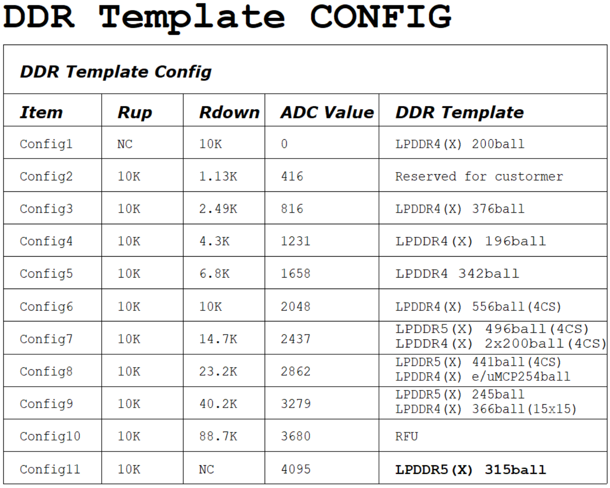
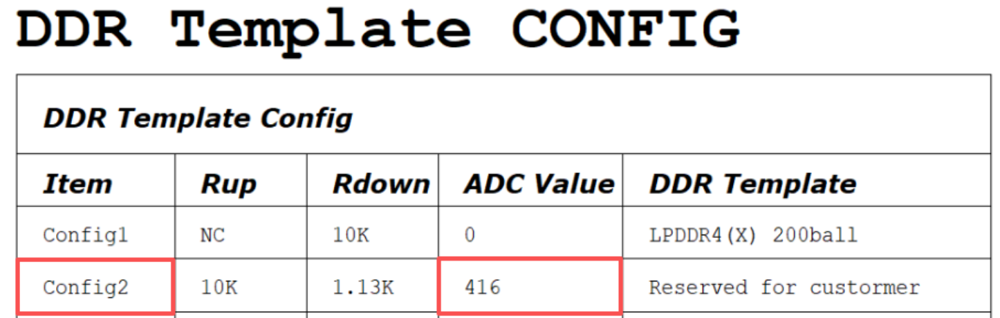

## 适用范围

本文面向 RK3572 自研主板与 ArmSoM Zero5 项目评估，依据 RK3572 硬件设计指南 V1.1 和本次硬件资料包。芯片接口不等于板卡已引出接口；Zero5 的最终配置、可用系统和内核版本须以对应硬件版本的正式产品文档为准。本文未进行 ArmSoM 硬件实测。

DDRBIN 配置不是把同一组参数复制给所有内存。RK3572 的 DDR 模板、ADC 档位、DRAM 类型和二进制版本必须成套记录。本文根据 2026-05-18 配置说明整理 Linux 与 Windows 两条路径，并保留原命令中的参数语义。

## 1. 开始前准备三份配套资料

准备实际采用的 DDR 原理图/PCB 模板、该模板的 `_ddrbin_tool_config.txt` 和匹配 SDK 的 `rk3572_ddr_*MHz_v*.*.bin`。如果模板包没有配置文件，按原说明使用 rkbin 默认配置，并记录这一选择；不要凭相似容量编造参数。保存原始 binary、配置文件、工具版本和输出文件校验值，便于回退与复现。

## 2. ADC Config 是配置编号，不是采样值

| Config | Rup | Rdown | ADC | DDR 模板选择 |
|---|---|---|---|---|
| 1 | NC | 10 kΩ | 0 | LPDDR4(X) 200-ball |
| 2 | 10 kΩ | 1.13 kΩ | 416 | 客户保留 |
| 3 | 10 kΩ | 2.49 kΩ | 816 | LPDDR4(X) 376-ball |
| 4 | 10 kΩ | 4.3 kΩ | 1231 | LPDDR4(X) 196-ball |
| 5 | 10 kΩ | 6.8 kΩ | 1658 | LPDDR4 342-ball |
| 6 | 10 kΩ | 10 kΩ | 2048 | LPDDR4(X) 556-ball (4 CS) |
| 7 | 10 kΩ | 14.7 kΩ | 2437 | LPDDR5(X) 496-ball (4 CS) / LPDDR4(X) 2 × 200-ball (4 CS) |
| 8 | 10 kΩ | 23.2 kΩ | 2862 | LPDDR5(X) 441-ball (4 CS) / LPDDR4(X) e/uMCP 254-ball |
| 9 | 10 kΩ | 40.2 kΩ | 3279 | LPDDR5(X) 245-ball / LPDDR4(X) 366-ball (15 × 15) |
| 10 | 10 kΩ | 88.7 kΩ | 3680 | RFU |
| 11 | 10 kΩ | NC | 4095 | LPDDR5(X) 315-ball |

例如 ADC 416 对应 Config 2，因此参数是 `adc_value_to_ddr_config=2`，不是 `=416`。Config 2 是原文演示用的客户配置位置，不代表所有 LPDDR4 板都应选 2。启动介质选择也使用 ADC 分压表，但那张表表达启动顺序，不能拿来替代这里的 DDR 配置关系。

## 3. Linux 工具配置流程

先阅读匹配版本的 `rkbin/tools/ddrbin_tool_user_guide.txt`，在工具目录使用 `ddrbin_tool.py`。下面保留原文的命令模板；模板名称、频率和版本星号都需要换成确定的文件名，不要让通配符同时匹配多个 DDR binary。该操作在主机修改文件，并不是向板卡烧录。

```text
./ddrbin_tool.py rk3572 模板名称_ddrbin_tool_config.txt rk3572_ddr_*MHz_v*.*.bin LPDDR4 adc_value_to_ddr_config=2
```

依次确认平台为 rk3572、配置文件属于实际 PCB 模板、DRAM 类型为本次目标类型、ADC Config 与硬件电阻一致。工具输出的位置和命名规则以该版本工具说明为准；核对返回信息和修改后的文件，再交给对应 SDK 打包流程使用。对没有 ADC 配置表的平台，原说明要求省略 DRAM 类型和 ADC 参数，不能照搬 RK3572 示例到所有平台。

[](/assets/rk3572-hardware-20261119/ddrbin-config-5.png)

*DDRBIN 配置工具与配置项*

## 4. Windows 工具配置流程

原文使用 `rk_ddrBin_tool_windows`。选择平台后，设置 DramType（示例为 LPDDR4）和 ADC Config（示例为 2），导入目标 DDRBIN，再按模板逐项填写参数。Linux 配置文件中的项目不能只靠截图猜测对应关系；最终以工具同版本说明、模板和输出检查为准。不要把截图中的示例容量或 timing 参数直接用于不同颗粒。

[](/assets/rk3572-hardware-20261119/ddrbin-config-6.png)

*Windows DDR 参数配置界面*

## 5. 多个 ADC 档位必须累计写入同一成果

一次配置只修改所选 DRAM 类型和 ADC 档位。需要多个配置时，第二次以第一次修改后的 binary 为输入，第三次再接着第二次结果，直到所有目标档位完成。如果每次都重新打开原始 binary，前面的修改不会自动累计。每次记录输入、输出、DRAM 类型与 Config 编号，最后逐个硬件档位验证。

## 6. 发布固件前的验收记录

| 项目 | 要求 |
|---|---|
| 硬件 | PCB 版本、DRAM 完整料号、容量、rank、ADC 电阻实装值 |
| 文件 | 模板、配置文件、工具版本、原 binary 与最终 binary 校验值 |
| 验证 | 每个目标档位的启动日志、容量、内存压力和休眠恢复 |

本页没有实际运行配置工具，也没有在 Zero5 上验证生成文件。量产前应由对应硬件与 SDK 负责人确认最终二进制，避免将一块参考 EVB 的启动成功当作所有内存选项已通过。

## ArmSoM 产品与下一步

正在评估小尺寸 RK3572 产品，可先查看 ArmSoM 的 Zero 版型规划，再整理需要保留的显示、存储、网络和供电接口。规划文章不代表已上市型号或最终原理图。已有量产项目的产品选择与接口核对，请使用官网产品目录和 Docs。

- [RK3572 / ArmSoM Zero 产品规划](/zh/articles/rockchip-rk3572-armsom-zero-preview/)
- [ArmSoM](https://www.armsom.org/category/all-products) · [ArmSoM Docs](https://docs.armsom.org/)

## 本系列阅读路径

- [RK3572 数据手册 V1.1：规格、接口与版本变化](/zh/articles/rk3572-datasheet-v10/)
- [RK3572 硬件设计指南：从资料选用到首板验证](/zh/articles/rk3572-hardware-design-series/)
- [RK3572 最小系统：24 MHz 时钟、复位、启动与串口调试](/zh/articles/rk3572-minimum-system-bringup/)
- [RK3572 电源设计：电源域、RK806-5 与双 PMIC 方案](/zh/articles/rk3572-power-domains-pmic/)
- [RK3572 DDR 设计：LPDDR4X、LPDDR5 电路与 PCB 约束](/zh/articles/rk3572-ddr-circuit-pcb/)
- [RK3572 DDRBIN 配置：DDR 模板、ADC 选择与多配置固件](/zh/articles/rk3572-ddrbin-adc-configuration/)
- [RK3572 存储与启动设计：eMMC、UFS、FSPI 的连接与供电](/zh/articles/rk3572-storage-boot-design/)
- [RK3572 USB 与 Type-C：烧录口、角色切换及供电检测](/zh/articles/rk3572-usb-typec-power-design/)
- [RK3572 PCIe 与 SATA：Combo PHY 复用、时钟和布线](/zh/articles/rk3572-high-speed-interface-design/)
- [RK3572 显示与摄像头：HDMI、eDP、MIPI 和电平匹配](/zh/articles/rk3572-display-camera-design/)
