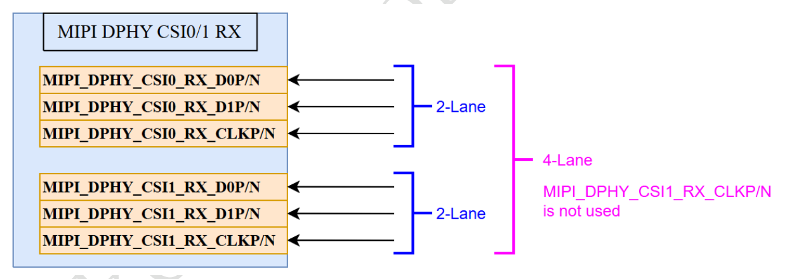
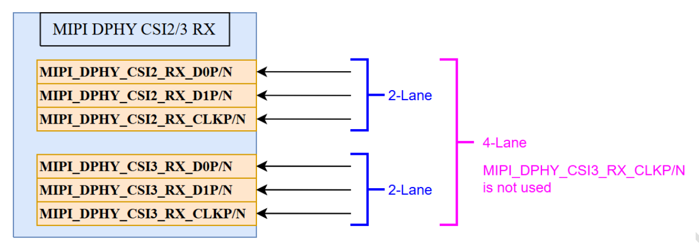
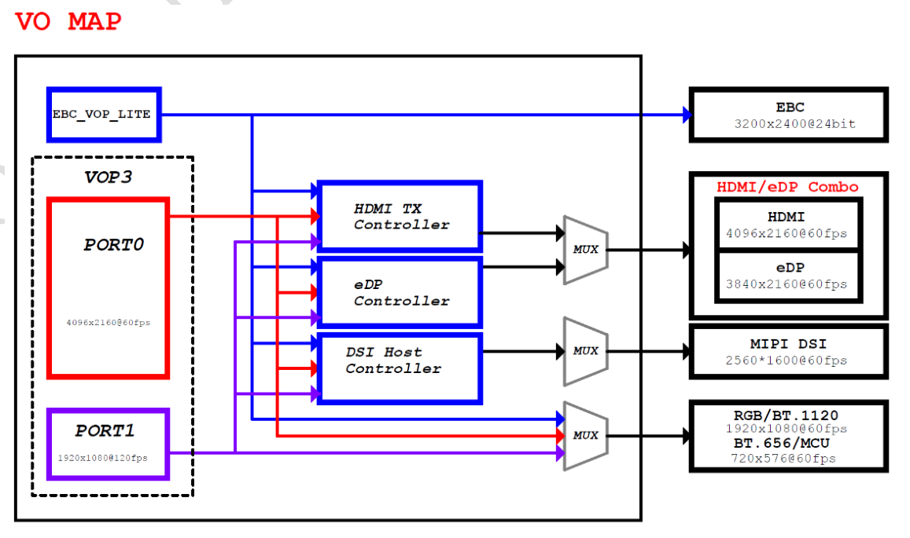
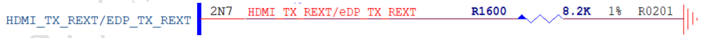
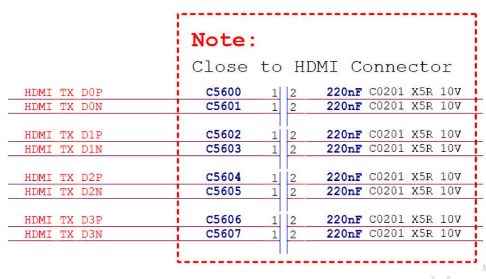
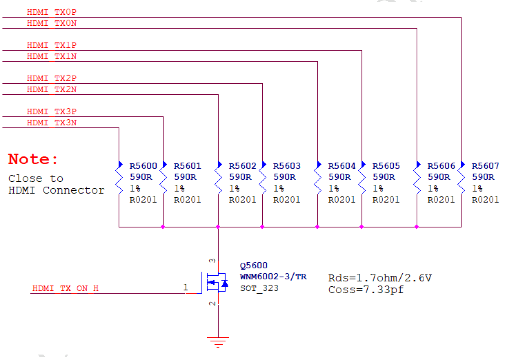
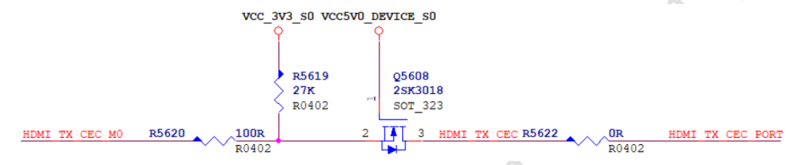
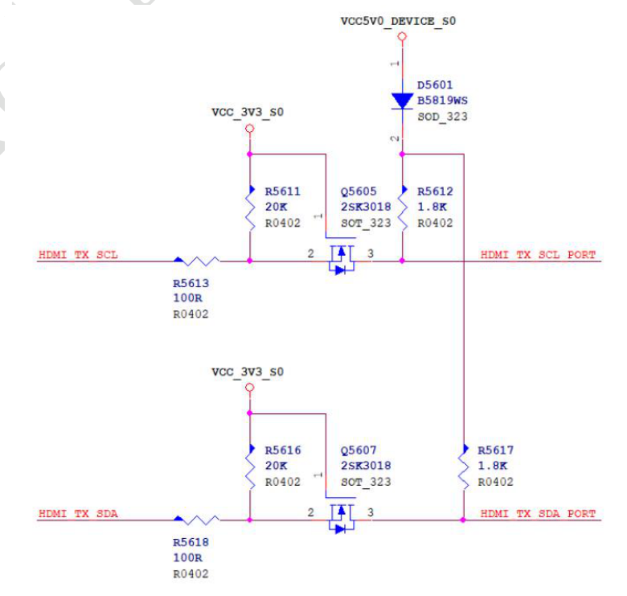
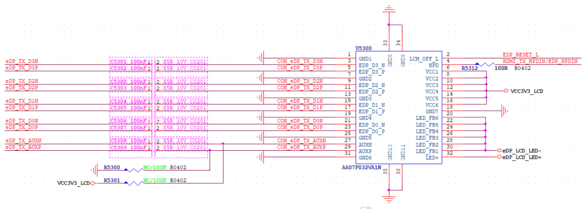
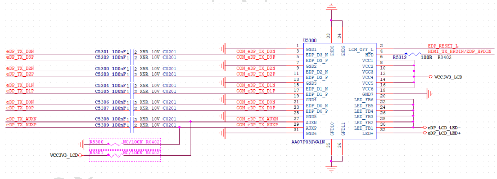

## 适用范围

本文面向 RK3572 自研主板与 ArmSoM Zero5 项目评估，依据 RK3572 硬件设计指南 V1.1 和本次硬件资料包。芯片接口不等于板卡已引出接口；Zero5 的最终配置、可用系统和内核版本须以对应硬件版本的正式产品文档为准。本文未进行 ArmSoM 硬件实测。

RK3572 的显示与摄像头设计，首先要匹配像素吞吐、VOP/ISP 路径、PHY 复用与接口电压。一个连接器能插上，并不代表分辨率、帧率、lane 数、电源时序和驱动都相容。本文将摄像头输入与显示输出分别展开，便于逐条审查原理图。

## 1. CSI 两组四 lane 与拆分模式

RK3572 有两组 MIPI D-PHY CSI RX，支持 D-PHY 1.2、最高 2.5 Gbit/s/lane。每组四 lane 可按参考图拆为两组双 lane；拆分后每个接口使用对应的时钟对，不是把四条数据线随意分给四个传感器。

| 数据资源 | 拆分后接口 |
|---|---|
| CSI0 D0/D1 | CSI0 D0/D1 + CLK0 |
| CSI0 D2/D3 | CSI1 D0/D1 + CLK1 |
| CSI2 D0/D1 | CSI2 D0/D1 + CLK2 |
| CSI2 D2/D3 | CSI3 D0/D1 + CLK3 |

*CSI0/CSI1 lane 分配*

*CSI2/CSI3 lane 分配*

## 2. 传感器供电、MCLK 与 I2C

参考相机供电使用 1.8 V、1.2 V、2.8 V 路径，但具体 DVDD 可能为 1.5 V 或 1.8 V，应以传感器数据手册为准；电流超过 100 mA 的核心供电应评估 DC/DC。DOVDD 必须匹配 SoC 的 VCCIO2/VCCIO4 与 I2C 电平。两个相同 I2C 地址的传感器需要不同总线或已验证的地址管理方案。

自动对焦的 2.8 V 应与模拟电源分开或通过磁珠隔离，去耦靠近连接器。PWDN 和 RESET 的默认状态要保证上电期间传感器不会误启动，参考 RESET 电容为 100 nF。MCLK 频率、电平和上电顺序按选定模组确认；指南的参考次序不能覆盖所有摄像头。

## 3. 并行视频输入的位宽与数据顺序

CIF 支持 BT.601 RAW 8/10/12-bit 与 8-bit YCbCr422、BT.656 8-bit，以及 BT.1120 16-bit 连接。低位对齐使用 data[0:n−1]，高位对齐使用 data[16−n:15]。BT.1120 的 Y/C 排列必须与输入设备一致，不能因为总线宽度相同就忽略字节顺序。参考时钟输入在源端使用 22 Ω，输出时靠近 SoC 使用 22 Ω；板间连接的阻尼与 ESD 按信号完整性确认。

## 4. VOP 输出与 HDMI/eDP 复用

*VOP 与显示接口关系*

HDMI 与 eDP 使用组合 PHY，不能把二者作为两路独立并发输出。数据手册 V1.1 将 VideoPort1 写为 2048×1080@60、8-bit，而硬件指南示例给出 2560×1600@60 的第二路显示；两者不一致，本页不据此承诺双屏最高组合。显示接口带宽、VOP 输出能力和 BSP 支持模式需要分别核对。RK3572 的 Type-C 也不能从这些接口能力推导出 DP Alt Mode。

## 5. HDMI：REXT、耦合电容与 TMDS 偏置

*HDMI REXT 参考电阻*

*HDMI 差分通道耦合*

*TMDS 偏置与开关电路*

REXT 使用 8.2 kΩ、1% 对地并靠近 SoC。差分通道串联 220 nF、建议 0201。TMDS 的 590 Ω 偏置电路通过 MOS 控制；FRL 模式与 TMDS 模式对应不同开关状态。参考板连接 RK628F 的特定 TMDS 场景不能替代通用外接 HDMI 连接器设计，后者还要满足关机漏电与一致性要求。指南列出的 FRL 协议档位不是本芯片所有档位均可用的承诺，应按 RK3572 实际 PHY 上限和 BSP 支持选择。

## 6. HDMI 控制脚的电平匹配

*CEC 隔离参考*

*DDC 电平转换参考*

HPD 按选择的 VCCIO6 或 PMUIO1 电源域匹配。CEC 使用 3.3 V 与 27 kΩ 上拉，参考隔离 MOS 的漏电和输出电容影响待机及波形。DDC 外部为 5 V，而 SoC 引脚不能据此视为 5 V 容忍，必须保留参考电平转换；D5601 等器件的反向漏电也要检查。HDMI Pin 18 电源为 4.8–5.3 V，参考去耦 1 µF。高速 ESD 电容按 ≤0.2 pF，其他信号按 ≤1 pF 检查。

## 7. eDP、DSI 与面板控制

*eDP 主链路交流耦合*

*eDP AUX 参考连接*

eDP 1.3 支持 1/2/4 lane、1.62/2.7/5.4 Gbit/s，AUX 为 1 Mbit/s，不能任意交换 lane。电路章节给出主链路 100 nF、AUX 100 nF，AUXP 下拉与 AUXN 上拉 3.3 V 的 100 kΩ 位置按面板要求决定是否贴装；PCB 章节却将 eDP 耦合电容写为 220 nF。本页明确保留 100/220 nF 的冲突，不擅自统一，投板前应以最新原厂答复和实际面板规格核对。

MIPI DSI 使用四 lane 输出，面板初始化序列、供电、RESET 与背光控制由具体屏幕决定。背光 FB 电阻建议 1% 精度，EN/PWM 默认下拉以避免上电闪屏。触摸 I2C 的上拉电压与地址需单独核对。并行 RGB、BT.1120 或 MCU 显示模式也必须按选定 IOMUX 检查，不能与同组引脚上的其他外设同时占用；MCU 显示接口不要假设有读回能力。

## 8. PCB 约束与系统验收

| 项目 | MIPI | HDMI | eDP |
|---|---|---|---|
| 差分阻抗 | 100 Ω ±10% | 100 Ω ±10% | 90 Ω ±10% |
| 对内偏差 | <1 ps / 6 mil | <1 ps / 6 mil | <1 ps / 6 mil |
| 长度 | <6 in | <4 in | <6 in |
| 信号过孔 | ≤4 | 尽量避免 | ≤2 |
| 差分对间距 | ≥4W; min 3W | ≥7W | ≥4W |

MIPI 时钟与数据的偏差另按 <2 ps/12 mil 检查，HDMI 对间偏差按 <80 ps/480 mil；这些值来自对应布线表，不是对所有板材的通用时间长度换算。系统测试应覆盖目标分辨率与帧率、色深、热插拔、黑屏恢复、背光、触摸、相机丢帧和并发负载。分别保存单路与多路结果，并记录线缆、屏幕/传感器型号和 BSP；不能用单路显示成功替代所有显示组合验证。

## ArmSoM 产品与下一步

正在评估小尺寸 RK3572 产品，可先查看 ArmSoM 的 Zero 版型规划，再整理需要保留的显示、存储、网络和供电接口。规划文章不代表已上市型号或最终原理图。已有量产项目的产品选择与接口核对，请使用官网产品目录和 Docs。

- [RK3572 / ArmSoM Zero 产品规划](/zh/articles/rockchip-rk3572-armsom-zero-preview/)
- [ArmSoM](https://www.armsom.org/category/all-products) · [ArmSoM Docs](https://docs.armsom.org/)

## 本系列阅读路径

- [RK3572 数据手册 V1.1：规格、接口与版本变化](/zh/articles/rk3572-datasheet-v10/)
- [RK3572 硬件设计指南：从资料选用到首板验证](/zh/articles/rk3572-hardware-design-series/)
- [RK3572 最小系统：24 MHz 时钟、复位、启动与串口调试](/zh/articles/rk3572-minimum-system-bringup/)
- [RK3572 电源设计：电源域、RK806-5 与双 PMIC 方案](/zh/articles/rk3572-power-domains-pmic/)
- [RK3572 DDR 设计：LPDDR4X、LPDDR5 电路与 PCB 约束](/zh/articles/rk3572-ddr-circuit-pcb/)
- [RK3572 DDRBIN 配置：DDR 模板、ADC 选择与多配置固件](/zh/articles/rk3572-ddrbin-adc-configuration/)
- [RK3572 存储与启动设计：eMMC、UFS、FSPI 的连接与供电](/zh/articles/rk3572-storage-boot-design/)
- [RK3572 USB 与 Type-C：烧录口、角色切换及供电检测](/zh/articles/rk3572-usb-typec-power-design/)
- [RK3572 PCIe 与 SATA：Combo PHY 复用、时钟和布线](/zh/articles/rk3572-high-speed-interface-design/)
- [RK3572 显示与摄像头：HDMI、eDP、MIPI 和电平匹配](/zh/articles/rk3572-display-camera-design/)
