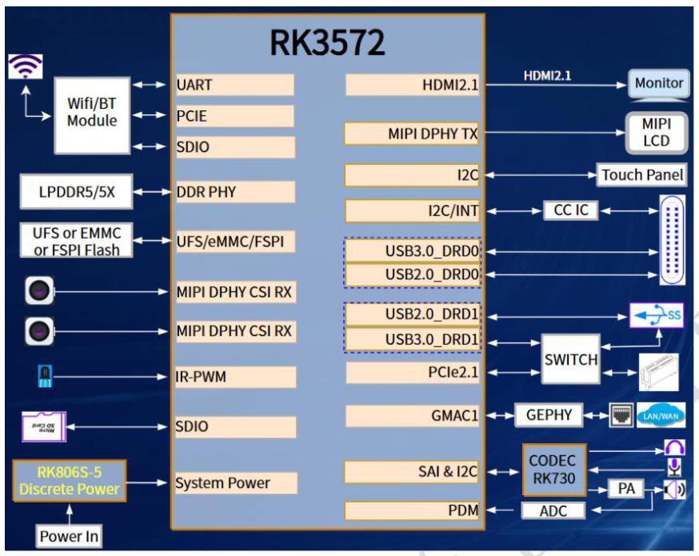
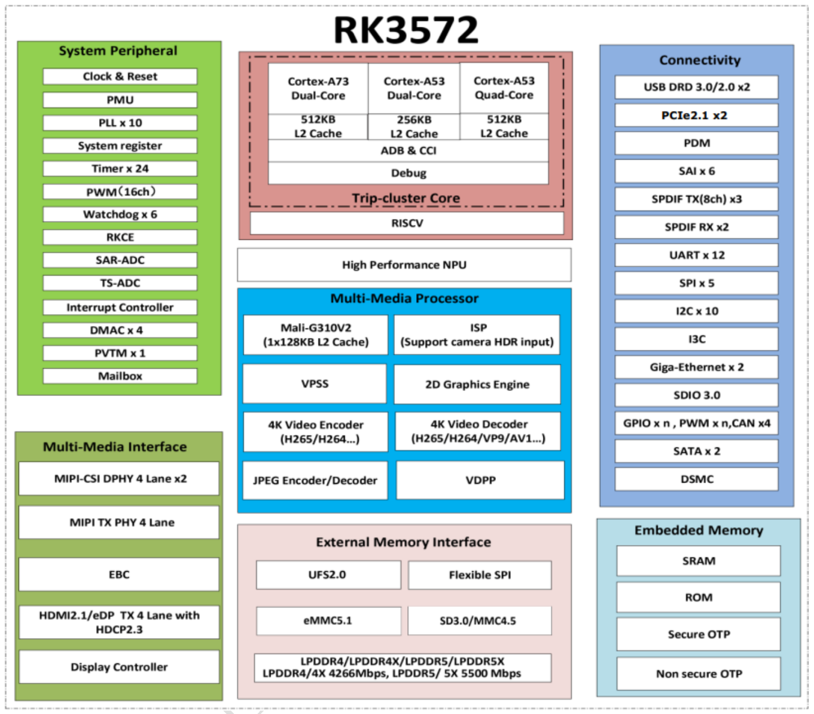

## 适用范围

本文面向 RK3572 自研主板与 ArmSoM Zero5 项目评估，依据 RK3572 硬件设计指南 V1.1 和本次硬件资料包。芯片接口不等于板卡已引出接口；Zero5 的最终配置、可用系统和内核版本须以对应硬件版本的正式产品文档为准。本文未进行 ArmSoM 硬件实测。

RK3572 设计资料包含数据手册、硬件设计指南、EVB 手册、DDR 模板、参考原理图和测试报告。最容易造成返工的不是缺一份文件，而是把不同用途、不同修订的文件拼成一套设计。本系列按工程决策拆分，让每个接口专题都能回到匹配的硬件版本。

*RK3572 EVB 参考应用框图*

*RK3572 功能与接口框图*

## 先选正确的参考设计

| 资料 | 用途 | 本批处理 |
|---|---|---|
| RK3572 Datasheet V1.1 | 芯片能力、引脚、电气边界 | 更新原有文章 |
| Hardware Design Guide V1.1 CN/EN | 原理图与 PCB 设计建议 | 按工程任务拆分，中文用中文图，英俄德用英文图 |
| RK3572_AIOT_REF_SCH_V13 | 非电池 AIoT 主板基线 | 核对总参考图及 TMI3255S 封装修改 |
| RK809C-8 + RK805B-8 V14 | 电池供电方向的参考方案 | 核对 Adapter/Type-C 检测与 HUSB311 |
| EVB1 / EVB2 / EVB3 | 接口使用与功能理解 | 不直接当作最新量产原理图 |
| NVR / E-ink DEMO | 特定应用演示 | 按选用说明保留更新及待机限制 |

资料选用说明明确指出 EVB1 不再更新，不建议直接作为量产 PCB/原理图基础。NVR 参考存在更新与待机设计限制，E-ink DEMO 也不能代替完整低功耗方案。应先确定电源架构，再选 DDR 模板和匹配固件，最后分配复用接口。

## 从需求到首板的六个检查点

1. 建立功能矩阵：每个显示、摄像头、USB、PCIe、SATA、GPIO 都记录控制器、PHY、MUX、电源域和连接器。
2. 冻结最小系统：主时钟、复位、启动 ADC、UART0 和 USB DRD0 烧录入口必须有测试手段。
3. 配套 DDR：颗粒、容量、rank、PCB 模板、ADC Config、DDRBIN 作为同一配置管理。
4. 审查电源与待机：记录各路电压、上电次序、保持电源和唤醒来源。
5. 在投板前审查高速走线：阻抗、等延时、参考平面、回流过孔、连接器及 ESD 一起评估。
6. 首板先验证供电与下载，再验证内存、存储和单个接口；最后测试并发负载和休眠恢复。

## 测试报告能证明什么

硬件测试报告可用于建立测试项目与仪器条件，但结论属于报告所用 EVB、固件和测试环境。更换层叠、DDR、PMIC、连接器、线缆或外壳后，需要重新验证对应项目。本文给出的流程是工程建议，不把原厂通过记录写成 ArmSoM Zero5 已通过。

## 本批覆盖范围

本批完成设计入口、最小系统、电源、DDR、DDRBIN、存储、USB、PCIe/SATA、显示与摄像头九个新专题，并更新数据手册及 RK730 旧文。完整指南中的音频、GMAC、低速接口、EMC、生产与焊接章节不宣称已在本批逐章翻译；对应专项可在后续继续展开。

## ArmSoM 产品与下一步

正在评估小尺寸 RK3572 产品，可先查看 ArmSoM 的 Zero 版型规划，再整理需要保留的显示、存储、网络和供电接口。规划文章不代表已上市型号或最终原理图。已有量产项目的产品选择与接口核对，请使用官网产品目录和 Docs。

- [RK3572 / ArmSoM Zero 产品规划](/zh/articles/rockchip-rk3572-armsom-zero-preview/)
- [ArmSoM](https://www.armsom.org/category/all-products) · [ArmSoM Docs](https://docs.armsom.org/)

## 本系列阅读路径

- [RK3572 数据手册 V1.1：规格、接口与版本变化](/zh/articles/rk3572-datasheet-v10/)
- [RK3572 硬件设计指南：从资料选用到首板验证](/zh/articles/rk3572-hardware-design-series/)
- [RK3572 最小系统：24 MHz 时钟、复位、启动与串口调试](/zh/articles/rk3572-minimum-system-bringup/)
- [RK3572 电源设计：电源域、RK806-5 与双 PMIC 方案](/zh/articles/rk3572-power-domains-pmic/)
- [RK3572 DDR 设计：LPDDR4X、LPDDR5 电路与 PCB 约束](/zh/articles/rk3572-ddr-circuit-pcb/)
- [RK3572 DDRBIN 配置：DDR 模板、ADC 选择与多配置固件](/zh/articles/rk3572-ddrbin-adc-configuration/)
- [RK3572 存储与启动设计：eMMC、UFS、FSPI 的连接与供电](/zh/articles/rk3572-storage-boot-design/)
- [RK3572 USB 与 Type-C：烧录口、角色切换及供电检测](/zh/articles/rk3572-usb-typec-power-design/)
- [RK3572 PCIe 与 SATA：Combo PHY 复用、时钟和布线](/zh/articles/rk3572-high-speed-interface-design/)
- [RK3572 显示与摄像头：HDMI、eDP、MIPI 和电平匹配](/zh/articles/rk3572-display-camera-design/)
