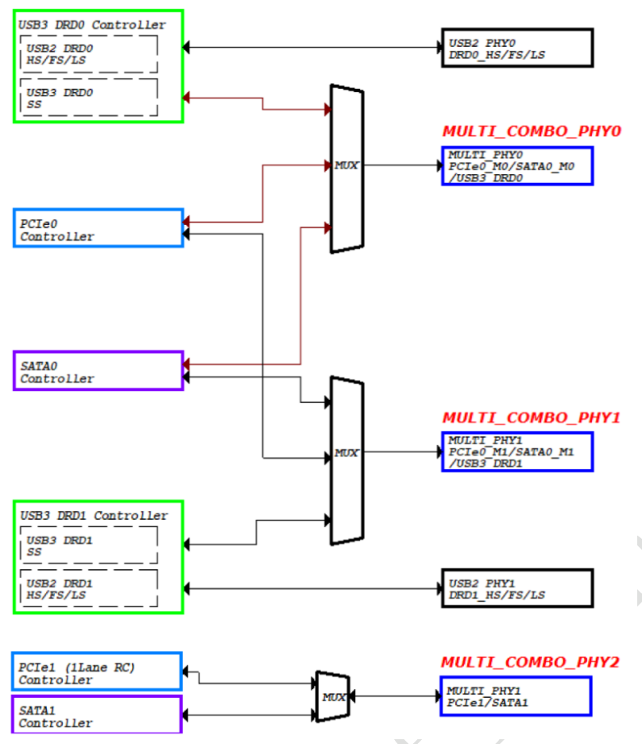
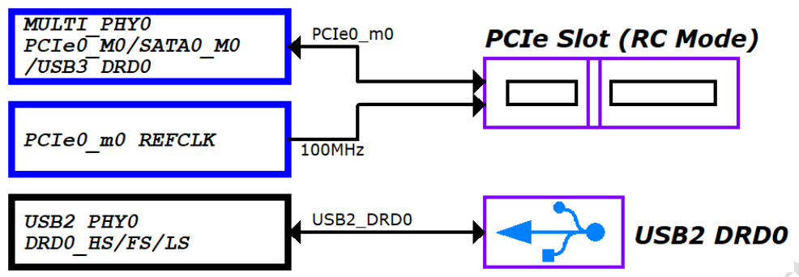
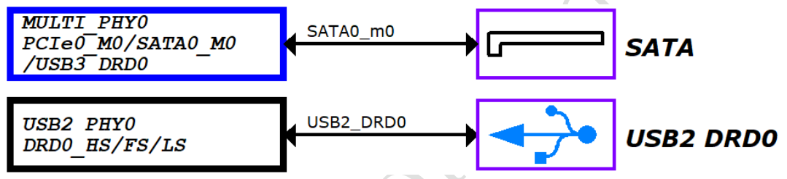
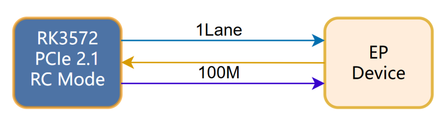
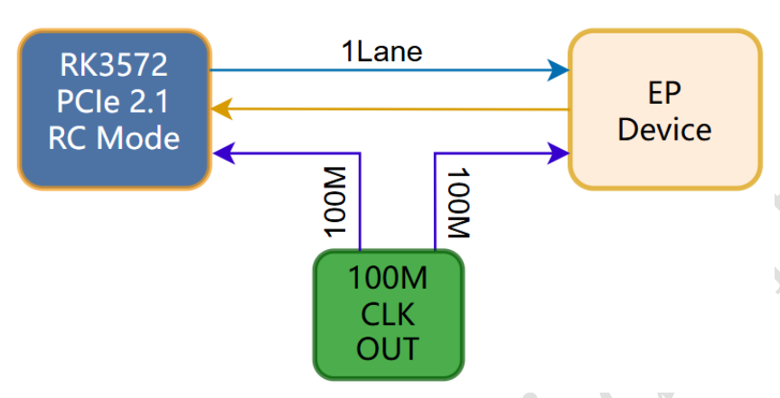
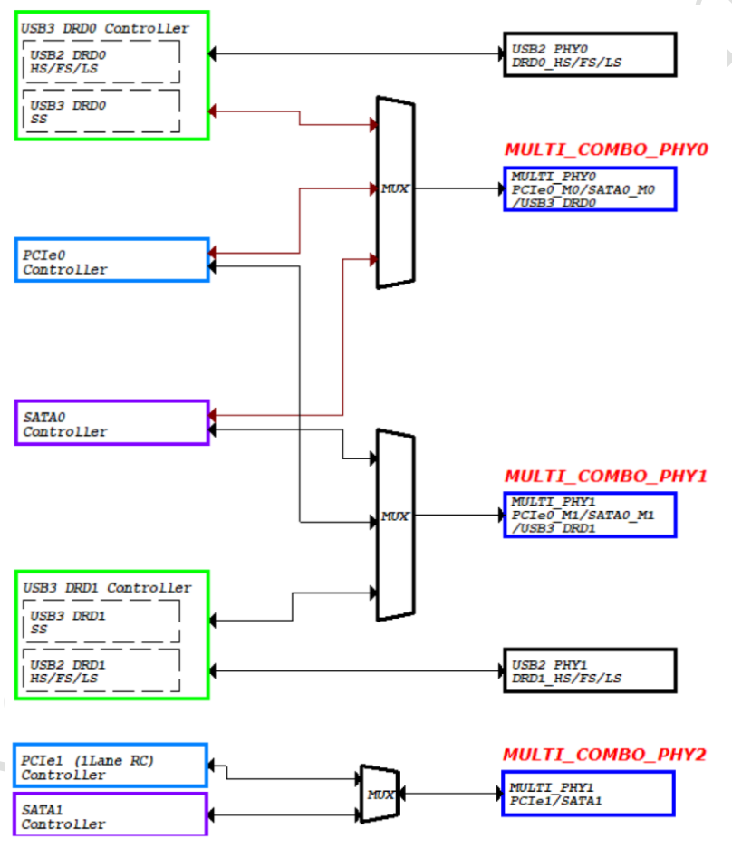

## 适用范围

本文面向 RK3572 自研主板与 ArmSoM Zero5 项目评估，依据 RK3572 硬件设计指南 V1.1 和本次硬件资料包。芯片接口不等于板卡已引出接口；Zero5 的最终配置、可用系统和内核版本须以对应硬件版本的正式产品文档为准。本文未进行 ArmSoM 硬件实测。

RK3572 接 SSD、SATA 硬盘或高速外设时，第一步不是数连接器，而是建立控制器到 PHY 的映射。三个 Combo PHY 不等于三套独立 PCIe 和三套独立 SATA；同一控制器的 M0/M1 也不是两个可以同时使用的端口。

## 1. 先解决接口数量与复用关系

| PHY | 可选功能 |
|---|---|
| Combo PHY0 | PCIe0_M0 / SATA0_M0 / USB3_DRD0 |
| Combo PHY1 | PCIe0_M1 / SATA0_M1 / USB3_DRD1 |
| Combo PHY2 | PCIe1 / SATA1 |

*PCIe 控制器与 PHY 的映射*

硬件指南 V1.1 明确描述两个 PCIe 2.1 x1 控制器，仅支持 RC，不支持 EP；SATA 章节也写两个控制器。数据手册 V1.1 列出两组 PCIe/SATA/USB 组合接口和一组 PCIe/SATA 组合接口，描述的是三组复用 PHY。控制器和 PHY 的统计口径不同，不能把复用位置相加，宣传为三路独立 PCIe 或 SATA；产品实际引出哪些接口仍须看板级设计。

*USB2 与 PCIe0 的参考组合*

*USB2 与 SATA0 的参考组合*

## 2. PCIe 参考时钟与边带信号

PCIE0/1_REFCLKP/N 支持输入或输出，默认输出给外部 EP。设计需要明确谁产生 100 MHz 参考时钟，不能将两端都配置为输出。TX 串联 100 nF、建议 0201；RX 和 REFCLK 按指南直连。TXP/TXN 极性反转属于协议支持，但这不意味着其他时钟、lane 或控制信号可随意交换。

*参考时钟作为输出*

*参考时钟作为输入*

| 项目 | 要求 |
|---|---|
| CLKREQN | 必须使用功能引脚，不能用普通 GPIO 替代 |
| PERSTN / WAKEN / PRSNT | 可使用电平匹配的 GPIO；核对默认状态与方向 |
| CLKREQN M0 / M1 / M2 / M3 | VCCIO4 / VCCIO3 / VCCIO2 / VCCIO6 |
| 标准插槽控制电平 | 3.3 V |

## 3. SATA 连接、热插拔与 PM

*SATA 控制器与 Combo PHY*

SATA 支持 1.5/3/6 Gbit/s 和 eSATA。指南给出的 Port Multiplier 上限为每端口 5 个设备，这些设备共享上游带宽，并不会增加独立控制器数量。SATA TX 与 RX 都串联 10 nF 交流耦合电容，建议 0201；不能沿用 PCIe TX 的 100 nF 值。eSATA 连接器附近增加保护，寄生电容不超过 0.4 pF。

SATA0_ACTLED 与 SATA1_ACTLED 分别指示活动，复用位置涉及 VCCIO4/VCCIO6。CPDET、MPSWIT、CPPOD 是两个控制器共用的控制资源，通过寄存器选择所属控制器；设计两个热插拔连接器时不能重复占用同一控制资源。电源开关、连接器时序和操作系统热插拔支持也必须配套。

## 4. PCB 阻抗、长度与保护

| 项目 | PCIe | SATA |
|---|---|---|
| 差分阻抗 | 85 Ω ±10%; REFCLK 100 Ω ±10% | 100 Ω ±10% |
| 对内偏差 | <1 ps / 6 mil | <1 ps / 6 mil |
| 长度 | <6 in | <6 in |
| 信号过孔 | ≤2 | ≤2 |
| 交流耦合 | TX 100 nF ±20% | TX/RX 10 nF ±20% |
| 差分对间距 | ≥4W | ≥4W |

PCIe 参考时钟对内偏差另按小于 12 mil 检查；数据对与其他信号优先保持 5W，最低 4W。SATA 的首选阻抗为 100 Ω，指南给出的降低目标方案需要结合实际层叠与仿真评估，不能把宽容差当作忽略阻抗的理由。跨层时提供回流路径，不跨越电源或地平面分割。

## 5. 未使用接口与首板调试

指南对未使用 PCIe 的处理包含数据/时钟悬空、相关电源处理及 DTS disable。执行前必须确认共享 PHY 是否仍被 USB 或 SATA 使用；不能因为 PCIe 未启用就将仍在工作的共用 PHY 电源接地。首板先确认电源、REFCLK、PERSTN 和 PHY 选择，再检查链路速率、宽度、错误计数与持续读写。休眠恢复和外设掉电重启应单独测试。

## ArmSoM 产品与下一步

正在评估小尺寸 RK3572 产品，可先查看 ArmSoM 的 Zero 版型规划，再整理需要保留的显示、存储、网络和供电接口。规划文章不代表已上市型号或最终原理图。已有量产项目的产品选择与接口核对，请使用官网产品目录和 Docs。

- [RK3572 / ArmSoM Zero 产品规划](/zh/articles/rockchip-rk3572-armsom-zero-preview/)
- [ArmSoM](https://www.armsom.org/category/all-products) · [ArmSoM Docs](https://docs.armsom.org/)

## 本系列阅读路径

- [RK3572 数据手册 V1.1：规格、接口与版本变化](/zh/articles/rk3572-datasheet-v10/)
- [RK3572 硬件设计指南：从资料选用到首板验证](/zh/articles/rk3572-hardware-design-series/)
- [RK3572 最小系统：24 MHz 时钟、复位、启动与串口调试](/zh/articles/rk3572-minimum-system-bringup/)
- [RK3572 电源设计：电源域、RK806-5 与双 PMIC 方案](/zh/articles/rk3572-power-domains-pmic/)
- [RK3572 DDR 设计：LPDDR4X、LPDDR5 电路与 PCB 约束](/zh/articles/rk3572-ddr-circuit-pcb/)
- [RK3572 DDRBIN 配置：DDR 模板、ADC 选择与多配置固件](/zh/articles/rk3572-ddrbin-adc-configuration/)
- [RK3572 存储与启动设计：eMMC、UFS、FSPI 的连接与供电](/zh/articles/rk3572-storage-boot-design/)
- [RK3572 USB 与 Type-C：烧录口、角色切换及供电检测](/zh/articles/rk3572-usb-typec-power-design/)
- [RK3572 PCIe 与 SATA：Combo PHY 复用、时钟和布线](/zh/articles/rk3572-high-speed-interface-design/)
- [RK3572 显示与摄像头：HDMI、eDP、MIPI 和电平匹配](/zh/articles/rk3572-display-camera-design/)
