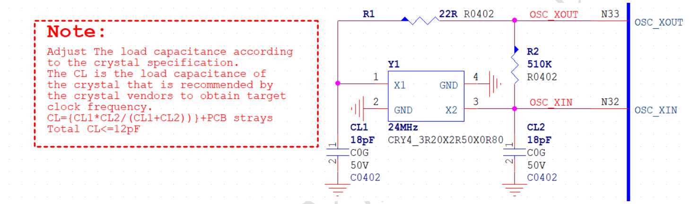
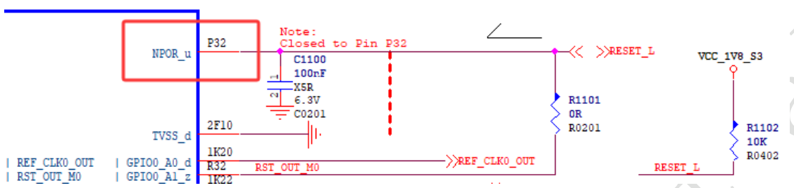
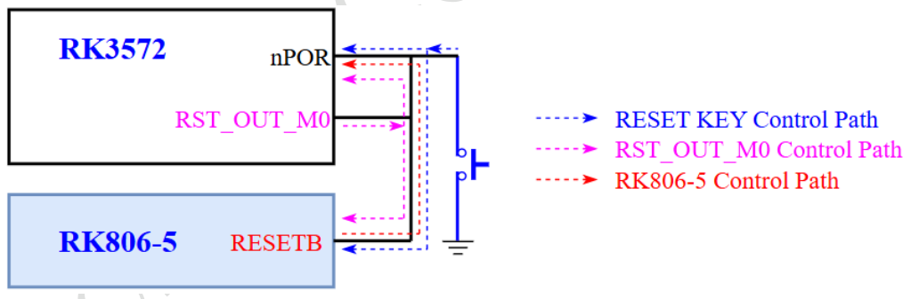
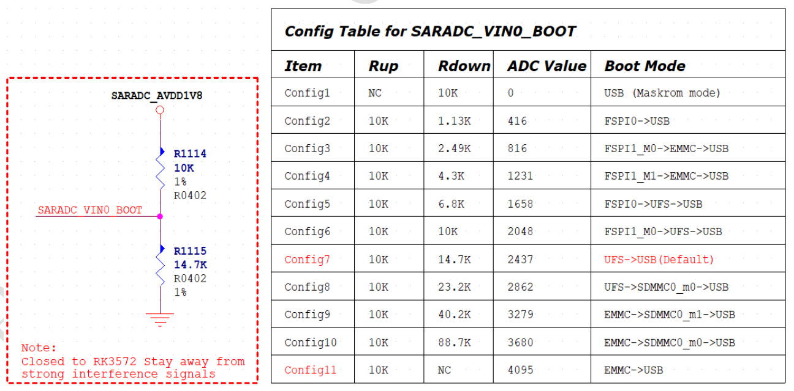

## 适用范围

本文面向 RK3572 自研主板与 ArmSoM Zero5 项目评估，依据 RK3572 硬件设计指南 V1.1 和本次硬件资料包。芯片接口不等于板卡已引出接口；Zero5 的最终配置、可用系统和内核版本须以对应硬件版本的正式产品文档为准。本文未进行 ArmSoM 硬件实测。

RK3572 首板没有串口输出时，先检查电源、主时钟、复位和启动选择，再定位 DDR 或系统镜像。将 UART0、USB DRD0 和强制 Maskrom 入口一起保留，才能在启动介质损坏时继续调试。

## 1. 24 MHz 主时钟与负载电容

*24 MHz 晶体参考电路*

| 检查项 | 设计要求 |
|---|---|
| Crystal | 24 MHz; CL ≤12 pF; ±20 ppm |
| XOUT | 22 Ω |
| 反馈电阻 | 510 kΩ |
| 参考负载电容 | 18 pF；按晶体 CL 与寄生电容调整，优先 C0G/NP0 |

18 pF 是参考电路值，不是所有 24 MHz 晶体的通用答案。四焊盘晶体的接地脚应可靠接地；晶体和负载电容靠近芯片，远离开关电源与高速走线。测量时考虑探头电容对振荡器的影响，避免把探头造成的停振当作芯片故障。

## 2. 32.768 kHz、时钟输出与待机

外部 RTC 时钟要求 32.768 kHz、±30 ppm、占空比 45%–55%，高电平范围为 0.7 × PMUIO0 电源至该电源电压。配置 CLK32K_IN 的 IOMUX；开漏输出方案还要检查内部下拉是否关闭。使用内部 PMU_PVTM 或外部低频时钟作为待机时钟，需要与电源保持方案一起配置。

| 输出 | 指南列出的频率 |
|---|---|
| REF_CLK0 / REF_CLK1 / REF_CLK2 | 10, 12, 20, 24, 25, 26, 27, 37.125, 40, 50, 58.5, 74.25, 100 MHz |
| ETH0_CLK25M / ETH1_CLK25M | 25 MHz |
| CAM_CLK0 / CAM_CLK1 / CAM_CLK2 | 24 MHz; 27 / 37.125 / 74.25 MHz |
| CLK0_32K_OUT / CLK1_32K_OUT | 依赖 24 MHz 振荡器；关闭后不能继续输出 |

## 3. 复位脉宽与电源稳定时间不是同一项

*RK3572 复位电路*

NPOR_u 位于 P32，低有效。指南要求低脉冲至少覆盖 100 个 24 MHz 周期，并以约 4 µs 描述；100 个周期实际约 4.17 µs，设计时应以周期要求并留裕量。系统最后一路电源稳定后，复位仍需保持至少 1 ms，参考范围为 5–200 ms。这两个时间不能混用。

RESET_L 上拉到 PMUIO0_VCC1V8，参考去抖电容为 100 nF。外部看门狗优先使用开漏输出，避免推挽输出与 PMIC 双向 RESETB 竞争。热保护可经 TSADC、RST_OUT 与复位控制链路触发；不要把该引脚当作普通调试 GPIO。

*复位与热保护路径*

## 4. 启动 ADC 选择与恢复入口

SARADC_IN0_BOOT 参与启动顺序选择，拉低进入 USB Maskrom；SARADC_IN1 的恢复按键用于 Recovery，二者用途不同。分压电阻采用 1% 精度并靠近 SoC。下表是启动选择表，不能与 DDRBIN 的 ADC Config 表混为一谈。

| Config | Rup | Rdown | ADC | 启动顺序 |
|---|---|---|---|---|
| 1 | NC | 10 kΩ | 0 | USB (Maskrom) |
| 2 | 10 kΩ | 1.13 kΩ | 416 | FSPI0 → USB |
| 3 | 10 kΩ | 2.49 kΩ | 816 | FSPI1_M0 → EMMC → USB |
| 4 | 10 kΩ | 4.3 kΩ | 1231 | FSPI1_M1 → EMMC → USB |
| 5 | 10 kΩ | 6.8 kΩ | 1658 | FSPI0 → UFS → USB |
| 6 | 10 kΩ | 10 kΩ | 2048 | FSPI1_M0 → UFS → USB |
| 7 | 10 kΩ | 14.7 kΩ | 2437 | UFS → USB |
| 8 | 10 kΩ | 23.2 kΩ | 2862 | UFS → SDMMC0_m0 → USB |
| 9 | 10 kΩ | 40.2 kΩ | 3279 | EMMC → SDMMC0_m1 → USB |
| 10 | 10 kΩ | 88.7 kΩ | 3680 | EMMC → SDMMC0_m0 → USB |
| 11 | 10 kΩ | NC | 4095 | EMMC → USB |

*启动 ADC 电阻配置*

BootROM 不直接从 PCIe SSD 启动。以 SSD 作为系统盘时，先从 SPI Flash 等受支持介质加载引导程序，再初始化 PCIe。不要把“系统可以放在 SSD”写成“芯片支持 PCIe BootROM”。

## 5. UART、JTAG 与首板检查顺序

默认调试口为 UART0 M0，波特率 1500000。JTAG M0 与 SDMMC0 复用；SDMMC0_DETN_M0（T33）为启动采样脚，内部上拉，参考 1 nF 电容，高电平默认 JTAG、低电平 SD，启动后再由 IOMUX 配置。JTAG M1 与 UART0 M0 复用：U33 为 TX/TCK，V32 为 RX/TMS。保留 100 Ω 串联与 TVS 位置，使用 2.54 mm 调试排针或直径至少 0.7 mm 的测试点，并匹配所在电源域电平。

建议按电源短路检查 → 上电时序 → 24 MHz → RESET_L 释放 → Maskrom 枚举 → DDR 初始化 → 启动介质 → 内核日志的顺序推进。每一步保存示波器波形、串口日志和固件版本；一次只改变一个配置，才能区分电源、内存训练与系统软件问题。

## ArmSoM 产品与下一步

正在评估小尺寸 RK3572 产品，可先查看 ArmSoM 的 Zero 版型规划，再整理需要保留的显示、存储、网络和供电接口。规划文章不代表已上市型号或最终原理图。已有量产项目的产品选择与接口核对，请使用官网产品目录和 Docs。

- [RK3572 / ArmSoM Zero 产品规划](/zh/articles/rockchip-rk3572-armsom-zero-preview/)
- [ArmSoM](https://www.armsom.org/category/all-products) · [ArmSoM Docs](https://docs.armsom.org/)

## 本系列阅读路径

- [RK3572 数据手册 V1.1：规格、接口与版本变化](/zh/articles/rk3572-datasheet-v10/)
- [RK3572 硬件设计指南：从资料选用到首板验证](/zh/articles/rk3572-hardware-design-series/)
- [RK3572 最小系统：24 MHz 时钟、复位、启动与串口调试](/zh/articles/rk3572-minimum-system-bringup/)
- [RK3572 电源设计：电源域、RK806-5 与双 PMIC 方案](/zh/articles/rk3572-power-domains-pmic/)
- [RK3572 DDR 设计：LPDDR4X、LPDDR5 电路与 PCB 约束](/zh/articles/rk3572-ddr-circuit-pcb/)
- [RK3572 DDRBIN 配置：DDR 模板、ADC 选择与多配置固件](/zh/articles/rk3572-ddrbin-adc-configuration/)
- [RK3572 存储与启动设计：eMMC、UFS、FSPI 的连接与供电](/zh/articles/rk3572-storage-boot-design/)
- [RK3572 USB 与 Type-C：烧录口、角色切换及供电检测](/zh/articles/rk3572-usb-typec-power-design/)
- [RK3572 PCIe 与 SATA：Combo PHY 复用、时钟和布线](/zh/articles/rk3572-high-speed-interface-design/)
- [RK3572 显示与摄像头：HDMI、eDP、MIPI 和电平匹配](/zh/articles/rk3572-display-camera-design/)
