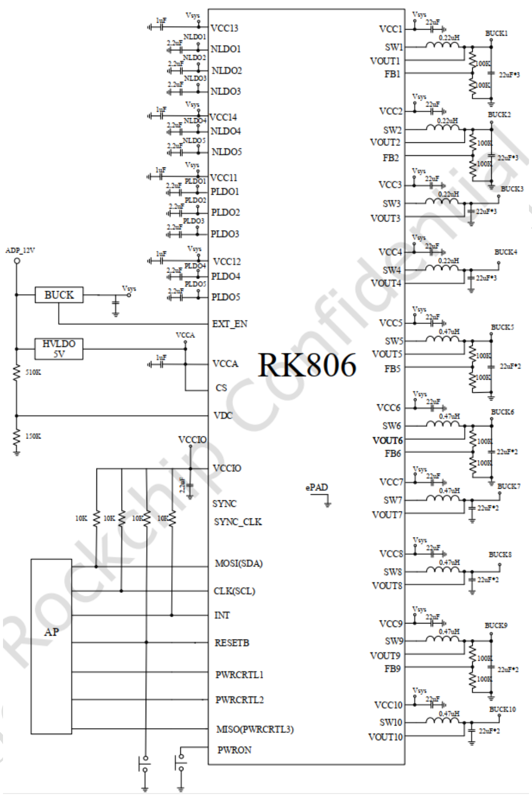
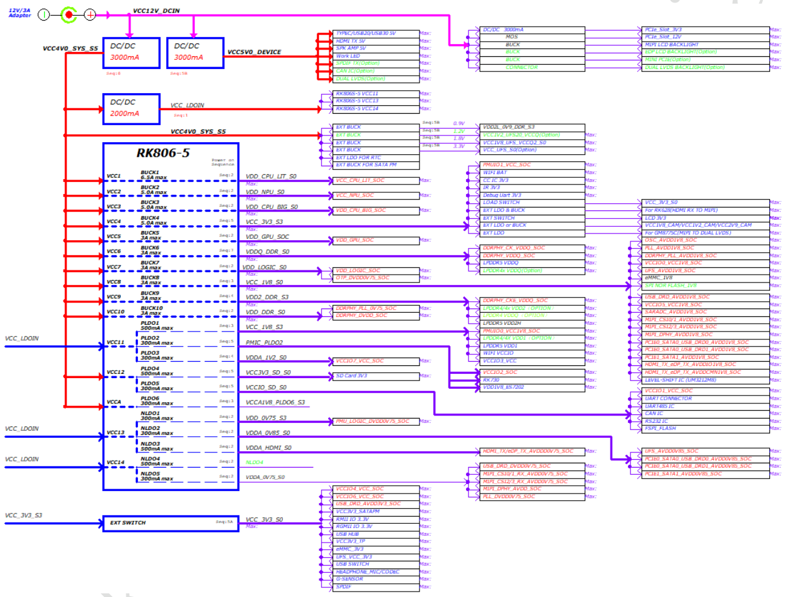

## 适用范围

本文面向 RK3572 自研主板与 ArmSoM Zero5 项目评估，依据 RK3572 硬件设计指南 V1.1 和本次硬件资料包。芯片接口不等于板卡已引出接口；Zero5 的最终配置、可用系统和内核版本须以对应硬件版本的正式产品文档为准。本文未进行 ArmSoM 硬件实测。

电源设计不能只按电压逐路连线。RK3572 需要同时满足电源域次序、动态负载、DDR 保持、唤醒路径和外设反灌约束。RK806-5 单 PMIC 参考方案与 RK809C-8 + RK805B-8 双 PMIC 方案也不能只按输出数量互换。

## 1. 先确定参考方案

本资料包建议普通非电池 AIoT 项目参考 RK806-5/RK806S-5 方案，电池项目参考 RK809C-8 + RK805B-8 分支。RK806 与 RK806S 的对应 -5 版本在资料中为兼容方案，但厂家、输入建议和具体 OTP 配置需要核对；不能用 RK806-2 直接替代 RK806-5。单看“RK806”基础型号无法确定上电顺序。

*RK806 典型连接*

## 2. 电源树与接口局部次序

*RK3572 电源树*

| 模块 | 局部电源次序 |
|---|---|
| UFS | 0.85 V → 1.8 V |
| USB | 0.75 V → 1.8 V → 3.3 V |
| MIPI / HDMI / eDP | 0.75 V → 1.8 V |
| PCIe / SATA / USB Combo PHY | 0.85 V → 1.8 V |
| DDR PHY | DVDD → VDDQH → VDDQ / CKVDDQ |

局部接口次序只是完整电源树的一部分。参考设计把核心相关电源放在第一组，随后依次为 1.8 V、DDR VDD2/1.2 V、部分 3.3 V 与 SD 电源、DDR 0.9 V 与运行态 3.3 V、DDRPHY_VDDQ，最后释放 RESET_L。网络名中的 S0/S3 表达参考设计的电源状态，不能只靠后缀判断自己板卡的待机行为。

## 3. 待机保留哪些电源，由唤醒方式决定

| 场景 | 需要核对的保持条件 |
|---|---|
| 最低功耗参考状态 | DDRPHY_VDDQH + PMU_LOGIC + PMUIO0/1 |
| USB HID | OSC + USB2 PHY |
| USB 4G 唤醒 | OSC + PLL + LOGIC + USB |
| 语音 / GMAC 唤醒 | OSC + PLL + LOGIC |
| CEC | OSC + LOGIC |
| IR / PWM | OSC；选择 PMU 域 PWM |
| 其他 GPIO | OSC + LOGIC + 对应 VCCIO |

上述是指南中与唤醒相关的保留项，仍需叠加 DDR、PMIC 和外设的要求。LOGIC 断电前设置好 GPIO 保持；外设常供电而 SoC I/O 断电时，还需检查反灌与非预期上拉。验证休眠恢复要同时记录电流、各域电压、唤醒源和恢复日志。

## 4. RK806 控制、按键与输入供电

| 检查项 | 设计要求 |
|---|---|
| VCCA | 先上电或与其他输入同时上电；不得明显落后于其他输入 |
| I2C | CS → VCCA; SDA/SCL: 2.2 kΩ → PMUIO0 |
| RESETB | 100 nF; 总电容 ≤0.3 µF |
| PWRON | 45 kΩ 内部上拉；低电平 20 ms 开机 |
| VDC | 高阈值约 0.8 V，建议 >1 V 且不超过 VCCA |

RK806 输入规格范围与参考板输入建议要分开：资料列出 2.7–5.5 V 工作范围，但普通 RK806 参考方案推荐 4 V；RK806S 对应方案的输入能力也应按具体器件确认。PWRON 长按关机时间可选择 6/8/10/12 s。VDC 始终保持高电平会影响硬件关机行为，必须结合按键与自动开机需求设计。

## 5. Buck 电感、电容和动态负载

| Buck | Iout max | Cin / Cout | L | Isat | DCR |
|---|---|---|---|---|---|
| 1 | 6.5 A | 22 / 66 µF | 0.24 µH | ≥7.8 A | <15 mΩ |
| 2–4 | 5 A | 22 / 66 µF | 0.24 µH | ≥6.5 A | <20 mΩ |
| 5–10 | 3 A | 10 / 44 µF | 0.47 µH | ≥4 A | <40 mΩ |

表格为参考选择条件，不能把每路最大电流相加当作 RK3572 实际功耗。电感还需检查温升、直流偏置和瞬态饱和；陶瓷电容按直流偏压后的有效容量评估。LDO 输出电容至少 2.2 µF。PLDO 输入应高于输出至少 0.2 V 且不低于 2 V；NLDO 输入也需保留 0.2 V，输出上限还受 VCCA − 1.5 V 约束。

## 6. 双 PMIC V1.4 的 Type-C 检测变化

2026-10-12 的双 PMIC V1.4 参考设计新增 HUSB311 检测，处理 Adapter 与 Type-C 共享 RK809C VDC（Pin 61）的场景。修改说明将 HUSB311 作为默认方案，GPIO 检测替代方案对应位置不贴。不能将 GPIO 电平检测当作完整的 USB PD 协议实现；复用旧版原理图时应同步核对 CC 检测、VDC、插拔和关机状态。

## 7. 投板前与首板验证清单

逐项记录 PMIC 完整后缀、OTP、输入来源、输出电压和电流预算；检查默认 GPIO 状态、外设反灌、RESET_L 和 DDR 电源次序；测量冷启动、热重启、长按关机和拔插电源。负载测试应覆盖 CPU、NPU、DDR 与外设组合，示波器同时关注最低电压与纹波，而不仅是万用表平均值。

## ArmSoM 产品与下一步

正在评估小尺寸 RK3572 产品，可先查看 ArmSoM 的 Zero 版型规划，再整理需要保留的显示、存储、网络和供电接口。规划文章不代表已上市型号或最终原理图。已有量产项目的产品选择与接口核对，请使用官网产品目录和 Docs。

- [RK3572 / ArmSoM Zero 产品规划](/zh/articles/rockchip-rk3572-armsom-zero-preview/)
- [ArmSoM](https://www.armsom.org/category/all-products) · [ArmSoM Docs](https://docs.armsom.org/)

## 本系列阅读路径

- [RK3572 数据手册 V1.1：规格、接口与版本变化](/zh/articles/rk3572-datasheet-v10/)
- [RK3572 硬件设计指南：从资料选用到首板验证](/zh/articles/rk3572-hardware-design-series/)
- [RK3572 最小系统：24 MHz 时钟、复位、启动与串口调试](/zh/articles/rk3572-minimum-system-bringup/)
- [RK3572 电源设计：电源域、RK806-5 与双 PMIC 方案](/zh/articles/rk3572-power-domains-pmic/)
- [RK3572 DDR 设计：LPDDR4X、LPDDR5 电路与 PCB 约束](/zh/articles/rk3572-ddr-circuit-pcb/)
- [RK3572 DDRBIN 配置：DDR 模板、ADC 选择与多配置固件](/zh/articles/rk3572-ddrbin-adc-configuration/)
- [RK3572 存储与启动设计：eMMC、UFS、FSPI 的连接与供电](/zh/articles/rk3572-storage-boot-design/)
- [RK3572 USB 与 Type-C：烧录口、角色切换及供电检测](/zh/articles/rk3572-usb-typec-power-design/)
- [RK3572 PCIe 与 SATA：Combo PHY 复用、时钟和布线](/zh/articles/rk3572-high-speed-interface-design/)
- [RK3572 显示与摄像头：HDMI、eDP、MIPI 和电平匹配](/zh/articles/rk3572-display-camera-design/)
