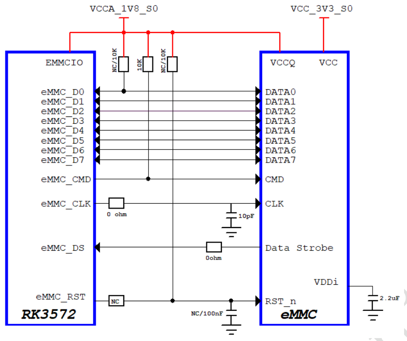
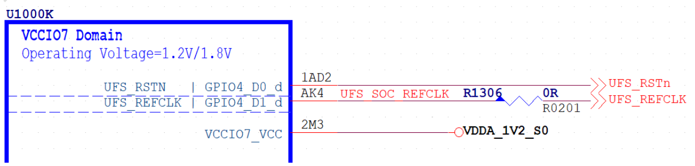
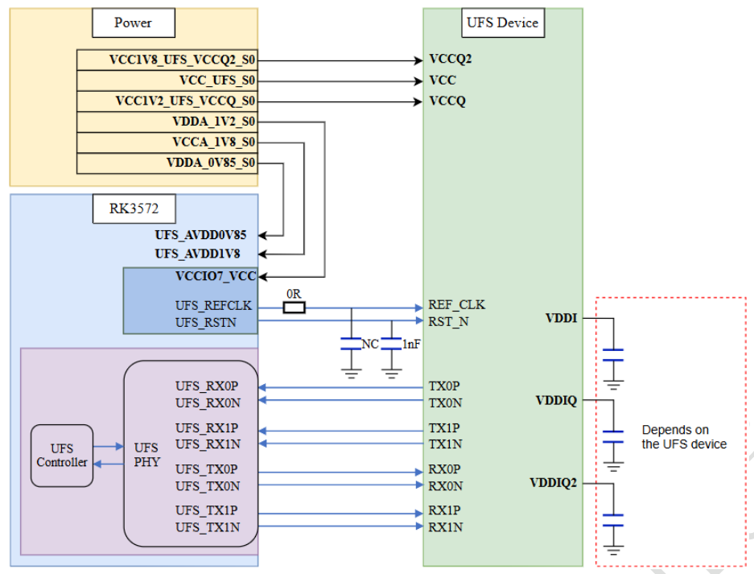
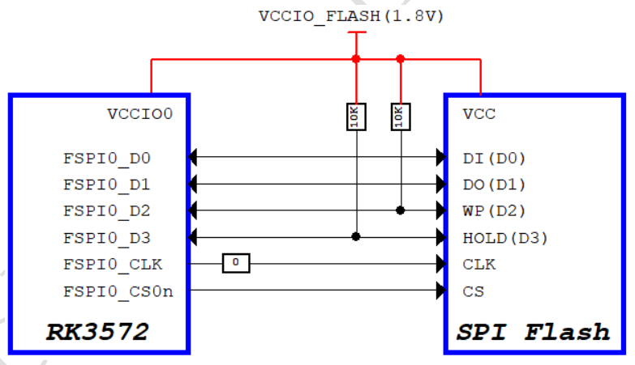
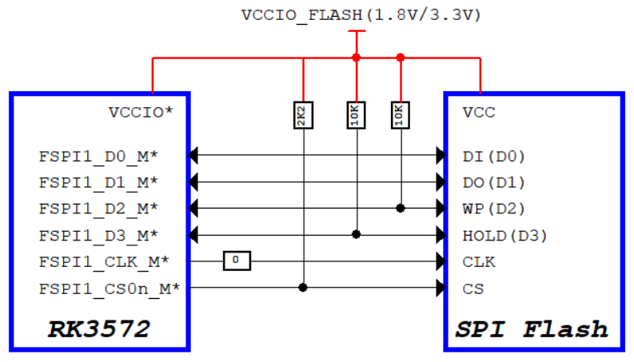

## 适用范围

本文面向 RK3572 自研主板与 ArmSoM Zero5 项目评估，依据 RK3572 硬件设计指南 V1.1 和本次硬件资料包。芯片接口不等于板卡已引出接口；Zero5 的最终配置、可用系统和内核版本须以对应硬件版本的正式产品文档为准。本文未进行 ArmSoM 硬件实测。

为 RK3572 选择 eMMC、UFS 或 SPI Flash，需要同时确认 BootROM 入口、控制器能力、I/O 电压、复用引脚和 PCB 条件。尤其要区分 UFS 器件版本与主控速度：连接更新版本的器件，不会让 RK3572 的 UFS 2.0 控制器自动升级。

## 1. 存储路线怎么选

| 项目 | 设计要求 |
|---|---|
| eMMC | eMMC 5.1; HS400 Enhanced Strobe / HS400 / HS200 / DDR50; 1/4/8-bit |
| UFS | UFS 2.0 主控，2 lane，5.8 Gbit/s/lane；连接兼容器件时仍受主控限制 |
| FSPI0 | 与 eMMC 复用，VCCIO0 为 1.8 V |
| FSPI1 | M0 使用 VCCIO1；M1 使用 VCCIO4，按整域电平配置 |

SDK 中支持某个文件系统，并不代表 BootROM 能直接加载该介质。PCIe SSD 作为系统盘需要先通过受支持启动介质加载引导程序；启动顺序由启动 ADC 及对应引导实现共同决定。设计时保留 USB DRD0 烧录路径，而不是把所有维护手段都依赖于正常工作的存储器。

## 2. eMMC：CMD、D0、CLK 与 STRB

*eMMC 参考连接*

| 项目 | 设计要求 |
|---|---|
| CMD | 外接 10 kΩ 上拉 |
| D0 | 预留 10 kΩ 上拉；其他数据线使用内部上拉时按参考图核对 |
| CLK | SoC 侧 0 Ω 串联，eMMC 侧预留 10 pF 对地 |
| STRB | eMMC 侧 0 Ω 串联，预留 47 kΩ 下拉 |
| RST_n | 参考默认不连接，使用 CMD 复位；采用硬件复位时核对上拉、0 Ω 与 100 nF |

eMMC 和 FSPI0 共享域电压，不要因为某个 Flash 支持 3.3 V 就把整个 VCCIO0 改成 3.3 V。容量、HS400 模式和 Enhanced Strobe 是否可用，还取决于实际颗粒与 BSP 配置；用低速模式启动成功后，仍需验证目标高速模式。

## 3. UFS 器件兼容性与三组电源

指南列出 UFS 2.0/2.1/2.2/3.0/3.1 器件连接方案，不包括 UFS 4.0。RSTN 与 REFCLK 所在 VCCIO7 为 1.2 V。PHY 的 0.85 V、1.8 V，SoC 的 VCCIO7，以及器件的 VCC/VCCQ/VCCQ2 是不同网络，必须逐项核对。

| UFS device | VCC | VCCQ | VCCQ2 |
|---|---|---|---|
| 2.0 | 3.3 V | 1.2 V | 1.8 V |
| 2.1 / 2.2 | 3.3 V | — | 1.8 V |
| 3.0 / 3.1 | 2.5 / 3.3 V | 1.2 V | — |

*UFS I/O 与电源关系*

*UFS 参考连接*

TX/RX 直接连接；REFCLK 在 SoC 侧串 0 Ω，器件侧预留对地电容；RSTN 直接连接并预留 1 nF。参考时序先 UFS 0.85 V，再 1.8 V，再 VCCIO7；器件 VCCQ2/VCCQ 按具体器件要求接入，VCC 不应早于 VCCIO7。器件的 JEDEC 时序与数据手册仍需一并满足。未使用 UFS 时，按指南处理专用 PHY 电源和软件节点，不能把未上电器件当作测试链路故障。

## 4. FSPI：片选上拉不能遗漏

*FSPI0 四线参考连接*

*FSPI1 四线参考连接*

FSPI1 M0 与 M1 是同一控制器的不同引脚选择，不能当成两个独立控制器。FSPI0 的片选有内部上拉；FSPI1 片选默认高阻，需要在 Flash 附近外接 2.2 kΩ 上拉，并检查复用为 CS1/RST 的引脚。四线接口用于单线模式时，D2/D3 按参考电路外接 10 kΩ。CLK 串联 0 Ω 放在 SoC 侧；使用八线 DQS 时，其 0 Ω 位置靠近 Flash。

## 5. PCB 与验证

| 项目 | eMMC | UFS |
|---|---|---|
| 阻抗 | 50 Ω ±10% | 100 Ω differential ±10% |
| 偏差 | CLK/data <20 ps / 120 mil | 对内 <1 ps / 6 mil；对间 <16 ps / 100 mil |
| 长度 | <3.5 in | <4 in |
| 换层过孔 | ≤2 | ≤2 |
| 回流过孔距离 | ≤30 mil | ≤25 mil |

UFS 差分对间距至少 4W，与其他信号至少 5W；REFCLK 做接地保护，地过孔间距不超过 400 mil。eMMC 普通线间距至少 2W，时钟与其他线优先 3W。验证时保存器件识别、实际协商模式、读写错误、长时间压力和掉电恢复结果；吞吐率应注明容量、固件和测试条件，不能用接口速率替代文件读写速度。

## ArmSoM 产品与下一步

正在评估小尺寸 RK3572 产品，可先查看 ArmSoM 的 Zero 版型规划，再整理需要保留的显示、存储、网络和供电接口。规划文章不代表已上市型号或最终原理图。已有量产项目的产品选择与接口核对，请使用官网产品目录和 Docs。

- [RK3572 / ArmSoM Zero 产品规划](/zh/articles/rockchip-rk3572-armsom-zero-preview/)
- [ArmSoM](https://www.armsom.org/category/all-products) · [ArmSoM Docs](https://docs.armsom.org/)

## 本系列阅读路径

- [RK3572 数据手册 V1.1：规格、接口与版本变化](/zh/articles/rk3572-datasheet-v10/)
- [RK3572 硬件设计指南：从资料选用到首板验证](/zh/articles/rk3572-hardware-design-series/)
- [RK3572 最小系统：24 MHz 时钟、复位、启动与串口调试](/zh/articles/rk3572-minimum-system-bringup/)
- [RK3572 电源设计：电源域、RK806-5 与双 PMIC 方案](/zh/articles/rk3572-power-domains-pmic/)
- [RK3572 DDR 设计：LPDDR4X、LPDDR5 电路与 PCB 约束](/zh/articles/rk3572-ddr-circuit-pcb/)
- [RK3572 DDRBIN 配置：DDR 模板、ADC 选择与多配置固件](/zh/articles/rk3572-ddrbin-adc-configuration/)
- [RK3572 存储与启动设计：eMMC、UFS、FSPI 的连接与供电](/zh/articles/rk3572-storage-boot-design/)
- [RK3572 USB 与 Type-C：烧录口、角色切换及供电检测](/zh/articles/rk3572-usb-typec-power-design/)
- [RK3572 PCIe 与 SATA：Combo PHY 复用、时钟和布线](/zh/articles/rk3572-high-speed-interface-design/)
- [RK3572 显示与摄像头：HDMI、eDP、MIPI 和电平匹配](/zh/articles/rk3572-display-camera-design/)
