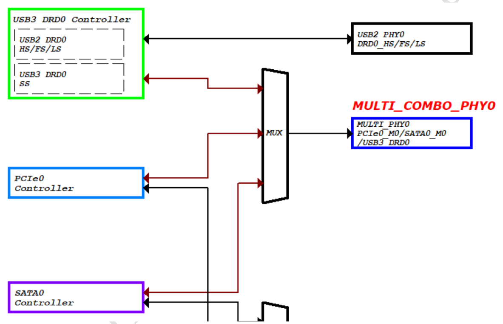
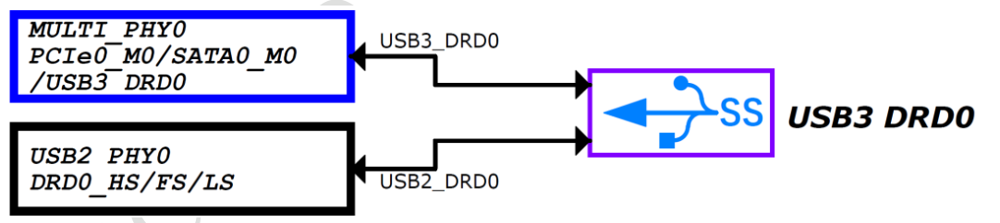
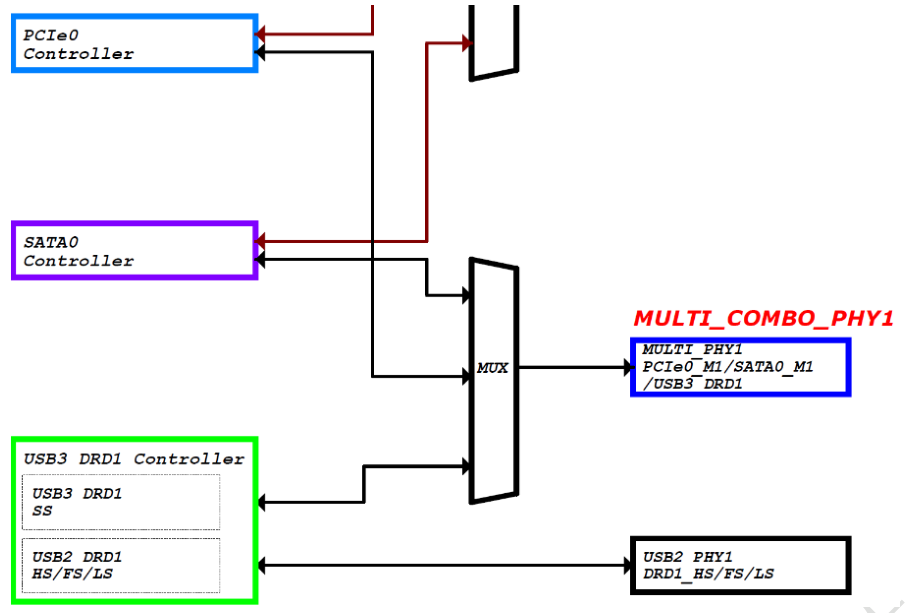
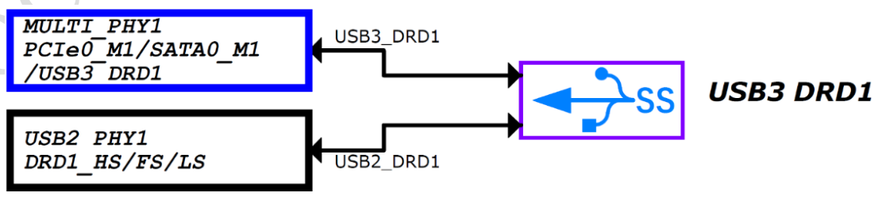
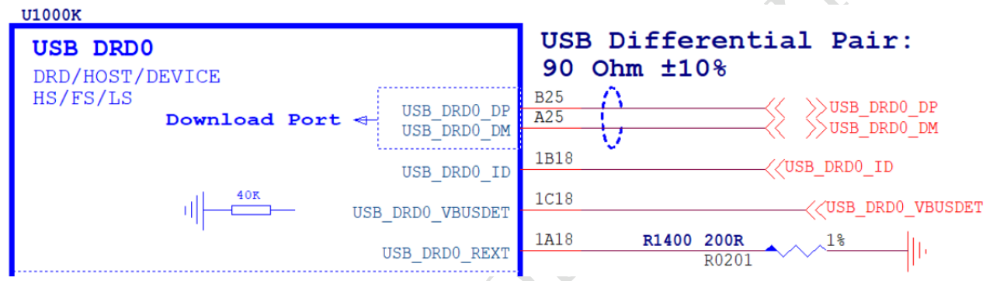
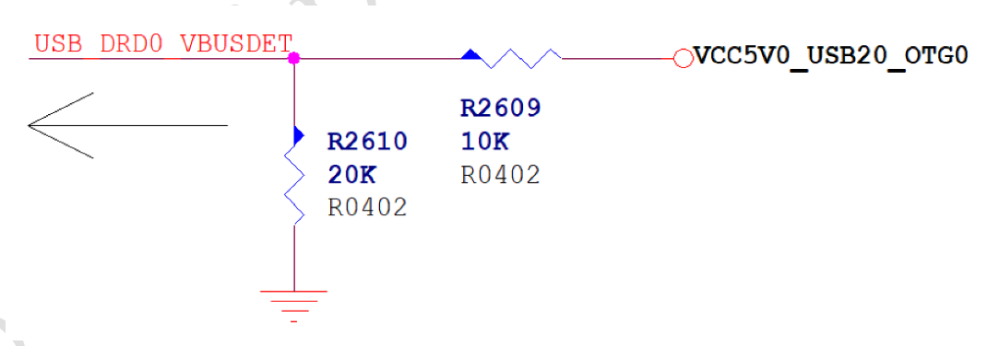
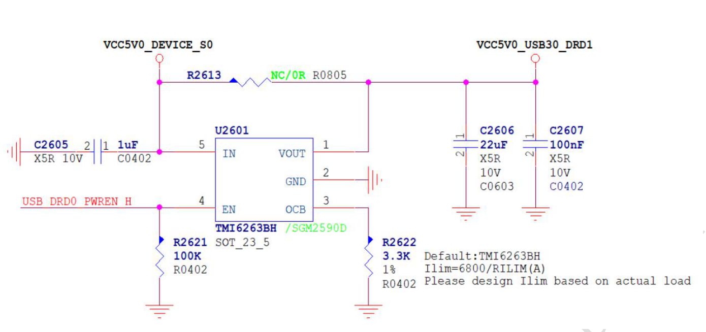
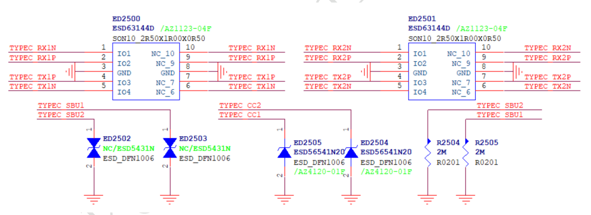

## 适用范围

本文面向 RK3572 自研主板与 ArmSoM Zero5 项目评估，依据 RK3572 硬件设计指南 V1.1 和本次硬件资料包。芯片接口不等于板卡已引出接口；Zero5 的最终配置、可用系统和内核版本须以对应硬件版本的正式产品文档为准。本文未进行 ArmSoM 硬件实测。

RK3572 的 USB 口需要同时规划数据角色和供电角色。Type-C 是连接器形式，不代表具备 DP Alt Mode，也不代表已经实现 USB PD。把 DRD 控制器、Combo PHY、VBUS、CC 检测和下载维护路径逐项对应，才能避免原理图看起来完整而实际不能枚举或烧录。

## 1. USB3 DRD 与 Combo PHY 的关系

RK3572 有两组 USB3 DRD 路径，每组中的 USB2 与 SuperSpeed 部分应配置为同一 HOST/DEVICE 角色，不能人为拆成相反角色。Combo PHY0 可选 USB3 DRD0、PCIe0 M0 或 SATA0 M0；Combo PHY1 可选 USB3 DRD1、PCIe0 M1 或 SATA0 M1。不同名字的接口不等于可以在同一 PHY 上同时运行。

*Combo PHY0 的复用关系*

*USB3 DRD0 参考连接*

*Combo PHY1 的复用关系*

*USB3 DRD1 参考连接*

## 2. 必须保留的下载通道

即使产品主要作为 USB Host，仍应为 USB DRD0 的 DP/DM、VBUSDET 和强制 Maskrom 操作保留维护入口。参考方案允许 USB2 DRD0 与选择了 PCIe/SATA 的高速 PHY 配合使用，但必须遵循对应复用图，而不是将未选中的 SuperSpeed 通道继续连接。USB DRD0 和 DRD1 的编号也不能在原理图与设备树之间随意交换。

*USB2 DRD0 与维护连接*

## 3. VBUSDET、ID 与 5 V 输入

| 项目 | 设计要求 |
|---|---|
| ID | 内部约 12 kΩ 上拉到 1.8 V；按参考图保护并匹配电平 |
| VBUSDET | 内部约 40 kΩ 下拉；典型输入 3 V，建议 2.7–3.3 V；检测阈值 >2.3 V |
| DP / DM | 2.2 Ω 串联电阻 |
| SuperSpeed TX / RX | TX: 100 nF, 0201; RX: 0 Ω |

*VBUS 检测分压参考*

不要将 5 V VBUS 直接送到 VBUSDET。分压计算应计入内部约 40 kΩ 下拉与外部器件容差，不能只计算两个外部电阻。不同 Type-C、Micro-USB 和固定 Host 参考电路的连接不完全相同，选择一种明确拓扑后再核对供电和角色转换。

## 4. Host 限流与 Type-C CC 检测

*USB Host 限流参考电路*

Host 的 5 V 输出应经过限流开关，GPIO 控制电平按参考 3.3 V 域核对。指南给出 22 µF + 100 nF 去耦；移动硬盘示例中较大电容仍需结合插入浪涌、限流阈值和电源余量评估，不能只增加电容解决供电不足。双 PMIC V1.4 方案通过 HUSB311 处理 CC 检测及 Adapter/Type-C 共用 VDC；GPIO 替代检测不是 USB PD 协议实现。

## 5. ESD 与 PCB 参数要一起选

*Type-C 接口保护参考*

| 项目 | USB 2.0 | USB 3.x |
|---|---|---|
| 差分阻抗 | 90 Ω ±10% | 90 Ω ±10% |
| 对内偏差 | <3 ps / 20 mil | <1 ps / 6 mil |
| 长度 | <6 in | <6 in |
| 信号过孔 | 建议 ≤4，最多 6 | ≤2 |
| 本页采用的保护电容上限 | ≤1 pF | ≤0.2 pF |

指南电路章节分别出现 USB2 ≤3 pF、SuperSpeed ≤0.25 pF 的 ESD 建议，PCB 章节则更严格，为 ≤1 pF 和 ≤0.2 pF。本页采用较严格值，并保留这一差异，最终还要确认具体保护器件的 S 参数和整条链路损耗。SuperSpeed 差分对与邻近信号至少按 4W 间距检查，保持连续参考面。

## 6. 验收不止一次枚举

分别验证 USB2 与 SuperSpeed、正反插、Host/Device 切换、冷启动时已插入设备、热插拔、短路限流、休眠恢复和 Maskrom 烧录。记录线缆、外设、BSP 与设备树版本。若出现“只有 USB2”，先检查 PHY 选择、SuperSpeed 通路与方向切换；若完全不枚举，优先核对 VBUSDET、CC/ID、DP/DM 和电源。

## ArmSoM 产品与下一步

正在评估小尺寸 RK3572 产品，可先查看 ArmSoM 的 Zero 版型规划，再整理需要保留的显示、存储、网络和供电接口。规划文章不代表已上市型号或最终原理图。已有量产项目的产品选择与接口核对，请使用官网产品目录和 Docs。

- [RK3572 / ArmSoM Zero 产品规划](/zh/articles/rockchip-rk3572-armsom-zero-preview/)
- [ArmSoM](https://www.armsom.org/category/all-products) · [ArmSoM Docs](https://docs.armsom.org/)

## 本系列阅读路径

- [RK3572 数据手册 V1.1：规格、接口与版本变化](/zh/articles/rk3572-datasheet-v10/)
- [RK3572 硬件设计指南：从资料选用到首板验证](/zh/articles/rk3572-hardware-design-series/)
- [RK3572 最小系统：24 MHz 时钟、复位、启动与串口调试](/zh/articles/rk3572-minimum-system-bringup/)
- [RK3572 电源设计：电源域、RK806-5 与双 PMIC 方案](/zh/articles/rk3572-power-domains-pmic/)
- [RK3572 DDR 设计：LPDDR4X、LPDDR5 电路与 PCB 约束](/zh/articles/rk3572-ddr-circuit-pcb/)
- [RK3572 DDRBIN 配置：DDR 模板、ADC 选择与多配置固件](/zh/articles/rk3572-ddrbin-adc-configuration/)
- [RK3572 存储与启动设计：eMMC、UFS、FSPI 的连接与供电](/zh/articles/rk3572-storage-boot-design/)
- [RK3572 USB 与 Type-C：烧录口、角色切换及供电检测](/zh/articles/rk3572-usb-typec-power-design/)
- [RK3572 PCIe 与 SATA：Combo PHY 复用、时钟和布线](/zh/articles/rk3572-high-speed-interface-design/)
- [RK3572 显示与摄像头：HDMI、eDP、MIPI 和电平匹配](/zh/articles/rk3572-display-camera-design/)
