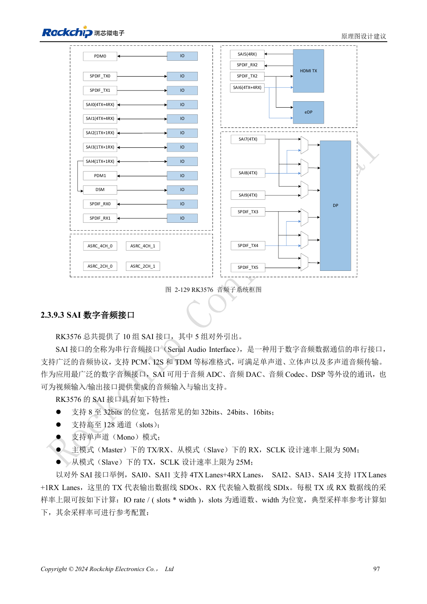
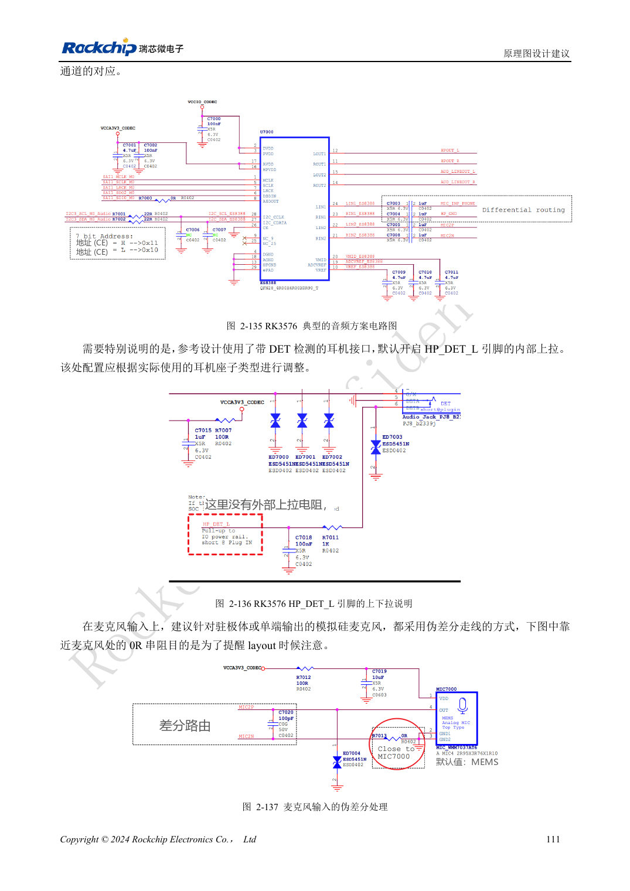

<!-- rk3576-hardware-v11-rest-20261109 -->

# RK3576 音频硬件：SAI、PDM、ASRC 与麦克风布局

本文基于 RK3576 Hardware Design Guide V1.1（2024-05-28）的中英文原稿，面向芯片主板设计。CM5 载板请以模块接口定义为准；Sige5 可用于建立软件和外设基线。指南没有限定一个可通用于所有产品的 SDK/BSP 或内核版本，实际适配需逐板核对。参数为原稿参考，不是 ArmSoM 实测。

**RK3576_Hardware_Design_Guide_V1.1_20240528_CN.pdf** · §2.3.9; Audio PCB

## 内部资源与外部接口分开计数

芯片有十组 SAI，但仅五组对外；另有两组 PDM、两组外部 SPDIF TX/RX 和一组 DSM。其余音频资源与视频接口关联。SAI4 在使用 DSM 时不可同时作为外部接口。SAI 支持 PCM/I2S/TDM，先明确主从、时钟方向、通道槽数与位宽，再确定实际采样率。

## 计算带宽并处理异步时钟

每根数据线采样率上限按 IO rate/(slots×width) 计算。例如 TDM16、32bit、48kHz 需要 24.576MHz SCLK，TDM32 则为 49.152MHz。主模式 TX/RX 和从模式 RX 的 SCLK 上限 50MHz，从模式 TX 为 25MHz，仍需满足信号质量。四组 ASRC 用于采样率或异步时钟转换，不是额外 IO。

## 布线、功放与验证

时钟参考串联 22Ω并靠近源端，多设备时采用菊花链，PDM 的两个同相时钟可减少长分支。模拟麦克风使用伪差分走线，远离 DDR、LCD、电感和 RF，耳机与麦克风保护靠近连接座。Codec、功放使能和耳机检测必须与软件一致。记录播放、录音、回采、切换爆音与负载干扰；DSM 是低成本方案，不等于高性能 DAC。

## 设计参数与检查表

| 项目 | 原稿参考值 |
| --- | --- |
| 外部 SAI | 5 |
| PDM | 2 groups |
| TDM16: 32bit ×48kHz | 24.576MHz |
| Slave TX SCLK | ≤25MHz |
| ASRC | 8–384kHz |

## 参考原图

下图为原稿参考页，包含对应电路图或时序图；点击可查看大图。位号和元件值属于参考设计，不是 ArmSoM 产品原理图。

中文原稿 · PDF 117 · 2-129

中文原稿 · PDF 131 · 2-137

## ArmSoM 开发路径

CM5 可用于定制载板，减少计算核心的重复设计；Sige5 可作为软件与外设验证起点。接口是否引出、连接器针脚、电平和镜像支持必须查对应板卡资料，不能从芯片功能直接推断。

- [ArmSoM CM5](https://www.armsom.org/cm5) · [CM5 Docs](https://docs.armsom.org/armsom-cm5)
- [ArmSoM Sige5](https://www.armsom.org/sige5) · [Sige5 Docs](https://docs.armsom.org/armsom-sige5)

## 继续阅读

- [RK3576 硬件设计系列：30 个主题](/zh/articles/rk3576-hardware-design-series/)
- [RK3576 DP/eDP 设计：PHY 复用、AUX 与耦合电容差异](/zh/articles/rk3576-dp-edp-hardware-design/)
- [RK3576 以太网硬件：RGMII 延时、PHY 时钟与网口保护](/zh/articles/rk3576-gmac-hardware-design/)
