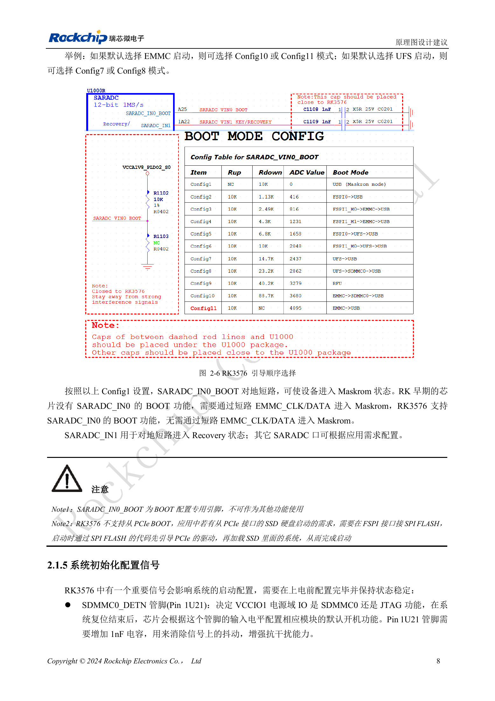

<!-- rk3576-hardware-v11-deep-20261109 -->

# RK3576 启动与调试设计：Boot 配置、Maskrom、UART 和 JTAG

可靠的恢复通道是量产设计的一部分。启动电阻、调试串口和 USB 下载接口应在原理图阶段确定，不应等到板子无法启动才临时飞线。

本文基于 RK3576 Hardware Design Guide V1.1（2024-05-28）的中英文原稿，面向芯片主板设计。CM5 载板请以模块接口定义为准；Sige5 可用于建立软件和外设基线。指南没有限定一个可通用于所有产品的 SDK/BSP 或内核版本，实际适配需逐板核对。参数为原稿参考，不是 ArmSoM 实测。

**RK3576_Hardware_Design_Guide_V1.1_20240528_CN.pdf** · §2.1.3–2.1.6

## 启动配置与两种恢复模式

SARADC_IN0_BOOT（Pin A25）选择启动顺序，原图包含 Config1–11。eMMC 默认对应 Config10/11，UFS 对应 Config7/8。Config1 将该输入接地进入 Maskrom，不必短接 eMMC 时钟或数据；SARADC_IN1 接地进入 Recovery，是不同机制。保留 BOOT 专用功能，不把该输入复用到无关模拟采集。完整电阻组合以原图为准。

## PCIe SSD 启动不是 BootROM 直接启动

指南明确不支持原生 PCIe BootROM 启动。SSD 系统需要 FSPI 上的 SPI Flash 先运行代码、初始化 PCIe，再加载 SSD 上的系统。设计中同时规划 SPI Flash、恢复入口和镜像维护，不能只画一个 NVMe 插槽就视为完整启动方案。

## 调试引脚与量产测试点

SDMMC0_DETN（Pin 1U21）在上电前保持稳定，高电平默认 JTAG、低电平 SDMMC0，指南配 1nF；启动后由 IOMUX 控制。JTAG 使用 TCK/TMS 两线 SWD，M0 与 VCCIO1 的 SDMMC0 共用，M1 与 PMUIO1 的 UART0_M0 共用。UART0 默认 1500000bps，保留 100Ω 串联电阻、ESD 和可接触测试点。具体镜像可能修改波特率，不应直接使用 5V 串口适配器。

## 设计参数与检查表

| 项目 | 数值或网络 | 核对说明 |
| --- | --- | --- |
| Maskrom | SARADC_IN0_BOOT = GND | Config1，区别于 Recovery |
| 串口电平域 | PMUIO1 | 与实际供电匹配 |
| 测试点 | ≥0.7mm / 2.54mm | 测试焊盘直径 / 可选排针间距 |

## 参考电路与原图

下图为原稿参考页，包含对应电路图或时序图；点击可查看大图。位号和元件值属于参考设计，不是 ArmSoM 产品原理图。

中文原稿 · PDF 28 · 2-6

## ArmSoM 产品与开发路径

CM5 适合把已集成的计算模块用于定制载板，Sige5 适合先验证 Linux 软件和外设。芯片具备某接口，不代表两款产品都把该接口引出；购买或布板前按连接器定义、板卡版本与系统镜像核对。

- [ArmSoM CM5](https://www.armsom.org/cm5) · [CM5 Docs](https://docs.armsom.org/armsom-cm5)
- [ArmSoM Sige5](https://www.armsom.org/sige5) · [Sige5 Docs](https://docs.armsom.org/armsom-sige5)

## 系列阅读顺序

- [RK3576 硬件设计系列：从最小系统到 DDR 与 USB](/zh/articles/rk3576-hardware-design-series/)
- [RK3576 最小系统与首次上电：从原理图检查到可重复启动](/zh/articles/rk3576-hardware-bringup/)
- [RK3576 时钟电路设计：24MHz 晶体、32kHz 待机与外设时钟](/zh/articles/rk3576-clock-circuit-design/)
- [RK3576 复位设计：NPOR、RK806S-5、看门狗与过温保护](/zh/articles/rk3576-reset-watchdog-design/)
- [RK3576 电源域与去耦：CPU、GPU、NPU 和 LOGIC 供电规划](/zh/articles/rk3576-power-domain-design/)
- [RK3576 与 RK806S-5：PMIC 选型、控制引脚和反馈设计](/zh/articles/rk3576-rk806s5-pmic-design/)
- [RK3576 电源时序与待机：复位释放、保留电源和唤醒路径](/zh/articles/rk3576-power-sequencing-standby/)
- [RK3576 DDR 电路与供电：LPDDR4、LPDDR4X 和 LPDDR5 的区别](/zh/articles/rk3576-ddr-circuit-power/)
- [RK3576 DDR PCB 布线：阻抗、长度、回流与 PDN 检查](/zh/articles/rk3576-ddr-pcb-routing/)
- [RK3576 USB 与 Type-C 硬件补充：复用、下载入口和保护器件](/zh/articles/168-rockchip-rk3576-usb/)
