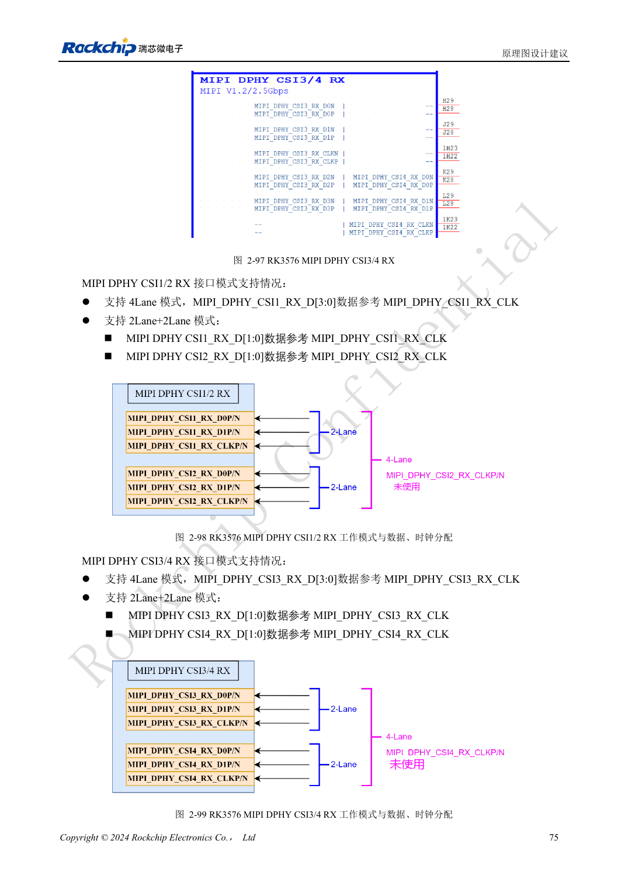
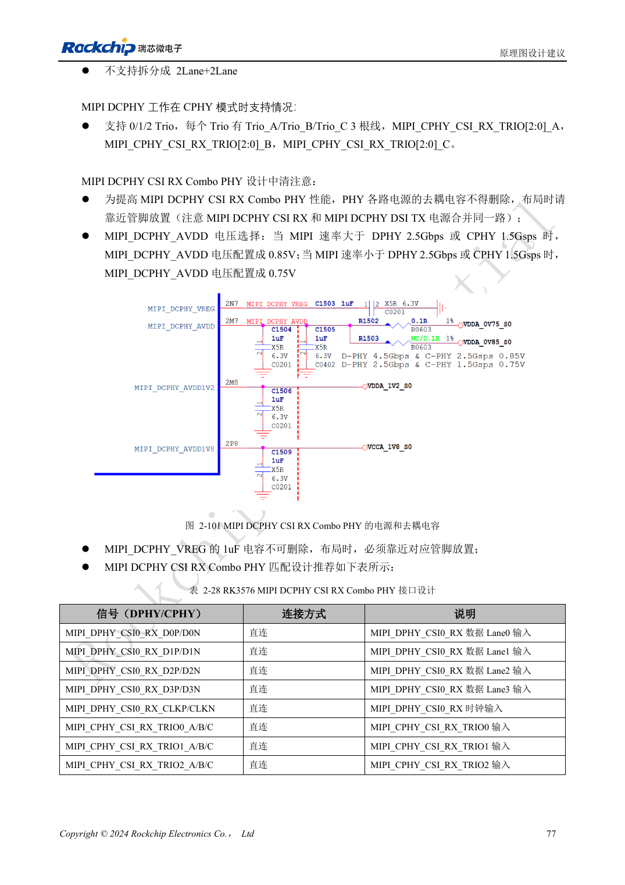

<!-- rk3576-hardware-v11-rest-20261109 -->

# RK3576 摄像头硬件：CSI 分组、DCPHY 模式与电源时序

本文基于 RK3576 Hardware Design Guide V1.1（2024-05-28）的中英文原稿，面向芯片主板设计。CM5 载板请以模块接口定义为准；Sige5 可用于建立软件和外设基线。指南没有限定一个可通用于所有产品的 SDK/BSP 或内核版本，实际适配需逐板核对。参数为原稿参考，不是 ArmSoM 实测。

**RK3576_Hardware_Design_Guide_V1.1_20240528_CN.pdf** · §2.3.7; Camera PCB

## 先核对物理分组

两组 DPHY CSI 接口可按四通道或 2+2 分拆，最高 2.5Gbps/lane。CSI0 使用 DCPHY，可选择 DPHY 四通道最高 4.5Gbps/lane 或 CPHY 三组最高 5.7Gbps/trio；CSI0 不支持 2+2 拆分。DCPHY 的 TX/RX 必须采用相同 DPHY 或 CPHY 模式，不能一侧一种。这些是芯片资源，CM5/Sige5 的连接器需另查。

## 相机供电不能只照抄三个电压

DVDD 按传感器要求可能是 1.2/1.5/1.8V。参考时序 1.8→1.2→2.8V 不适用于所有模组。PWDN、RESET 和 I2C 上拉需匹配 DOVDD，保留复位 100nF 和接口去耦。两个相同 I2C 地址的传感器应分配不同总线。DCPHY 的 MIPI_DCPHY_VREG 1μF 不可删；速率相关 AVDD 档位须按当前规格验证，原稿阈值等号边界未明确。

## 原稿冲突与实际验收

CIF 章节写 VCCIO4，摄像头注意事项却写 VCCIO6：中文 PDF 98/100 页、英文 105/107 页均如此。本文不把其中一个当作确定接线，请按 PinOut、具体复用与最新参考图核对。连接器差分对间安排地脚，MCLK 与差分线隔离；低照度场景还需权衡 DVDD 电源噪声。检查多摄像头同时工作、帧错误、曝光切换和温升。

## 设计参数与检查表

| 项目 | 原稿参考值 |
| --- | --- |
| CSI DPHY 分组 | 4 lanes / 2+2 |
| CSI0 DCPHY | No 2+2 |
| VREG | 1μF |
| RESET | 100nF |
| CIF 原稿冲突 | VCCIO4 / VCCIO6 |

## 参考原图

下图为原稿参考页，包含对应电路图或时序图；点击可查看大图。位号和元件值属于参考设计，不是 ArmSoM 产品原理图。

中文原稿 · PDF 95 · 2-98

中文原稿 · PDF 97 · 2-101

## ArmSoM 开发路径

CM5 可用于定制载板，减少计算核心的重复设计；Sige5 可作为软件与外设验证起点。接口是否引出、连接器针脚、电平和镜像支持必须查对应板卡资料，不能从芯片功能直接推断。

- [ArmSoM CM5](https://www.armsom.org/cm5) · [CM5 Docs](https://docs.armsom.org/armsom-cm5)
- [ArmSoM Sige5](https://www.armsom.org/sige5) · [Sige5 Docs](https://docs.armsom.org/armsom-sige5)

## 继续阅读

- [RK3576 硬件设计系列：30 个主题](/zh/articles/rk3576-hardware-design-series/)
- [RK3576 SATA 硬件：PHY 复用、耦合与硬盘供电](/zh/articles/rk3576-sata-hardware-design/)
- [RK3576 屏幕硬件：MIPI、RGB、背光与触摸供电](/zh/articles/rk3576-display-panel-hardware/)
