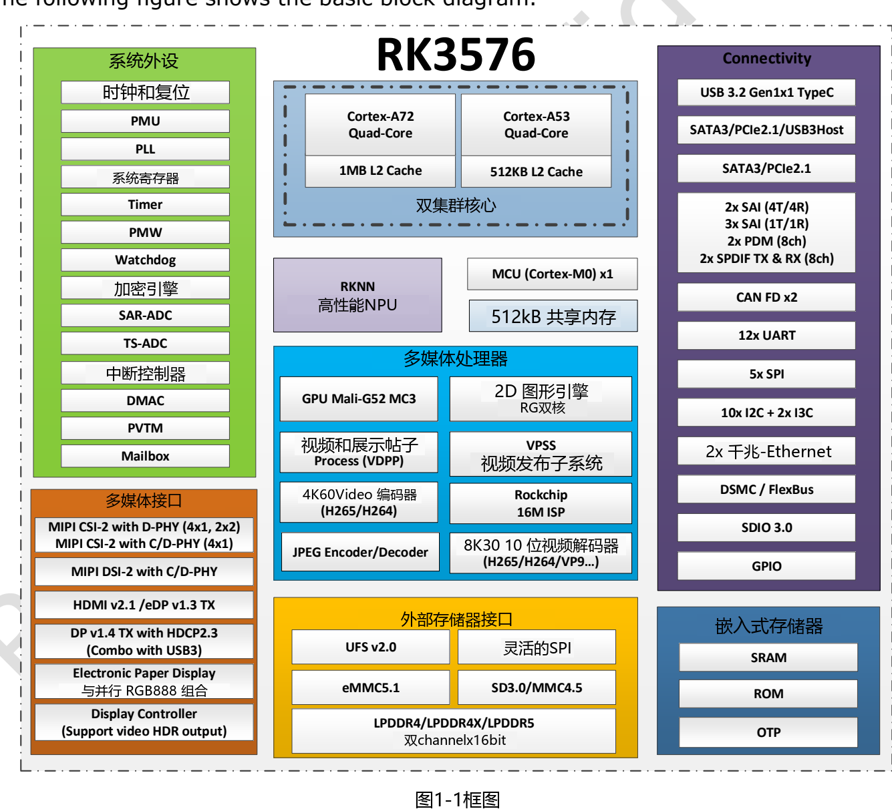
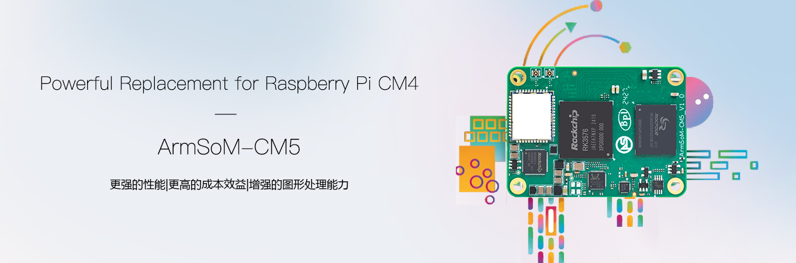

RK3576 适合把图像、推理、显示与设备连接放到同一台边缘终端中。对开发者而言，选择它不只是比较 CPU 核数，而是看业务链路中哪些工作可以交给专用硬件，再选择合适的 ArmSoM 产品形态。

## CPU、GPU、NPU 各自做什么

| 模块 | V1.0 中的规格 | 应用中的分工 |
|---|---|---|
| CPU | 4× Cortex-A72 + 4× Cortex-A53；L2 为 1MB / 512KB | 系统、协议、业务逻辑与前后处理 |
| GPU | Mali-G52 MC3 | 界面渲染与受驱动支持的图形计算 |
| NPU | 双核，可协作或独立工作；6 TOPS INT8 带星号 | 转换后且算子受支持的神经网络 |
| 内存 | 双通道，每通道 16-bit；LPDDR4/4X-4266、LPDDR5-4800；最高 16GB 地址空间 | 模型、视频缓冲与应用数据 |
| 图像与视频 | 16MP ISP、RGA、视频编解码器 | 图像采集、缩放与压缩 |

这些是芯片能力，不代表每块板都引出了全部接口。V1.0 第 41 页仍将 CPU、GPU、NPU 最高频率列为 TBD；板级频率应查看实际产品和镜像配置。V1.0 和较新官方简版 V1.2 均将 6 TOPS 的星号解释为 **Sparsity（稀疏计算）**，不能直接换算成模型帧率或与不同口径的 TOPS 比较。

## 一条实用的边缘视觉链路

以工位检测为例，相机先把图像送入系统，ISP 完成适配后的图像处理，RGA 可承担缩放与颜色处理，NPU 运行已转换模型，CPU 再处理判定规则、保存事件并向业务系统上报。显示器则展示状态和复核画面。

这一方案的价值在于减少原始视频外传，并把采集到结果的链路放在本地。实际效果取决于相机驱动、光照、训练数据、算子覆盖和内存传输；必须测端到端延迟、误检率和持续运行温度，不能只展示单次 NPU 推理耗时。

## 视频参数要按格式看

V1.0 概述列有最高 8K30 或 4K120 解码能力，详细条目按编码格式分别限定；H.264 不能套用其他格式的最高值。较新的官方简版 V1.2 主要列出各格式 4K 档位，本文不将两版拼成一个无条件的最大规格。

同时，解码、显示输出和多路并发是三个不同问题。项目应准备目标分辨率、帧率、码率、位深和编码格式的样本，验证驱动和应用是否真正调用了硬件加速。屏幕上的 HDMI 版本标签也不等于任意显示模式都能启用。

## 从 Sige5 原型走向 CM5 产品

Sige5 是面向直接连接外设的单板计算机，适合先验证算法、网络与交互；CM5 是核心板，适合围绕机壳、连接器和专用外设设计载板。同为 RK3576 可以复用部分应用经验，但迁移仍需要核对设备树、引脚复用、供电与散热。

如果你的目标是智能终端、定制 HMI 或设备网关，建议先列出必须连接的外设，再选板。不要把芯片的 PCIe、SATA、USB 组合 PHY 当成可以任意同时启用的独立接口。

## 建议的项目验证顺序

1. 固定板卡版本、系统镜像、内核和 NPU runtime。
2. 先完成相机、网络、存储与显示的基础测试。
3. 用真实数据完成模型转换、精度对比与端到端性能测试。
4. 加入异常恢复、日志轮转、掉电恢复和远程升级策略。
5. 在最终外壳内做长时间满载与温升测试。

本文是资料解读与方案建议，没有声称完成上述应用的 ArmSoM 实测。

## 系列文章与产品入口

- [ArmSoM CM5：树莓派 CM4/CM5 项目的替代选型与迁移指南](/zh/articles/cm5-raspberry-pi-cm4-cm5-alternative/)
- [Sige5 能做什么？六种 RK3576 边缘计算应用方案](/zh/articles/sige5-rk3576-applications/)
- [RK3576 Datasheet V1.0 下载与解读：规格、封装、电气与散热](/zh/articles/rk3576-datasheet-v10/)
- [ArmSoM CM5](https://www.armsom.org/cm5) · [ArmSoM Sige5](https://docs.armsom.org/armsom-sige5)

## 参考资料

- [Rockchip RK3576](https://www.rock-chips.com/a/en/products/RK35_Series/2024/1212/2033.html)
- [RK3576 Brief V1.2 (2025-08-28)](https://www.rock-chips.com/uploads/pdf/2024.3.18/191/RK3576%20Brief%20Datasheet%20V1.2-20250828.pdf)
- [ArmSoM CM5](https://docs.armsom.org/armsom-cm5)
- [ArmSoM Sige5](https://docs.armsom.org/armsom-sige5)
- [Raspberry Pi CM5](https://www.raspberrypi.com/products/compute-module-5/)
