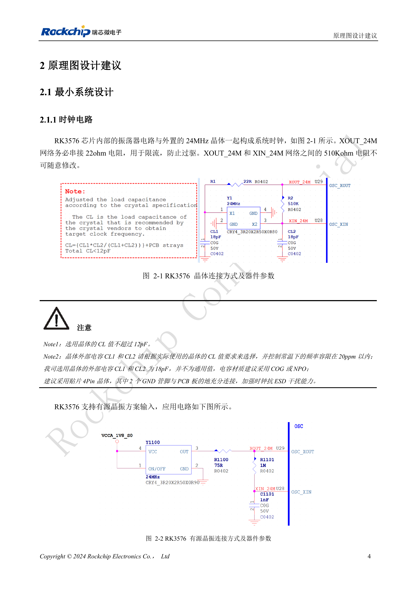

<!-- rk3576-hardware-v11-deep-20261109 -->

# RK3576 时钟电路设计：24MHz 晶体、32kHz 待机与外设时钟

时钟问题可能表现为不启动、USB 异常或待机唤醒失败。设计审查必须同时看振荡电路、时钟精度、输出电平和待机时仍然存在的时钟源，不能只确认原理图上有一个 24MHz 晶体。

本文基于 RK3576 Hardware Design Guide V1.1（2024-05-28）的中英文原稿，面向芯片主板设计。CM5 载板请以模块接口定义为准；Sige5 可用于建立软件和外设基线。指南没有限定一个可通用于所有产品的 SDK/BSP 或内核版本，实际适配需逐板核对。参数为原稿参考，不是 ArmSoM 实测。

**RK3576_Hardware_Design_Guide_V1.1_20240528_CN.pdf** · §2.1.1

## 24MHz 无源晶体的关键元件

XOUT_24M 串联 22Ω 用于限制过驱动，XOUT/XIN 间 510kΩ 电阻不可随意修改。晶体负载电容 CL 不大于 12pF；CL1/CL2 应按实际晶体选型计算与验证。指南中的 18pF 是参考设计值。优先使用 C0G/NP0 电容与四脚晶体，两个接地脚充分接地。测量时注意探头电容对振荡的影响。

## 有源输入与占空比

有源时钟参考电压为 1.35–1.8V，占空比 50%，频率精度 20ppm。指南通过把旁路 24MHz 引到 REF_CLK0_OUT（Pin V29）观察波形，并调整 R1100；这不是一个通用寄存器操作命令。0.8V 输入可能无法调至 50% 占空比，不应因能起振就判定输入合格。

## 待机与输出时钟一起审查

停止 24MHz 前应切换到 PMU_PVTM 或外部 32.768kHz，并确认唤醒源不依赖 24MHz。最小待机主要由 PMUIO0/1 中断唤醒。外部开漏 RTC 接入 CLK32K_IN 时需关闭对应 GPIO 内部下拉。CLK0/1_32K_OUT 并不保证在 24MHz 停止后仍输出；CAM_CLK 与以太网时钟也要同时检查引脚复用和外设电压。

## 设计参数与检查表

| 项目 | 数值或网络 | 核对说明 |
| --- | --- | --- |
| 晶体频差 | ≤20ppm | 室温，按原稿条件 |
| 外部待机时钟 | 32.768kHz ±30ppm; 45–55% | 幅度 0.7×VDD 至 VDD；VDD=PMUIO0 |
| 参考时钟输出 | REF_CLK0/1/2_OUT | 12/24/25/26/27/37.125/74.25/10/20/40/50/58.5/100MHz |
| 摄像头时钟 | CAM_CLK0/1/2_OUT | 默认 24MHz；可选 27/37.125/74.25MHz |

## 参考电路与原图

下图为原稿参考页，包含对应电路图或时序图；点击可查看大图。位号和元件值属于参考设计，不是 ArmSoM 产品原理图。

中文原稿 · PDF 24 · 2-1 / 2-2

## ArmSoM 产品与开发路径

CM5 适合把已集成的计算模块用于定制载板，Sige5 适合先验证 Linux 软件和外设。芯片具备某接口，不代表两款产品都把该接口引出；购买或布板前按连接器定义、板卡版本与系统镜像核对。

- [ArmSoM CM5](https://www.armsom.org/cm5) · [CM5 Docs](https://docs.armsom.org/armsom-cm5)
- [ArmSoM Sige5](https://www.armsom.org/sige5) · [Sige5 Docs](https://docs.armsom.org/armsom-sige5)

## 系列阅读顺序

- [RK3576 硬件设计系列：从最小系统到 DDR 与 USB](/zh/articles/rk3576-hardware-design-series/)
- [RK3576 最小系统与首次上电：从原理图检查到可重复启动](/zh/articles/rk3576-hardware-bringup/)
- [RK3576 复位设计：NPOR、RK806S-5、看门狗与过温保护](/zh/articles/rk3576-reset-watchdog-design/)
- [RK3576 启动与调试设计：Boot 配置、Maskrom、UART 和 JTAG](/zh/articles/rk3576-boot-debug-design/)
- [RK3576 电源域与去耦：CPU、GPU、NPU 和 LOGIC 供电规划](/zh/articles/rk3576-power-domain-design/)
- [RK3576 与 RK806S-5：PMIC 选型、控制引脚和反馈设计](/zh/articles/rk3576-rk806s5-pmic-design/)
- [RK3576 电源时序与待机：复位释放、保留电源和唤醒路径](/zh/articles/rk3576-power-sequencing-standby/)
- [RK3576 DDR 电路与供电：LPDDR4、LPDDR4X 和 LPDDR5 的区别](/zh/articles/rk3576-ddr-circuit-power/)
- [RK3576 DDR PCB 布线：阻抗、长度、回流与 PDN 检查](/zh/articles/rk3576-ddr-pcb-routing/)
- [RK3576 USB 与 Type-C 硬件补充：复用、下载入口和保护器件](/zh/articles/168-rockchip-rk3576-usb/)
