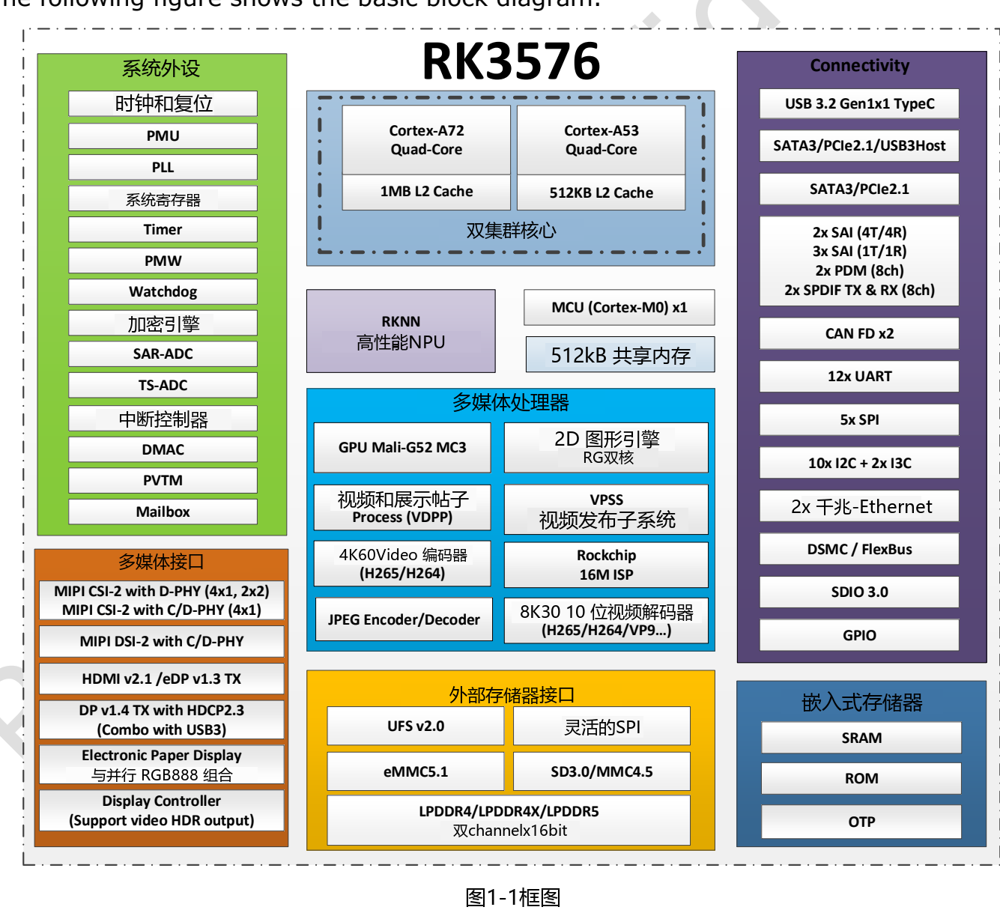
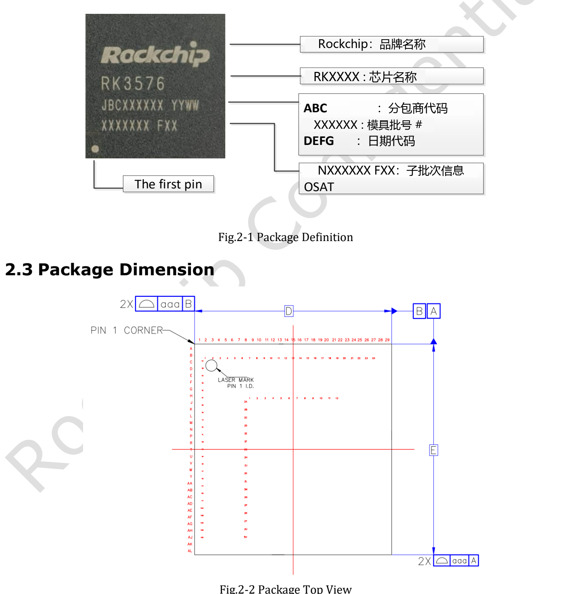
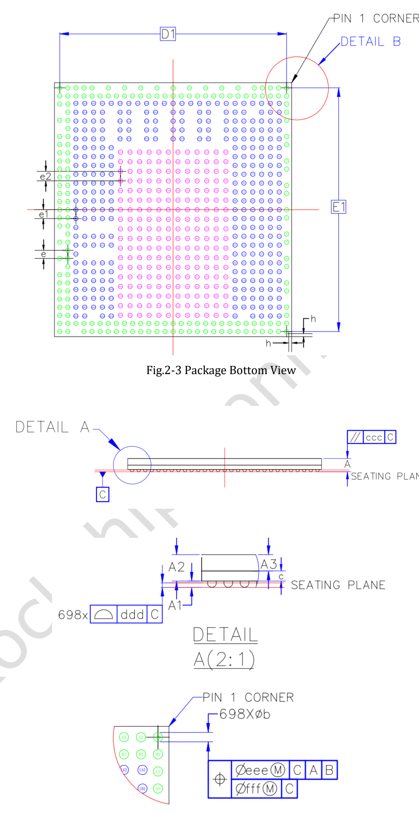
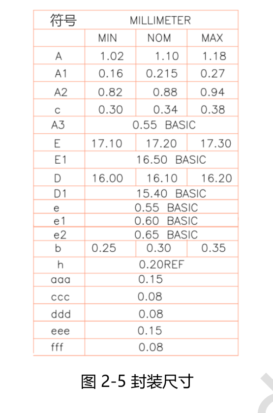

这份 **RK3576 Datasheet V1.0（2024-03-15，46 页）**适合查阅芯片框图、封装、引脚和电气条件。本文提供阅读导航与设计要点，不是 46 页逐字译本，也不将初始版本称为最新规格。

[下载完整原始 PDF](/assets/rk3576/Rockchip-RK3576-Datasheet-V1.0-20240315.pdf)

## 章节导航

| 原稿位置 | 内容 | 用途 |
|---|---|---|
| 第 6–22 页 | CPU、内存、系统模块、多媒体与接口，含框图 | 确定架构与接口需求 |
| 第 23–25 页 | 标识、封装图、尺寸、MSL 与焊球材料 | 封装和制造参考 |
| 第 26–37 页 | 引脚编号表 | 核对电源域和复用信号 |
| 第 38 页 | Absolute Ratings | 极限条件，不是建议工作点 |
| 第 39–45 页 | 建议工作条件及接口电气特性 | 供电与信号设计 |
| 第 46 页 | 热管理及测试条件 | 散热分析参考 |

## 架构与内存

V1.0 描述四核 Cortex-A72 与四核 Cortex-A53，分别具有 1MB 和 512KB 共享 L2。内存接口为两个 16-bit 通道，支持 LPDDR4/4X-4266 和 LPDDR5-4800，地址空间最高 16GB。存储接口包括 eMMC 5.1、UFS 2.0 和串行 Flash，但板卡是否提供相应连接由硬件设计决定。

## 三项不能忽略的版本差异

- **频率**：第 41 页 A72、A53、GPU、NPU 最高频率仍写 TBD。不要把当前产品页频率倒填成原稿内容。
- **NPU**：第 11 页写 6 TOPS* INT8，脚注明确为 Sparsity；较新官方 Brief V1.2 也保留这一口径。推广材料应保留稀疏口径。
- **图形与视频**：V1.0 列 Vulkan 1.1、OpenCL 2.0，较新简版列 Vulkan 1.2、OpenCL 2.1；视频规格的展示也不同。API 能力需结合实际驱动，视频需按格式、位深和目标模式验证。

## 封装与引脚

V1.0 标注 FCCSP698L，主体 16.1 × 17.2mm，焊球直径 0.30mm，球距为 0.55/0.60/0.65mm 混合。MSL 为 3，焊球材料为 SnAgCu。不能用简化的单一球距描述直接生成封装；请使用原始尺寸表和正式设计文件。

## 电气条件与散热

绝对最大额定值和建议工作条件分列不同表。核心电源、存储器电源和通用 IO 不能按单一电压处理，5V 板级输入不代表 SoC 引脚允许 5V。第 39 页部分项仍为 TBD，应在设计定版前获取确认。

第 46 页要求结温低于 125°C，这不是允许的环境温度。表中的 θJA=15.84、θJB=6.96、θJC=0.67、ψJT=0.031°C/W 是带有指定条件的封装参考数据，原文注明模拟数据需以实物测试为准。不能把 θJA 直接套用到任意机壳，也不能将 ψJT 当作普通热阻。

## 对 CM5 和 Sige5 项目的意义

用现成板卡时，先看板级供电、引脚和散热要求；做 CM5 载板时，以模块引脚表和参考设计为入口，不能把 SoC 焊球表当成模块连接器定义。本文未重新验证芯片电气参数，原始 PDF 完整保留，图中的原始标识也未去除。

## 系列文章与产品入口

- [RK3576 芯片详解：从八核 CPU 到 ArmSoM 边缘 AI 产品](/zh/articles/rk3576-chip-guide/)
- [ArmSoM CM5：树莓派 CM4/CM5 项目的替代选型与迁移指南](/zh/articles/cm5-raspberry-pi-cm4-cm5-alternative/)
- [Sige5 能做什么？六种 RK3576 边缘计算应用方案](/zh/articles/sige5-rk3576-applications/)
- [ArmSoM CM5](https://www.armsom.org/cm5) · [ArmSoM Sige5](https://docs.armsom.org/armsom-sige5)

## 参考资料

- [Rockchip RK3576](https://www.rock-chips.com/a/en/products/RK35_Series/2024/1212/2033.html)
- [RK3576 Brief V1.2 (2025-08-28)](https://www.rock-chips.com/uploads/pdf/2024.3.18/191/RK3576%20Brief%20Datasheet%20V1.2-20250828.pdf)
- [ArmSoM CM5](https://docs.armsom.org/armsom-cm5)
- [ArmSoM Sige5](https://docs.armsom.org/armsom-sige5)
- [Raspberry Pi CM5](https://www.raspberrypi.com/products/compute-module-5/)

<!-- datasheet-related-20261110 -->
## 其他芯片数据手册

以下用于跨平台查阅，各芯片的电气条件和引脚不可互换。

- [RK3506B](/zh/articles/rk3506b-datasheet-v10/)
- [RK3588](/zh/articles/rk3588-datasheet-v14/)
- [RK3528](/zh/articles/rk3528-datasheet-v10/)
- [RK3568](/zh/articles/rk3568-datasheet-v12/)
- [RK730](/zh/articles/rk730-audio-codec-design/)
