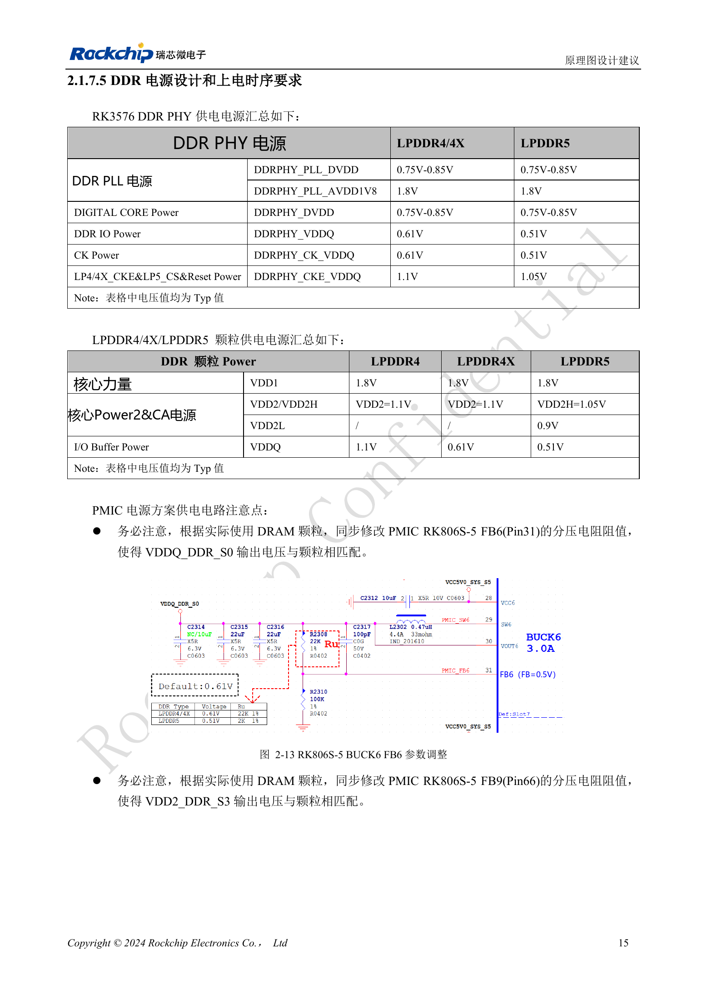
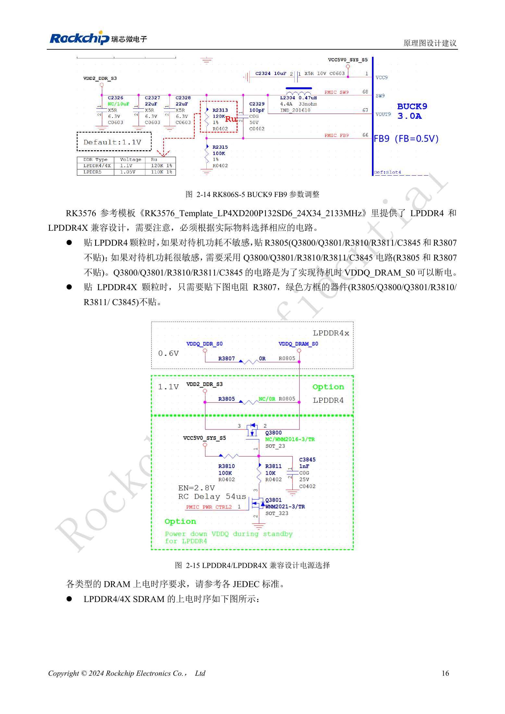

<!-- rk3576-hardware-v11-deep-20261109 -->

# RK3576 DDR 电路与供电：LPDDR4、LPDDR4X 和 LPDDR5 的区别

DDR 兼容设计不能只看封装。颗粒电源、PHY 电源、ZQ、信号分配、待机和固件必须同时匹配。下表保留原稿典型值，并把 DRAM 与 PHY 分开，避免把 LPDDR4 的 1.1V 和 PHY 的 0.61V 混为一谈。

本文基于 RK3576 Hardware Design Guide V1.1（2024-05-28）的中英文原稿，面向芯片主板设计。CM5 载板请以模块接口定义为准；Sige5 可用于建立软件和外设基线。指南没有限定一个可通用于所有产品的 SDK/BSP 或内核版本，实际适配需逐板核对。参数为原稿参考，不是 ArmSoM 实测。

**RK3576_Hardware_Design_Guide_V1.1_20240528_CN.pdf** · §2.1.7

## 接口与容量边界

RK3576 支持 LPDDR4/4X/5，32 位由两组 16 位通道组成，每通道最高 8GB、合计最高 16GB 是芯片寻址规格，不代表 CM5 或 Sige5 的所有 SKU。DQ/CA 不支持任意交换，应按模板与表 2-4 逐脚校对。LPDDR5 引入 WCK，频率为 CK 的 2 倍或 4 倍；不能把 LPDDR4 的 CKE 等信号直接套到 LPDDR5 定义。

## ZQ 与 PMIC 分压

DDR PHY ZQ 用 240Ω、1% 接 DDRPHY_VDDQ_S0。LPDDR4X/5 颗粒的 ZQ 同样接该域，而 LPDDR4 ZQ 接 VDD2_DDR_S3。LPDDR4/4X 的 ODT_CA 接 VDD2_DDR_S3。选好颗粒后核对 RK806S-5 FB6（Pin31）对应 VDDQ_DDR_S0、FB9（Pin66）对应 VDD2_DDR_S3 的分压。典型值不替代颗粒数据手册的容差与时序。

## 兼容贴装与待机

模板 RK3576_Template_LP4XD200P132SD6_24X34_2133MHz 中，LPDDR4 若重视低待机功耗，使用 Q3800/Q3801/R3810/R3811/C3845，省略 R3805/R3807；不要求该待机方案时使用 R3805。LPDDR4X 使用 R3807，省略对应绿色框电路。这些位号只属于该模板，不是任意 CM5 载板的改装指导。保持 DDRPHY_CKE_VDDQ 的待机供电，并按颗粒 JEDEC 时序核对每条电源。

## 设计参数与检查表

| 项目 | 数值或网络 | 核对说明 |
| --- | --- | --- |
| DRAM VDD1 | 1.8 / 1.8 / 1.8V | 顺序均为 LPDDR4 / 4X / 5 |
| DRAM VDD2/VDD2H | 1.1 / 1.1 / 1.05V | LPDDR5 另有 VDD2L=0.9V |
| DRAM VDDQ | 1.1 / 0.61 / 0.51V | 不要与 PHY 电源混淆 |
| PHY VDDQ/CK_VDDQ | 0.61 / 0.61 / 0.51V | 典型值 |
| PHY CKE_VDDQ | 1.1 / 1.1 / 1.05V | 待机保留 |
| PHY DVDD / PLL_DVDD | 0.75–0.85V | PLL_AVDD1V8=1.8V |

## 参考电路与原图

下图为原稿参考页，包含对应电路图或时序图；点击可查看大图。位号和元件值属于参考设计，不是 ArmSoM 产品原理图。

中文原稿 · PDF 35 · 2-13

中文原稿 · PDF 36 · 2-15

## ArmSoM 产品与开发路径

CM5 适合把已集成的计算模块用于定制载板，Sige5 适合先验证 Linux 软件和外设。芯片具备某接口，不代表两款产品都把该接口引出；购买或布板前按连接器定义、板卡版本与系统镜像核对。

- [ArmSoM CM5](https://www.armsom.org/cm5) · [CM5 Docs](https://docs.armsom.org/armsom-cm5)
- [ArmSoM Sige5](https://www.armsom.org/sige5) · [Sige5 Docs](https://docs.armsom.org/armsom-sige5)

## 系列阅读顺序

- [RK3576 硬件设计系列：从最小系统到 DDR 与 USB](/zh/articles/rk3576-hardware-design-series/)
- [RK3576 最小系统与首次上电：从原理图检查到可重复启动](/zh/articles/rk3576-hardware-bringup/)
- [RK3576 时钟电路设计：24MHz 晶体、32kHz 待机与外设时钟](/zh/articles/rk3576-clock-circuit-design/)
- [RK3576 复位设计：NPOR、RK806S-5、看门狗与过温保护](/zh/articles/rk3576-reset-watchdog-design/)
- [RK3576 启动与调试设计：Boot 配置、Maskrom、UART 和 JTAG](/zh/articles/rk3576-boot-debug-design/)
- [RK3576 电源域与去耦：CPU、GPU、NPU 和 LOGIC 供电规划](/zh/articles/rk3576-power-domain-design/)
- [RK3576 与 RK806S-5：PMIC 选型、控制引脚和反馈设计](/zh/articles/rk3576-rk806s5-pmic-design/)
- [RK3576 电源时序与待机：复位释放、保留电源和唤醒路径](/zh/articles/rk3576-power-sequencing-standby/)
- [RK3576 DDR PCB 布线：阻抗、长度、回流与 PDN 检查](/zh/articles/rk3576-ddr-pcb-routing/)
- [RK3576 USB 与 Type-C 硬件补充：复用、下载入口和保护器件](/zh/articles/168-rockchip-rk3576-usb/)
