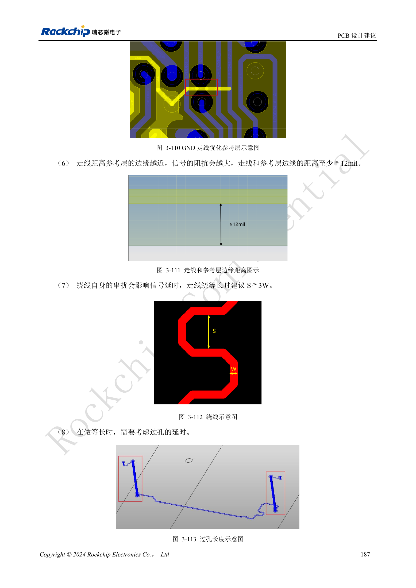

<!-- rk3576-hardware-v11-deep-20261109 -->

# RK3576 DDR PCB 布线：阻抗、长度、回流与 PDN 检查

DDR 布线首先应复用经过验证的 PCB 模板和对应 DDR 固件。等长只是其中一项：参考平面、过孔回流、阻抗、串扰和供电阻抗同时决定接口裕量。下面按指南 §3.5.3 整理审查重点。

本文基于 RK3576 Hardware Design Guide V1.1（2024-05-28）的中英文原稿，面向芯片主板设计。CM5 载板请以模块接口定义为准；Sige5 可用于建立软件和外设基线。指南没有限定一个可通用于所有产品的 SDK/BSP 或内核版本，实际适配需逐板核对。参数为原稿参考，不是 ArmSoM 实测。

**RK3576_Hardware_Design_Guide_V1.1_20240528_CN.pdf** · §3.5.3; Tables 3-18 / 3-19

## 先建立连续回流

不要删去 SoC 或 DRAM 模板中的 GND 过孔。信号过孔中心 25mil 范围内至少有一个连接两侧参考地的 GND 过孔；信号与地过孔交错分布，避免成团。至少保留一层连续 GND，走线距离参考平面边缘建议不小于 12mil。不能用增加蛇形线补救跨分割的回流路径。

## 长度、间距和过孔一起算

表中的 W 是实际走线宽度，不能预先写死成某个 mil 数。蛇形内部间距建议 S≥3W；走线与过孔焊盘间距至少 8mil。把过孔传播延迟纳入等长，差分对内长度差不大于 5mil。DQS/CLK/WCLK 保护地线的地过孔间距不大于 400mil。非功能焊盘处理须与板厂工艺共同确认。

## PDN 目标与工程验收

LPDDR4X 的 VDD2/VDDQ 和 LPDDR5 的 VDD2H，三个频段 100kHz–1MHz、1–30MHz、30–100MHz 的阻抗上限依次为 0.03/0.03/0.04Ω；LPDDR5 VDD2L 对应 0.07/0.07/0.08Ω。保留参考去耦并检查实际电容模型。原中文引言把速率写成“4266bps”，英文为“4266Mbps”，本文记录单位差异，不据此推导产品保证速率。验收需结合仿真、实际 DDR 固件、冷启动和负载稳定性。

## 设计参数与检查表

| 项目 | 数值或网络 | 核对说明 |
| --- | --- | --- |
| DQ/DM 单端 | LPDDR5:40Ω±10%; LPDDR4/4X:45Ω±10% | 按实际叠层计算线宽 |
| CA/控制 | 50Ω±10% | 差分对 90Ω±10% |
| 字节内长度差 | ≤90mil | DQ/DM 相对 DQS/WCLK |
| 地址/控制长度差 | ≤90mil | 相对 CLK |
| 选通与时钟 | DQS/WCLK ↔ CLK ≤230mil | 含过孔传播延迟 |
| 线间距 | ≥2W; DQ↔DQS/WCLK, CLK: ≥3W preferred | 关键组合最小 2W，推荐 3W |

## 参考电路与原图

下图为原稿参考页，包含对应电路图或时序图；点击可查看大图。位号和元件值属于参考设计，不是 ArmSoM 产品原理图。

中文原稿 · PDF 207 · 3-112 / 3-113

## ArmSoM 产品与开发路径

CM5 适合把已集成的计算模块用于定制载板，Sige5 适合先验证 Linux 软件和外设。芯片具备某接口，不代表两款产品都把该接口引出；购买或布板前按连接器定义、板卡版本与系统镜像核对。

- [ArmSoM CM5](https://www.armsom.org/cm5) · [CM5 Docs](https://docs.armsom.org/armsom-cm5)
- [ArmSoM Sige5](https://www.armsom.org/sige5) · [Sige5 Docs](https://docs.armsom.org/armsom-sige5)

## 系列阅读顺序

- [RK3576 硬件设计系列：从最小系统到 DDR 与 USB](/zh/articles/rk3576-hardware-design-series/)
- [RK3576 最小系统与首次上电：从原理图检查到可重复启动](/zh/articles/rk3576-hardware-bringup/)
- [RK3576 时钟电路设计：24MHz 晶体、32kHz 待机与外设时钟](/zh/articles/rk3576-clock-circuit-design/)
- [RK3576 复位设计：NPOR、RK806S-5、看门狗与过温保护](/zh/articles/rk3576-reset-watchdog-design/)
- [RK3576 启动与调试设计：Boot 配置、Maskrom、UART 和 JTAG](/zh/articles/rk3576-boot-debug-design/)
- [RK3576 电源域与去耦：CPU、GPU、NPU 和 LOGIC 供电规划](/zh/articles/rk3576-power-domain-design/)
- [RK3576 与 RK806S-5：PMIC 选型、控制引脚和反馈设计](/zh/articles/rk3576-rk806s5-pmic-design/)
- [RK3576 电源时序与待机：复位释放、保留电源和唤醒路径](/zh/articles/rk3576-power-sequencing-standby/)
- [RK3576 DDR 电路与供电：LPDDR4、LPDDR4X 和 LPDDR5 的区别](/zh/articles/rk3576-ddr-circuit-power/)
- [RK3576 USB 与 Type-C 硬件补充：复用、下载入口和保护器件](/zh/articles/168-rockchip-rk3576-usb/)
