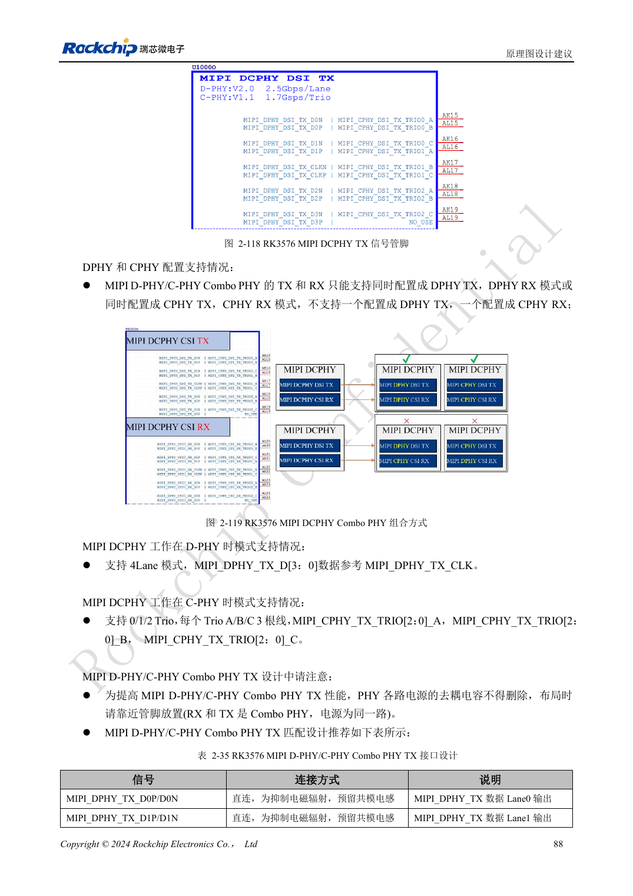
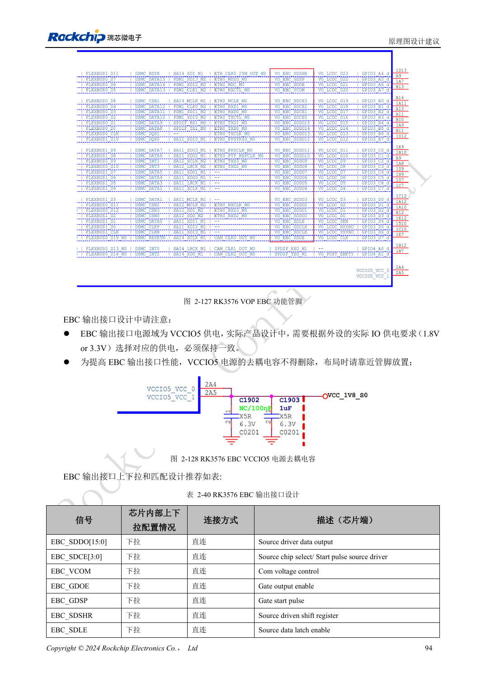

<!-- rk3576-hardware-v11-rest-20261109 -->

# RK3576 屏幕硬件：MIPI、RGB、背光与触摸供电

本文基于 RK3576 Hardware Design Guide V1.1（2024-05-28）的中英文原稿，面向芯片主板设计。CM5 载板请以模块接口定义为准；Sige5 可用于建立软件和外设基线。指南没有限定一个可通用于所有产品的 SDK/BSP 或内核版本，实际适配需逐板核对。参数为原稿参考，不是 ArmSoM 实测。

**RK3576_Hardware_Design_Guide_V1.1_20240528_CN.pdf** · §2.3.8.2, §2.3.8.4–6; MIPI/RGB PCB

## 按接口而不是分辨率选屏

MIPI TX 可选 DPHY 四通道最高 2.5Gbps/lane，或 CPHY 三组最高 1.7Gsps；指南列出 2560×1600@60 参考能力。显示与摄像头共享 DCPHY 时，TX/RX 模式必须一致。RGB/BT1120 使用 VCCIO5，按屏端要求匹配 1.8/3.3V。RGB666、RGB565 等位宽映射使用高位，不能顺手从 D0 开始接。

## 上电默认关闭屏与背光

屏电源应可控且上电默认关闭，背光 EN/PWM 选择默认下拉并外接下拉，减少闪屏。升压电感、二极管及电容按最大工作和空载电压选型，FB 限流电阻使用 1% 精度。TP 的 I2C 使用 2.2kΩ 上拉到 VCC3V3_TP，优先独立总线；共用时检查地址、电源先后和反向供电。

## 区分 DPHY 与 CPHY 约束

DPHY 按差分对管理，CPHY 按三线组管理，不能把三线组当普通差分对。FPC、连接器、ESD 与测试点都计入链路，测试点残桩尽量短。验收应覆盖冷启动、亮度调节、休眠唤醒、触摸中断和长时间显示，软件初始化序列按具体面板而不是仅按芯片型号选择。

## 设计参数与检查表

| 项目 | 原稿参考值 |
| --- | --- |
| DPHY Zdiff | 100Ω ±10% preferred |
| DPHY 对内 / 时钟数据差 | <6mil / <12mil |
| CPHY Zsingle | 50Ω ±10% |
| CPHY 组内 / 组间差 | <6mil / <100mil |
| DPHY / CPHY 长度 | <6inch / <5inch |

## 参考原图

下图为原稿参考页，包含对应电路图或时序图；点击可查看大图。位号和元件值属于参考设计，不是 ArmSoM 产品原理图。

中文原稿 · PDF 108 · 2-118

中文原稿 · PDF 114 · 2-127

## ArmSoM 开发路径

CM5 可用于定制载板，减少计算核心的重复设计；Sige5 可作为软件与外设验证起点。接口是否引出、连接器针脚、电平和镜像支持必须查对应板卡资料，不能从芯片功能直接推断。

- [ArmSoM CM5](https://www.armsom.org/cm5) · [CM5 Docs](https://docs.armsom.org/armsom-cm5)
- [ArmSoM Sige5](https://www.armsom.org/sige5) · [Sige5 Docs](https://docs.armsom.org/armsom-sige5)

## 继续阅读

- [RK3576 硬件设计系列：30 个主题](/zh/articles/rk3576-hardware-design-series/)
- [RK3576 摄像头硬件：CSI 分组、DCPHY 模式与电源时序](/zh/articles/rk3576-camera-hardware-design/)
- [RK3576 HDMI 硬件：FRL/TMDS、DDC 电平与保护器件](/zh/articles/rk3576-hdmi-hardware-design/)
