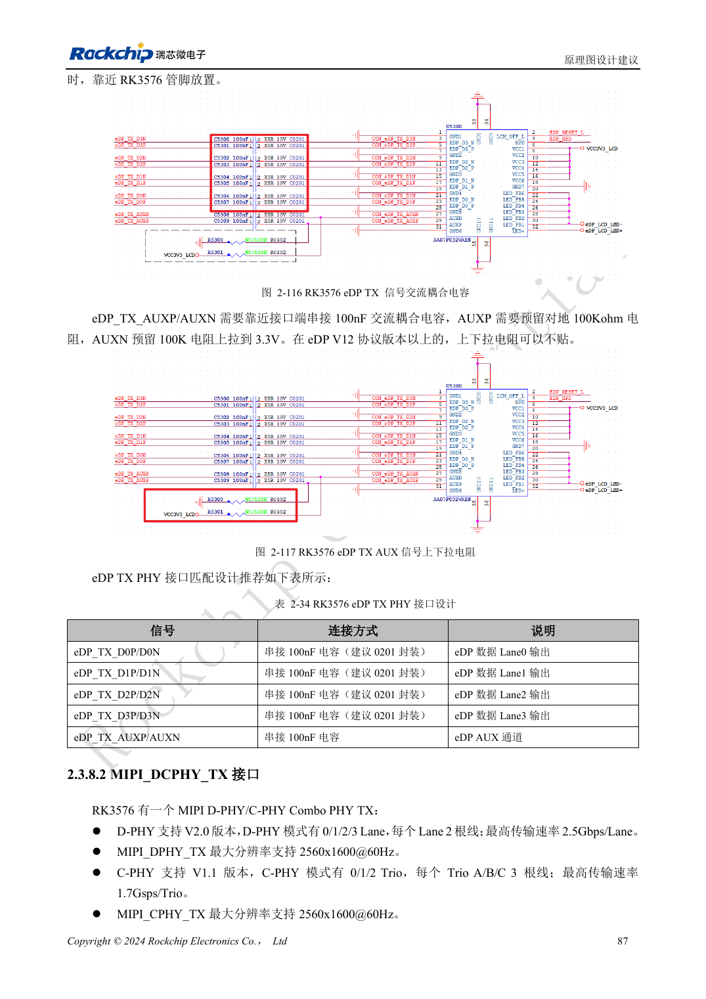
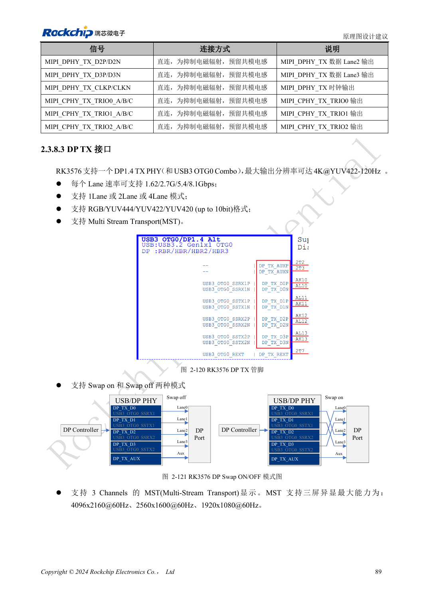

<!-- rk3576-hardware-v11-rest-20261109 -->

# RK3576 DP/eDP 设计：PHY 复用、AUX 与耦合电容差异

本文基于 RK3576 Hardware Design Guide V1.1（2024-05-28）的中英文原稿，面向芯片主板设计。CM5 载板请以模块接口定义为准；Sige5 可用于建立软件和外设基线。指南没有限定一个可通用于所有产品的 SDK/BSP 或内核版本，实际适配需逐板核对。参数为原稿参考，不是 ArmSoM 实测。

**RK3576_Hardware_Design_Guide_V1.1_20240528_CN.pdf** · §2.3.8.1, §2.3.8.3; DP/eDP PCB

## DP 与 eDP 的资源不同

DP 1.4 与 USB3 OTG0 共享 Combo PHY，支持 1/2/4 通道以及 1.62/2.7/5.4/8.1Gbps。eDP 1.3 与 HDMI 共享 PHY，支持 1/2/4 通道、1.62/2.7/5.4Gbps，原稿注明不支持 lane swap。MST、多显示或 Type-C 组合必须核对实际复用和板卡引出，不能只按显示数量做连接器规划。

## AUX 与原稿电容冲突

DP 数据和 AUX 采用 100nF，AUX 电容靠近连接器；参考电阻为 8.2kΩ、1%。eDP 原理图章节写 100nF，但 PCB 表写 220nF±20%：中文 PDF 106–107/222 页，英文原理图与 PDF 244 页亦有差异。这里保留两种写法，不能直接择一改 BOM；需按当前参考图、接收端和厂商确认。

## 链路训练之外还要检查电源

DP 专用差分线参考 100Ω，与 USB 共享时参考 95Ω；eDP 参考 90Ω并与线缆匹配。验证 AUX 通信、HPD、链路训练、屏电源与背光顺序，以及休眠恢复。屏不亮时先分清无 AUX、训练失败和背光未开启三类问题，避免反复修改视频时序。

## 设计参数与检查表

| 项目 | 原稿参考值 |
| --- | --- |
| DP / eDP Zdiff | 100Ω (95Ω shared) / 90Ω |
| 差分对内长度差 | <6mil |
| 走线长度 | <6inch |
| eDP 耦合：待核对 | 100nF / 220nF ±20% |
| 过孔数量建议 | ≤2 |

## 参考原图

下图为原稿参考页，包含对应电路图或时序图；点击可查看大图。位号和元件值属于参考设计，不是 ArmSoM 产品原理图。

中文原稿 · PDF 107 · 2-116

中文原稿 · PDF 109 · 2-121

## ArmSoM 开发路径

CM5 可用于定制载板，减少计算核心的重复设计；Sige5 可作为软件与外设验证起点。接口是否引出、连接器针脚、电平和镜像支持必须查对应板卡资料，不能从芯片功能直接推断。

- [ArmSoM CM5](https://www.armsom.org/cm5) · [CM5 Docs](https://docs.armsom.org/armsom-cm5)
- [ArmSoM Sige5](https://www.armsom.org/sige5) · [Sige5 Docs](https://docs.armsom.org/armsom-sige5)

## 继续阅读

- [RK3576 硬件设计系列：30 个主题](/zh/articles/rk3576-hardware-design-series/)
- [RK3576 HDMI 硬件：FRL/TMDS、DDC 电平与保护器件](/zh/articles/rk3576-hdmi-hardware-design/)
- [RK3576 音频硬件：SAI、PDM、ASRC 与麦克风布局](/zh/articles/rk3576-audio-hardware-design/)
