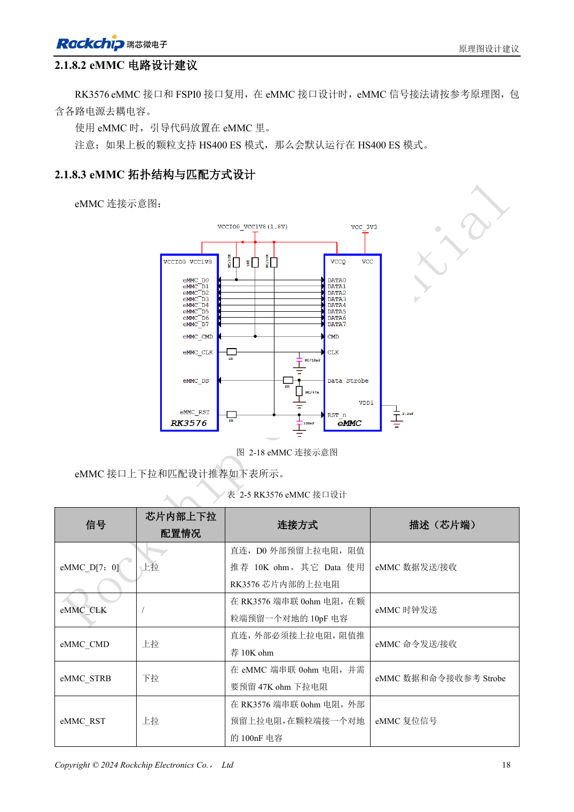
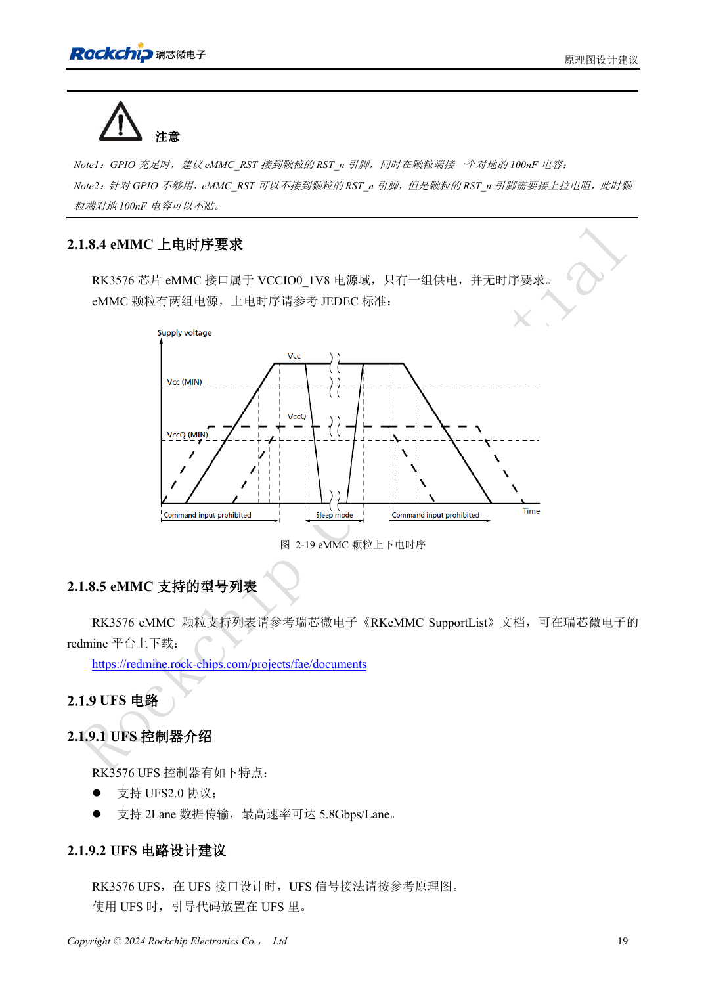

<!-- rk3576-hardware-v11-rest-20261109 -->

# RK3576 eMMC 硬件设计：供电、上拉与 HS400 布线

本文基于 RK3576 Hardware Design Guide V1.1（2024-05-28）的中英文原稿，面向芯片主板设计。CM5 载板请以模块接口定义为准；Sige5 可用于建立软件和外设基线。指南没有限定一个可通用于所有产品的 SDK/BSP 或内核版本，实际适配需逐板核对。参数为原稿参考，不是 ArmSoM 实测。

**RK3576_Hardware_Design_Guide_V1.1_20240528_CN.pdf** · §2.1.8; eMMC PCB

## 从启动介质到完整链路

RK3576 支持 eMMC 5.1、5.0、4.51 和 4.41，以及 HS400ES、HS400、HS200 和 DDR50。芯片支持一种模式，不代表任意颗粒与 PCB 都能可靠运行该模式。先确定颗粒、Loader、IO 电源和布线，再验证协商结果。eMMC 与 FSPI0 复用，不能把两者当作独立的启动接口同时占用。

## CMD、D0 和复位分别处理

VCCIO0 固定为 1.8V，颗粒的核心电源与 IO 电源按自身规格和时序连接。CMD 必须外接 10kΩ 上拉；D0 预留 10kΩ 上拉，其余数据线按原稿使用内部上拉。CLK 的 0Ω 串阻靠近 SoC，颗粒端预留 10pF；STRB 的 0Ω 靠近颗粒，并预留 47kΩ 下拉。RST 使用 GPIO 时保留颗粒端 100nF；没有 GPIO 时仍需上拉 RST_n，不能悬空。

## 从布线检查到验证

按下表设置约束，换层处保持地回流。上电后分别检查冷启动、连续读写、重启和异常断电后的恢复，保存颗粒型号、实际总线模式、镜像版本及错误日志。频率降下来能工作只是定位线索，不能替代供电和信号质量检查。

## 设计参数与检查表

| 项目 | 原稿参考值 |
| --- | --- |
| Z | 50Ω ±10% |
| CLK ↔ DATA | <120mil |
| 走线长度 | <3.5inch |
| 空气间距 | ≥2W |
| 过孔数量建议 | ≤2 |
| 伴随地过孔距离 | ≤30mil |

## 参考原图

下图为原稿参考页，包含对应电路图或时序图；点击可查看大图。位号和元件值属于参考设计，不是 ArmSoM 产品原理图。

中文原稿 · PDF 38 · 2-18

中文原稿 · PDF 39 · 2-19

## ArmSoM 开发路径

CM5 可用于定制载板，减少计算核心的重复设计；Sige5 可作为软件与外设验证起点。接口是否引出、连接器针脚、电平和镜像支持必须查对应板卡资料，不能从芯片功能直接推断。

- [ArmSoM CM5](https://www.armsom.org/cm5) · [CM5 Docs](https://docs.armsom.org/armsom-cm5)
- [ArmSoM Sige5](https://www.armsom.org/sige5) · [Sige5 Docs](https://docs.armsom.org/armsom-sige5)

## 继续阅读

- [RK3576 硬件设计系列：30 个主题](/zh/articles/rk3576-hardware-design-series/)
- [RK3576 UFS 硬件设计：颗粒兼容、电源顺序与高速差分线](/zh/articles/rk3576-ufs-hardware-design/)
