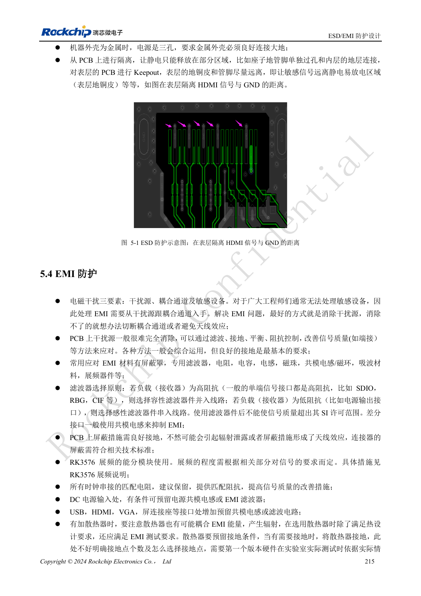

<!-- rk3576-hardware-v11-rest-20261109 -->

# RK3576 ESD 与 EMI：接口泄放、复位抗扰和量产检查

本文基于 RK3576 Hardware Design Guide V1.1（2024-05-28）的中英文原稿，面向芯片主板设计。CM5 载板请以模块接口定义为准；Sige5 可用于建立软件和外设基线。指南没有限定一个可通用于所有产品的 SDK/BSP 或内核版本，实际适配需逐板核对。参数为原稿参考，不是 ArmSoM 实测。

**RK3576_Hardware_Design_Guide_V1.1_20240528_CN.pdf** · Chapters 5–6

## 保护器件必须有可用的泄放路径

ESD 器件放在连接器入口侧，信号先经过保护再进入芯片，地回路短且不穿过敏感区域。高速保护器件不仅看耐压，还要符合接口允许的电容。接口章节与通用 ESD 章节的串阻值用途不同，不能把通用范围统一替换所有 HDMI、USB、SDIO 的具体值。

## 复位、时钟和机壳共同检查

指南建议复位、时钟与中断线远离板边至少 5mm，NPOR 的 100nF 靠近芯片并有近端地过孔。时钟阻尼靠近源端，尽量走内层并保持回流。散热片与机壳也可能形成辐射路径，接地方式要通过整机验证，而不是靠增加共模电感反复试错。

## 把设计建议转为可追溯试验

建立端口、极性、测试点、工作模式与失败现象记录，ESD 后检查复位、通信、存储与恢复，不把未死机等同于无数据损坏。生产前还需检查回流焊、受潮与包装条件；原稿 MSL3 的暴露参考为 168 小时、≤30°C/60%RH，不应扩展成任意包装的保存承诺。测试等级按目标产品标准确定，本文不声称已通过认证。

## 设计参数与检查表

| 项目 | 原稿参考值 |
| --- | --- |
| 敏感线距板边 | ≥5mm |
| NPOR 滤波 | 100nF |
| 时钟阻尼距离 | ≤400mil |
| MSL3 暴露寿命参考 | 168h; ≤30°C / 60%RH |

## 参考原图

下图为原稿参考页，包含对应电路图或时序图；点击可查看大图。位号和元件值属于参考设计，不是 ArmSoM 产品原理图。

中文原稿 · PDF 235 · 5-1

## ArmSoM 开发路径

CM5 可用于定制载板，减少计算核心的重复设计；Sige5 可作为软件与外设验证起点。接口是否引出、连接器针脚、电平和镜像支持必须查对应板卡资料，不能从芯片功能直接推断。

- [ArmSoM CM5](https://www.armsom.org/cm5) · [CM5 Docs](https://docs.armsom.org/armsom-cm5)
- [ArmSoM Sige5](https://www.armsom.org/sige5) · [Sige5 Docs](https://docs.armsom.org/armsom-sige5)

## 继续阅读

- [RK3576 硬件设计系列：30 个主题](/zh/articles/rk3576-hardware-design-series/)
- [RK3576 散热设计：热阻、PCB 导热与持续负载验证](/zh/articles/rk3576-thermal-hardware-design/)
