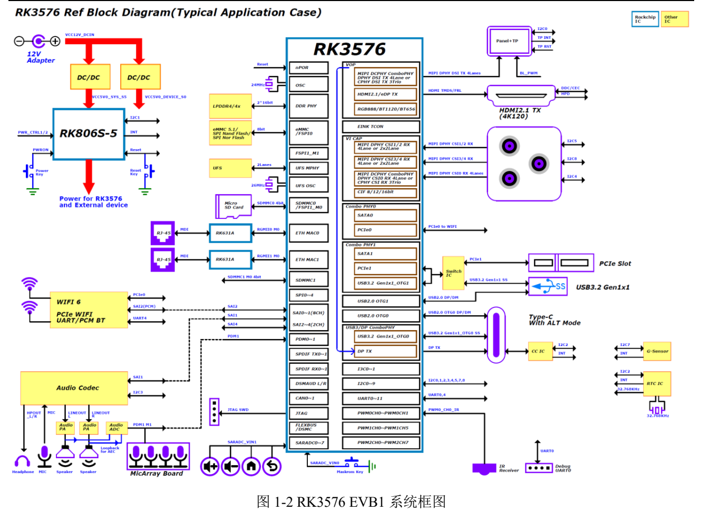
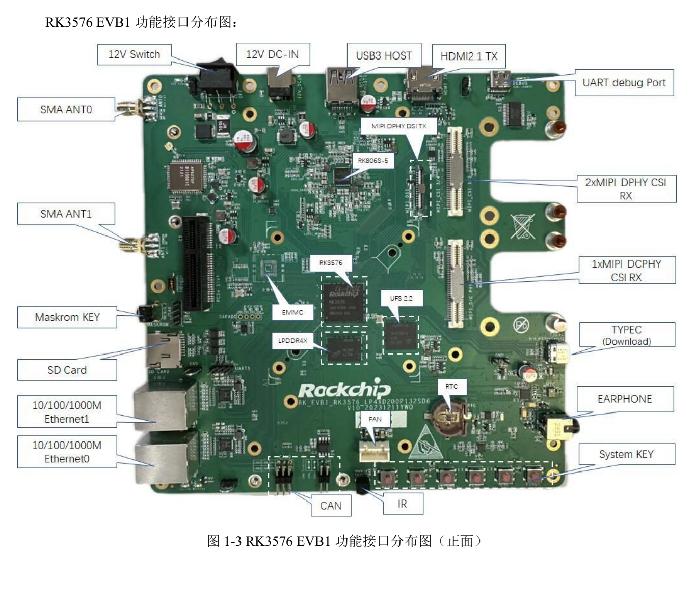
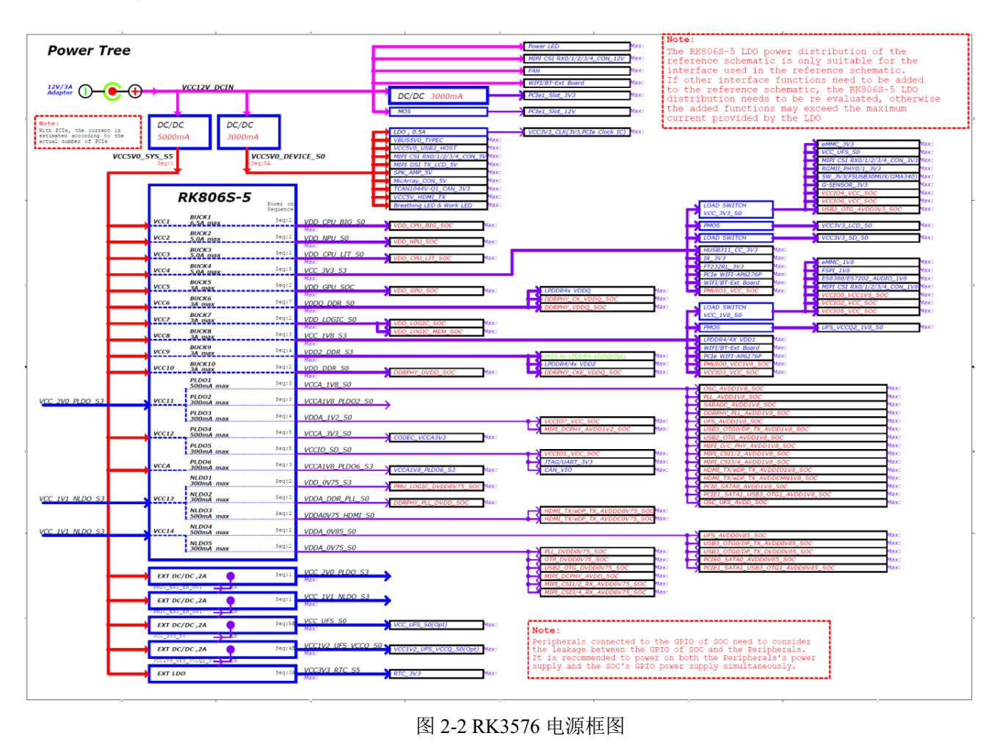

本文按选型和调试任务解读原稿，保留关键参数、边界和原图；不是逐页翻译或完整引脚／寄存器手册。原厂示例不是 ArmSoM 实测。应用前须核对具体板卡版本、原理图、SDK/BSP、内核及驱动；本文未新增硬件验证。

**主要资料：** `Rockchip_RK3576_EVB1_User_Guide_V1.0_CN.pdf` · PDF 53 页.

## 先确认参考板版本

原稿对应 `RK_EVB1_RK3576_LP4XD200P132SD6_V10_20231211YWQ_final`，功能表列 8GB LPDDR4x、128GB UFS、eMMC 为 N/A，套件电源 12V/3A。这是 EVB1 配置，不是 CM5 或 Sige5 配置。两款 ArmSoM 产品均为 RK3576 平台，迁移时仍须使用各自原理图和 BSP。


[](/assets/hardware-reference-20261110/rk3576-evb-p12.png)

*RK3576 EVB1 系统框图 — 中文原图；本批未找到对应英文图. `Rockchip_RK3576_EVB1_User_Guide_V1.0_CN.pdf`, PDF p. 12.*


## 认清端口后再上电

参考板主 Type-C 同时承担下载和 DP Alt Mode；另一个 Type-C 是 USB-UART Debug。将调试端口接 PC 后先确认 COM 号，原稿串口速率为 `1500000`（1.5M）。使用支持该速率的串口适配路径，保存从复位开始的完整日志。


[](/assets/hardware-reference-20261110/rk3576-evb-p14.png)

*RK3576 EVB1 接口布局 — 中文原图；本批未找到对应英文图. `Rockchip_RK3576_EVB1_User_Guide_V1.0_CN.pdf`, PDF p. 14.*


## Loader、MASKROM 与 USB3 下载

1. 确认镜像、Loader、Parameter、Uboot 与 EVB 存储及板级版本匹配，并备份数据。
2. 参考板进入 MASKROM：连接下载 Type-C，按住 MASKROM，上电并打开开关；工具显示 MASKROM 后释放。
3. Loader：按住 Volume+(RECOVERY) 后上电或复位；识别 Loader 后释放。原稿对应 `SARADC_IN1` 的低电平条件。
4. 原稿要求工具 v3.28 及以上。USB3 下载在 `config.ini` 中配置以下项；是否切到 USB3 还取决于设备端支持。

```ini
USB3_TRANSFER=TRUE
```

这段配置是原稿示例，不适用于所有软件版本。CM5/Sige5 的按键、供电和下载接口应查产品文档，不能直接照搬 EVB 的 12V 步骤。

## 三个常见接口误判

**PCIe 插槽外形不等于链路宽度。** 原稿描述标准 PCIex4 金手指接口，功能表写实际 1 lane，并注明与 USB3.0 Host 互选。规划扩展卡前核对供电、有效 lane、PHY 与 BSP，不能按 x4 外形估算吞吐。

**相机连接器不代表任意模组即插即用。** 资料给出 DCPHY 与 DPHY 接入、80pin 座子和 IMX415 示例。概述写 DCPHY 为 1×3 trios CPHY，而后文出现不同表述；优先依据具体原理图和正式芯片资料确认模式，不叠加接口数量。供电、reset、时钟、I2C 和驱动需同时匹配。

**USB 待机唤醒需要硬件供电条件。** 第 30 页列多组电阻换位，涉及 Host 5V、USB PHY 和振荡器持续供电。这不是单改软件属性就能保证的功能。任何电阻位号都只属于所列 EVB 修订。


[](/assets/hardware-reference-20261110/rk3576-evb-p23.png)

*RK3576 EVB1 电源树 — 中文原图；本批未找到对应英文图. `Rockchip_RK3576_EVB1_User_Guide_V1.0_CN.pdf`, PDF p. 23.*


## I2C 电平与地址选例

| EVB 总线 | 器件 | 原稿地址 | 电平 |
| --- | --- | --- | --- |
| I2C1_M0 | RK806S-5 | `0x23` | 1.8V |
| I2C2_M0 | HYM8563TS / HUSB311 | `0x51` / `0x4E` | 3.3V |
| I2C3_M0 | ES8388 / ES7202 | `0x11` / `0x30` | 1.8V |
| I2C4_M3 | CAM0 | `0x1A` | 1.8V |

这些是第 23 页的已知项节选。其他相机、触摸和 MicArray 项有 `TBD`，不要替它们编造地址。增加外设前检查冲突、上拉电源与休眠时的反向供电。

## 调试与迁移检查表

手册注明 SD 卡插入时不能使用 JTAG，CAN 也标有与 SD Card 的复用条件。风扇章节列 12V/5V 支持、默认 12V，并写 EVB1 暂不支持 Sensor 调速；不要把接口存在当成闭环转速控制已完成。

若运行带 ADB 的镜像，可用原稿中的只读连接检查：

```sh
adb devices
adb shell
```

随后按电源、下载、串口、存储、显示、网络、相机的顺序验证，再测试并发与休眠恢复。CM5 载板与 Sige5 整板采用各自的引脚、存储、固件和电源条件；EVB 资料提供的是排查方法。


## 产品与开发资料

- **CM5** — [产品页](https://www.armsom.org/cm5) · [官方文档](https://docs.armsom.org/armsom-cm5)
- **Sige5** — [产品页](https://www.armsom.org/sige5) · [官方文档](https://docs.armsom.org/armsom-sige5)
