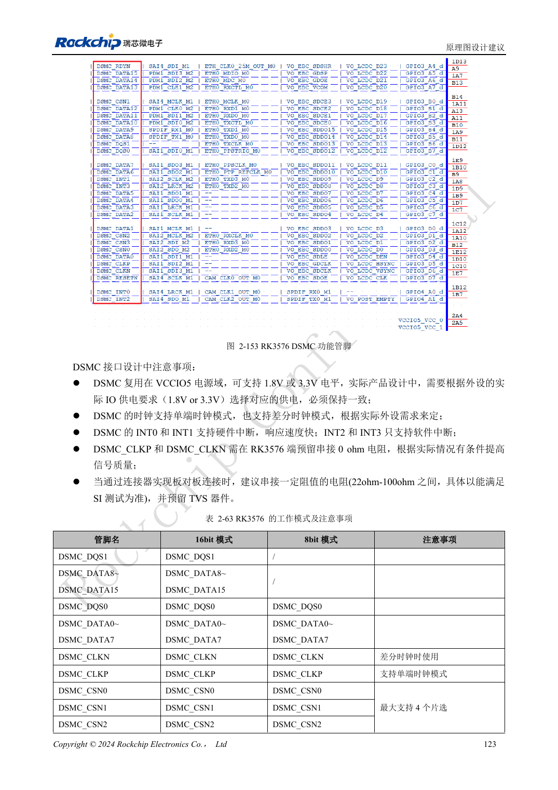

<!-- rk3576-hardware-v11-rest-20261109 -->

# RK3576 FlexBus 与 DSMC：FPGA、PSRAM 和并行接口布线

本文基于 RK3576 Hardware Design Guide V1.1（2024-05-28）的中英文原稿，面向芯片主板设计。CM5 载板请以模块接口定义为准；Sige5 可用于建立软件和外设基线。指南没有限定一个可通用于所有产品的 SDK/BSP 或内核版本，实际适配需逐板核对。参数为原稿参考，不是 ArmSoM 实测。

**RK3576_Hardware_Design_Guide_V1.1_20240528_CN.pdf** · §2.3.11–12; DSMC/FlexBus PCB

## 先区别两种总线

FlexBus0 支持发送或接收，FlexBus1 仅接收，提供 2/4/8/16bit 模式，参考最高时钟 100MHz。DSMC 面向 DDR PSRAM 或 FPGA，支持 8/16bit、四个片选和最高 100MHz 时钟。不能仅看位宽相同就互换控制器；对端协议、采样边沿和软件支持需要对应。

## IO 域与数据打包

FlexBus 主要使用 VCCIO5，扩展引脚涉及 VCCIO2，两域使用时电平必须匹配。非标准位宽在内存中可能按更宽单位打包，例如 3bit 按 4bit、5/6/7bit 按 8bit，不能直接用引脚宽度推导缓冲区布局。DSMC 位于 VCCIO5；INT0/1 有硬件路径，INT2/3 使用软件处理，时延预算需区分。

## 按拓扑检查分支

DSMC 不只是总长限制：L2/L3 小于 500mil，L4 小于 1inch，L5 小于 100mil；L1 加相应主分支小于 5inch，T 分支差小于 100mil。保留原图的 L1–L5 定义，不能换一个拓扑后仍沿用数字。验证固定图样、边界长度与持续传输，排查位序、时钟边沿和缓存打包错误。

## 设计参数与检查表

| 项目 | 原稿参考值 |
| --- | --- |
| 时钟 | ≤100MHz |
| DSMC Z | 50Ω single / 100Ω differential ±10% |
| DSMC CLK-data | <120mil |
| FlexBus CLK-data | <180mil |
| 主路径长度 | <5inch |

## 参考原图

下图为原稿参考页，包含对应电路图或时序图；点击可查看大图。位号和元件值属于参考设计，不是 ArmSoM 产品原理图。

中文原稿 · PDF 143 · 2-153

## ArmSoM 开发路径

CM5 可用于定制载板，减少计算核心的重复设计；Sige5 可作为软件与外设验证起点。接口是否引出、连接器针脚、电平和镜像支持必须查对应板卡资料，不能从芯片功能直接推断。

- [ArmSoM CM5](https://www.armsom.org/cm5) · [CM5 Docs](https://docs.armsom.org/armsom-cm5)
- [ArmSoM Sige5](https://www.armsom.org/sige5) · [Sige5 Docs](https://docs.armsom.org/armsom-sige5)

## 继续阅读

- [RK3576 硬件设计系列：30 个主题](/zh/articles/rk3576-hardware-design-series/)
- [RK3576 工业控制接口：UART、I2C/I3C、SPI、CAN 与 PWM](/zh/articles/rk3576-industrial-control-interfaces/)
- [RK3576 PCB 叠层与扇出：六层、八层和混合球距 BGA](/zh/articles/rk3576-pcb-stackup-fanout/)
