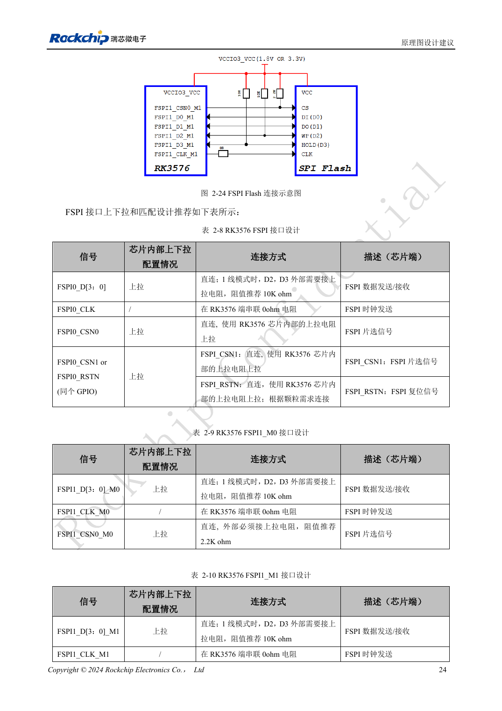
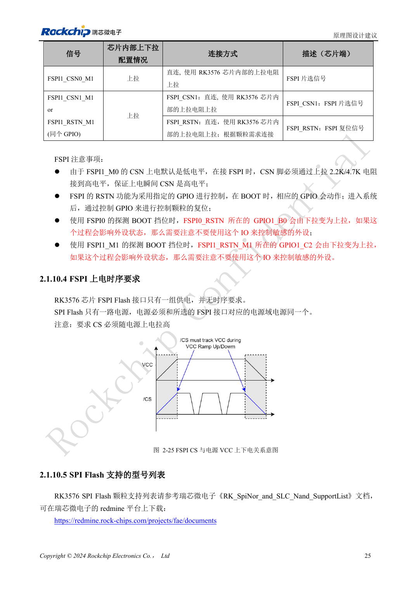

<!-- rk3576-hardware-v11-rest-20261109 -->

# RK3576 FSPI 启动电路：NOR/NAND、电压与片选默认状态

本文基于 RK3576 Hardware Design Guide V1.1（2024-05-28）的中英文原稿，面向芯片主板设计。CM5 载板请以模块接口定义为准；Sige5 可用于建立软件和外设基线。指南没有限定一个可通用于所有产品的 SDK/BSP 或内核版本，实际适配需逐板核对。参数为原稿参考，不是 ArmSoM 实测。

**RK3576_Hardware_Design_Guide_V1.1_20240528_CN.pdf** · §2.1.10; FSPI PCB

## 先选控制器与整组复用

两组 FSPI 支持 NOR/NAND 和 SDR 1/2/4 线。FSPI0 与 eMMC 共享管脚，VCCIO0 只能是 1.8V。FSPI1_M0 位于 VCCIO1，M1 位于 VCCIO3，可按整个 IO 域选择 1.8V 或 3.3V。不能把不同复用组的 CLK、CS 和数据拼成一组。

## 上电时片选必须可靠

单线模式的 D2/D3 使用外部 10kΩ 上拉。FSPI1_M0 的 CSN 默认下拉，必须外部上拉：表格给出 2.2kΩ，正文给出 2.2kΩ/4.7kΩ，按当前参考 BOM 与时序确认。Flash 电源应与 IO 域一致，CS 随电源拉高。启动探测会改变 GPIO1_B0、GPIO1_C2 的上下拉，不宜把敏感使能信号接到这些脚。

## 时钟与可恢复性一起验证

CLK 预留 SoC 端 0Ω 串阻，布线按 50Ω 单端、时钟与数据差小于 200mil、总长小于 4inch 检查。保留独立 USB 恢复入口，测试空白 Flash、损坏镜像、擦写后掉电与正常冷启动，不能只验证一次成功下载。

## 设计参数与检查表

| 项目 | 原稿参考值 |
| --- | --- |
| FSPI0 | VCCIO0 = 1.8V |
| FSPI1_M0 / M1 | VCCIO1 / VCCIO3 |
| Z | 50Ω ±10% |
| CLK ↔ DATA | <200mil |
| 走线长度 | <4inch |

## 参考原图

下图为原稿参考页，包含对应电路图或时序图；点击可查看大图。位号和元件值属于参考设计，不是 ArmSoM 产品原理图。

中文原稿 · PDF 44 · 2-24

中文原稿 · PDF 45 · 2-25

## ArmSoM 开发路径

CM5 可用于定制载板，减少计算核心的重复设计；Sige5 可作为软件与外设验证起点。接口是否引出、连接器针脚、电平和镜像支持必须查对应板卡资料，不能从芯片功能直接推断。

- [ArmSoM CM5](https://www.armsom.org/cm5) · [CM5 Docs](https://docs.armsom.org/armsom-cm5)
- [ArmSoM Sige5](https://www.armsom.org/sige5) · [Sige5 Docs](https://docs.armsom.org/armsom-sige5)

## 继续阅读

- [RK3576 硬件设计系列：30 个主题](/zh/articles/rk3576-hardware-design-series/)
- [RK3576 UFS 硬件设计：颗粒兼容、电源顺序与高速差分线](/zh/articles/rk3576-ufs-hardware-design/)
- [RK3576 SD 卡与 SDIO Wi-Fi：电压切换、供电控制和射频布局](/zh/articles/rk3576-sdio-wifi-hardware/)
