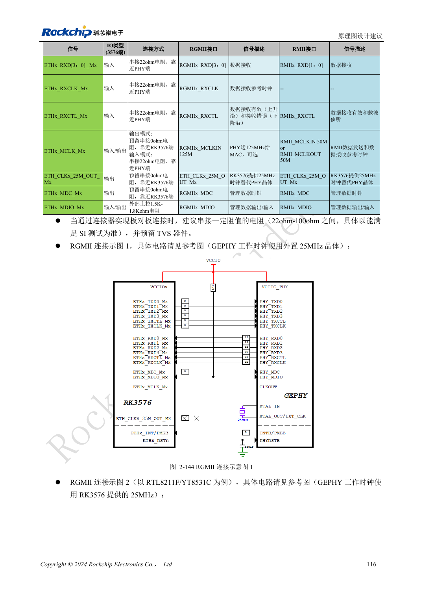
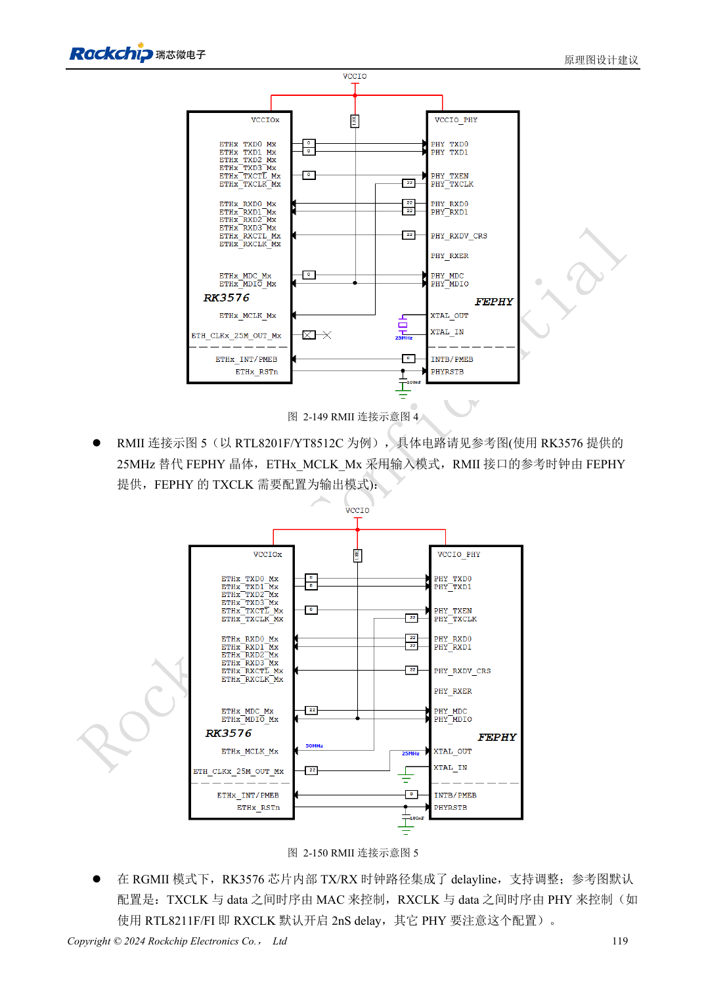

<!-- rk3576-hardware-v11-rest-20261109 -->

# RK3576 以太网硬件：RGMII 延时、PHY 时钟与网口保护

本文基于 RK3576 Hardware Design Guide V1.1（2024-05-28）的中英文原稿，面向芯片主板设计。CM5 载板请以模块接口定义为准；Sige5 可用于建立软件和外设基线。指南没有限定一个可通用于所有产品的 SDK/BSP 或内核版本，实际适配需逐板核对。参数为原稿参考，不是 ArmSoM 实测。

**RK3576_Hardware_Design_Guide_V1.1_20240528_CN.pdf** · §2.3.10

## MAC 需要外置 PHY

两个 GMAC 可连接 RGMII 10/100/1000Mbps 或 RMII 10/100Mbps PHY。GMAC0 的 M0/M1 分别位于 VCCIO5/VCCIO4；GMAC1 的 M0/M1 位于 VCCIO4/VCCIO3。每个接口选择完整一组，优先匹配 1.8V 以改善信号质量，但具体 PHY 必须支持该电平。

## 时钟方向与延时只设置一次

RMII 的 50MHz 可由 MAC 或 PHY 提供，配置必须与原理图一致，不能两端都输出。RGMII 参考方案 TX 时序由 MAC 控制，RX 时序由 PHY 控制；RTL8211F/FI 示例开启 RXCLK 2ns 延时。更换 PHY 后要重新检查内部延时与设备树，不能重复加延时。TX 预留 SoC 端 0Ω，RX 使用 PHY 端 22Ω，MDIO 上拉 1.5–1.8kΩ。

## 连接器一侧同样决定稳定性

RTL8211F/FI 复位脚按原稿为 3.3V，保留近端 100nF；不能根据 RGMII 的 1.8V 推断复位电平。磁性器件中心抽头按 PHY 厂商要求，RJ45 上下扣方向会改变引脚对应。验证不同速率、双口并发、长线缆、重启和待机恢复，统计错误包而不只看链路灯。

## 设计参数与检查表

| 项目 | 原稿参考值 |
| --- | --- |
| RMII 参考时钟 | 50MHz |
| PHY 晶体参考 | 25MHz, ±20ppm |
| MDIO 上拉 | 1.5–1.8kΩ |
| RX 串阻 | 22Ω at PHY |
| RTL8211F/FI RX 延时示例 | 2ns |

## 参考原图

下图为原稿参考页，包含对应电路图或时序图；点击可查看大图。位号和元件值属于参考设计，不是 ArmSoM 产品原理图。

中文原稿 · PDF 136 · 2-144

中文原稿 · PDF 139 · 2-149

## ArmSoM 开发路径

CM5 可用于定制载板，减少计算核心的重复设计；Sige5 可作为软件与外设验证起点。接口是否引出、连接器针脚、电平和镜像支持必须查对应板卡资料，不能从芯片功能直接推断。

- [ArmSoM CM5](https://www.armsom.org/cm5) · [CM5 Docs](https://docs.armsom.org/armsom-cm5)
- [ArmSoM Sige5](https://www.armsom.org/sige5) · [Sige5 Docs](https://docs.armsom.org/armsom-sige5)

## 继续阅读

- [RK3576 硬件设计系列：30 个主题](/zh/articles/rk3576-hardware-design-series/)
- [RK3576 音频硬件：SAI、PDM、ASRC 与麦克风布局](/zh/articles/rk3576-audio-hardware-design/)
- [RK3576 GPIO 与 SARADC：电源域、反向供电和按键采样](/zh/articles/rk3576-gpio-saradc-hardware/)
