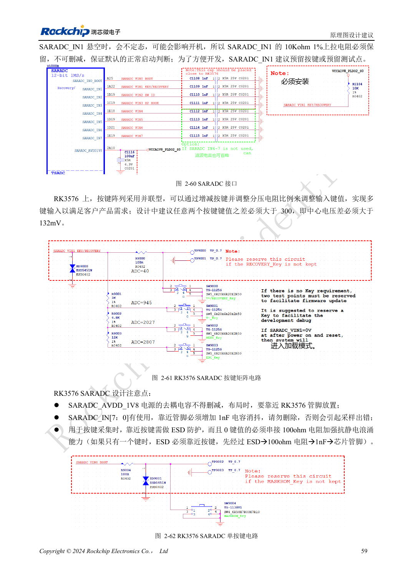

<!-- rk3576-hardware-v11-rest-20261109 -->

# RK3576 GPIO 与 SARADC：电源域、反向供电和按键采样

本文基于 RK3576 Hardware Design Guide V1.1（2024-05-28）的中英文原稿，面向芯片主板设计。CM5 载板请以模块接口定义为准；Sige5 可用于建立软件和外设基线。指南没有限定一个可通用于所有产品的 SDK/BSP 或内核版本，实际适配需逐板核对。参数为原稿参考，不是 ArmSoM 实测。

**RK3576_Hardware_Design_Guide_V1.1_20240528_CN.pdf** · §2.1.11; §2.3.2

## GPIO 电平属于整个 IO 域

PMUIO0、VCCIO0 固定 1.8V；VCCIO7 在 UFS 应用为 1.2V，否则按指南为 1.8V。PMUIO1 与 VCCIO1–6 支持 1.8/3.3V。给一个引脚选择不同功能，不会让同域其它引脚获得另一种电压。上下拉后缀 _u/_d/_z 分别表示上拉、下拉、高阻，需结合启动探测与休眠状态检查。

## 关机与待机都要防反灌

指南支持核心断电、IO 保持供电的保持场景，但不支持核心和 IO 都断电时的 fail-safe 输入。外设仍供电时不能直接把高电平灌入已关闭 IO。不同电源的上拉归属、使能顺序和隔离器件需一起审查；驱动强度应查具体引脚，不把所有 GPIO 当作同一种电流驱动能力。

## SARADC 按键与启动用途

SARADC 为 12bit、最高 1MS/s、八路 0–1.8V 输入。IN0 用于启动配置，IN1 用于恢复按键，即使无按键也需 10kΩ、1% 上拉。按键档位差建议大于 300 个计数或 132mV，使用近端 1nF 滤波。参考保护拓扑为接口→ESD→100Ω→1nF→芯片，不能把 3.3V 信号直接送入 ADC。

## 设计参数与检查表

| 项目 | 原稿参考值 |
| --- | --- |
| SARADC | 12bit; 0–1.8V |
| IN1 上拉 | 10kΩ ±1% |
| 按键档位差 | >300 counts / >132mV |
| 滤波电容 | 1nF |

## 参考原图

下图为原稿参考页，包含对应电路图或时序图；点击可查看大图。位号和元件值属于参考设计，不是 ArmSoM 产品原理图。

中文原稿 · PDF 79 · 2-61

## ArmSoM 开发路径

CM5 可用于定制载板，减少计算核心的重复设计；Sige5 可作为软件与外设验证起点。接口是否引出、连接器针脚、电平和镜像支持必须查对应板卡资料，不能从芯片功能直接推断。

- [ArmSoM CM5](https://www.armsom.org/cm5) · [CM5 Docs](https://docs.armsom.org/armsom-cm5)
- [ArmSoM Sige5](https://www.armsom.org/sige5) · [Sige5 Docs](https://docs.armsom.org/armsom-sige5)

## 继续阅读

- [RK3576 硬件设计系列：30 个主题](/zh/articles/rk3576-hardware-design-series/)
- [RK3576 以太网硬件：RGMII 延时、PHY 时钟与网口保护](/zh/articles/rk3576-gmac-hardware-design/)
- [RK3576 工业控制接口：UART、I2C/I3C、SPI、CAN 与 PWM](/zh/articles/rk3576-industrial-control-interfaces/)
