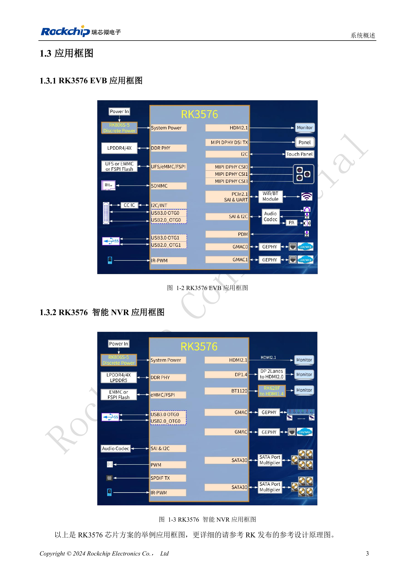

# RK3576 硬件设计入门：最小系统与首次上电检查

## 适用范围与资料

本篇为围绕工程问题编写的专题导读，不是整本 PDF 的逐页翻译。原文示例不代表 ArmSoM 实测；具体电压、引脚、SDK/BSP 和内核应按实际板卡版本核对。

**Rockchip:** `RK3576_Hardware_Design_Guide_V1.1_20240528_CN.pdf` · V1.1 · §2.1, §2–3

## 从最小系统开始

RK3576 硬件设计指南 V1.1 的第 2.1 节依次讨论时钟、复位、引导、JTAG、UART 和存储。第一次调试不必同时接入摄像头、显示器和高速外设。先建立一套能重复启动、输出串口日志、进入恢复模式的最小配置，再逐项增加负载。这样每次出现异常时，都能知道最近改变了什么。

在自研芯片主板上，DDR、供电和时钟属于最小系统；使用 CM5 时，应从模块接口与配套载板资料出发，避免把芯片内部电源轨当作模块输入。Sige5 可用于应用与外设验证，但不能替代自研板的电气验证。

## 首次上电的五道检查

| 检查项 | 上电前 | 上电后保留的证据 |
| --- | --- | --- |
| 电源 | 按实际 BOM 核对电压、极性、短路与限流设置 | 输入电流、各电源轨及启动瞬态 |
| 时钟 | 核对晶体、负载网络与 PCB | 使用适合的探测方法检查频率与波形 |
| 复位 | 核对电源域、上下拉和复位源 | 电源稳定与复位释放的相对时间 |
| 启动 | 确认介质、配置电阻、Loader 和板卡版本 | 从 BootROM/Loader 到内核的完整日志 |
| 调试 | 保留 UART、恢复和必要测试点 | 冷启动、重启与失败恢复的可重复结果 |

原稿 §2.1.1 以外部 24MHz 晶体说明主时钟电路；这不是要求在 CM5 载板再增加同样的晶体。复位电平和调试串口电平也应按对应网络的电源域核对，不能套用其他开发板的默认设置。

## 启动异常如何缩小范围

没有串口输出时，先检查适配器电平、公共地、TX/RX、波特率与供电复位，而不是立即更换系统镜像。已有 Loader 日志却无法进入内核时，再检查 DDR 初始化、启动介质、镜像和设备树是否属于同一硬件版本。内核起来后外设失效，应分别核对接口供电、引脚复用、时钟与驱动。

每轮只改变一个变量，并记录原理图版本、模块版本、镜像校验值和日志。启动成功之后，还需要重复冷启动、掉电恢复和负载测试；单次启动不能作为量产放行依据。

## 在 ArmSoM 上落实

用 CM5 开发定制设备时，先以配套 IO 板建立软件基线，再迁移到自己的载板。用 Sige5 评估应用时，记录外设型号、线缆和供电条件，方便后续复现。本文提供调试方法，没有给出未经验证的通用电压表，也不代替具体硬件的设计审查。

## 原文配图

中文稿原图。 参考设计，不是 ArmSoM 板卡原理图。

`RK3576_Hardware_Design_Guide_V1.1_20240528_CN.pdf` · PDF p. 23.

## 相关产品与开发资料

- **CM5** — [产品页面](https://www.armsom.org/cm5) · [开发文档](https://docs.armsom.org/armsom-cm5)
- **Sige5** — [产品页面](https://www.armsom.org/sige5) · [开发文档](https://docs.armsom.org/armsom-sige5)

## 继续阅读本系列

- [ArmSoM CM5 载板设计检查表：供电、启动与接口规划](/zh/articles/019-cm5-carrier-production/)
- [RK3576 高速接口设计：原理图与 PCB 如何配合检查](/zh/articles/rk3576-high-speed-interface-design/)
- [RK3588S 硬件设计指南：从芯片参考设计到 CM7s 载板](/zh/articles/rk3588s-cm7s-carrier-design/)
- [RK3588 边缘 AI 设备设计：供电、散热与扩展接口规划](/zh/articles/rk3588-edge-ai-hardware-design/)
- [RK3588 高速 PCB 设计：叠层、阻抗与布线检查](/zh/articles/rk3588-high-speed-pcb-review/)
- [RK3506 工业 HMI 硬件设计：结合 CM1 与 Forge1 选择开发路径](/zh/articles/rk3506-industrial-hmi-hardware/)
- [RK3308 系列芯片差异与兼容检查：P2 Pro 音频项目参考](/zh/articles/rk3308-hardware-variant-compatibility/)
- [RK3588S 与 RK3588S2 有什么区别？改版前需要核对什么](/zh/articles/rk3588s-rk3588s2-hardware-differences/)
- [Rockchip 设备从样机到量产：工艺要求与测试清单](/zh/articles/rockchip-hardware-production-checklist/)

<!-- rk3576-hardware-v11-deep-20261109 -->

## RK3576 最小系统与首次上电：从原理图检查到可重复启动

最小系统的目标不是点亮一次，而是能够重复冷启动、获得完整日志并可靠恢复。先建立供电、时钟、复位、DDR、启动介质与调试通道的闭环，再接入显示、摄像头和高速外设。下面补充设计指南中的具体约束。

本文基于 RK3576 Hardware Design Guide V1.1（2024-05-28）的中英文原稿，面向芯片主板设计。CM5 载板请以模块接口定义为准；Sige5 可用于建立软件和外设基线。指南没有限定一个可通用于所有产品的 SDK/BSP 或内核版本，实际适配需逐板核对。参数为原稿参考，不是 ArmSoM 实测。

**RK3576_Hardware_Design_Guide_V1.1_20240528_CN.pdf** · §2.1–2.2

## 先区分芯片主板与模块载板

自研 RK3576 主板需要完成内部电源域、DDR 和 PMIC 设计；CM5 载板应按模块输入电源、连接器和信号定义设计，不能把芯片内部电压直接施加到模块引脚。Sige5 适合作为软件和外设基线，不能证明另一块 PCB 的电气设计正确。

## 按失败阶段定位

完全没有 UART 输出时，先核对公共地、电平、TX/RX、1500000bps 默认设置、24MHz 和 RESET_L；有 Loader 日志但 DDR 初始化失败时核对颗粒、布局模板和 DDR 固件；已进入内核才出错时，再核对设备树、电源、时钟和引脚复用。每次只改一个变量，并保留失败日志。

## 把验证变成可复现记录

记录 PCB/BOM 版本、镜像校验值、Loader/DDR 固件、SDK/BSP、内核、输入电源及外设。用同一探测参考点保存电源和复位波形，并验证冷启动、软件重启、异常断电和恢复下载。本文未对 ArmSoM 硬件执行这些测试，也不为不同板卡设定统一通过次数。

## 设计参数与检查表

| 项目 | 数值或网络 | 核对说明 |
| --- | --- | --- |
| 主时钟 | 24MHz | 核对晶体与负载，不把参考电容视为通用值 |
| 复位释放 | ≥1ms | 最后一路电源稳定后的要求，区别于复位脉宽 |
| 恢复入口 | USB2_OTG0_DP/DM + VBUSDET | 即使只做 Host 产品也保留 |
| DDR 地址/数据 | DQ/CA | 不支持任意交换，按模板与颗粒定义 |

## 参考电路与原图

下图为原稿参考页，包含对应电路图或时序图；点击可查看大图。位号和元件值属于参考设计，不是 ArmSoM 产品原理图。

中文原稿 · PDF 23 · 1-2 / 1-3

## ArmSoM 产品与开发路径

CM5 适合把已集成的计算模块用于定制载板，Sige5 适合先验证 Linux 软件和外设。芯片具备某接口，不代表两款产品都把该接口引出；购买或布板前按连接器定义、板卡版本与系统镜像核对。

- [ArmSoM CM5](https://www.armsom.org/cm5) · [CM5 Docs](https://docs.armsom.org/armsom-cm5)
- [ArmSoM Sige5](https://www.armsom.org/sige5) · [Sige5 Docs](https://docs.armsom.org/armsom-sige5)

## 系列阅读顺序

- [RK3576 硬件设计系列：从最小系统到 DDR 与 USB](/zh/articles/rk3576-hardware-design-series/)
- [RK3576 时钟电路设计：24MHz 晶体、32kHz 待机与外设时钟](/zh/articles/rk3576-clock-circuit-design/)
- [RK3576 复位设计：NPOR、RK806S-5、看门狗与过温保护](/zh/articles/rk3576-reset-watchdog-design/)
- [RK3576 启动与调试设计：Boot 配置、Maskrom、UART 和 JTAG](/zh/articles/rk3576-boot-debug-design/)
- [RK3576 电源域与去耦：CPU、GPU、NPU 和 LOGIC 供电规划](/zh/articles/rk3576-power-domain-design/)
- [RK3576 与 RK806S-5：PMIC 选型、控制引脚和反馈设计](/zh/articles/rk3576-rk806s5-pmic-design/)
- [RK3576 电源时序与待机：复位释放、保留电源和唤醒路径](/zh/articles/rk3576-power-sequencing-standby/)
- [RK3576 DDR 电路与供电：LPDDR4、LPDDR4X 和 LPDDR5 的区别](/zh/articles/rk3576-ddr-circuit-power/)
- [RK3576 DDR PCB 布线：阻抗、长度、回流与 PDN 检查](/zh/articles/rk3576-ddr-pcb-routing/)
- [RK3576 USB 与 Type-C 硬件补充：复用、下载入口和保护器件](/zh/articles/168-rockchip-rk3576-usb/)
