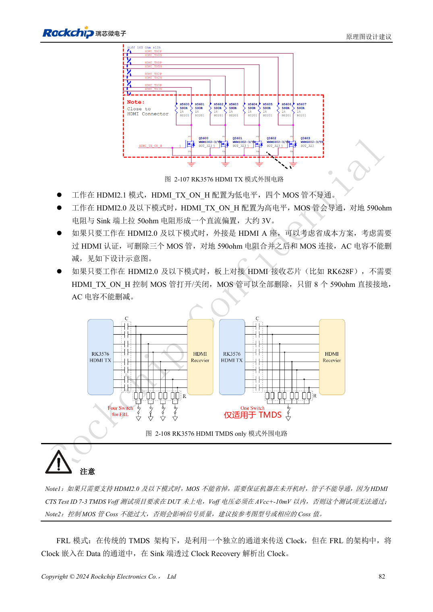
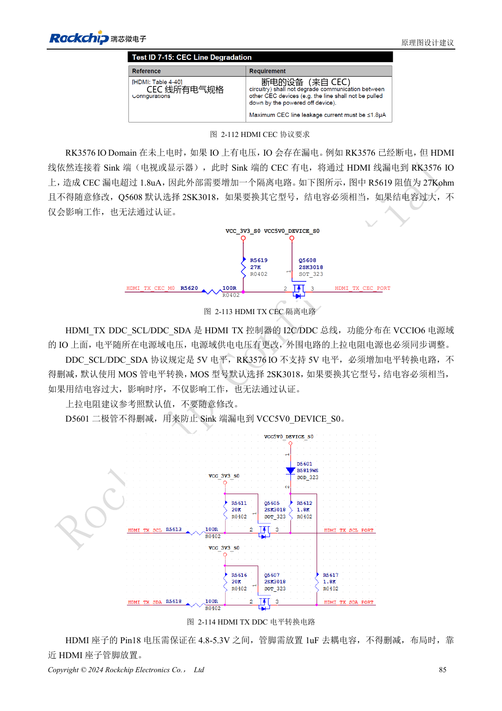

<!-- rk3576-hardware-v11-rest-20261109 -->

# RK3576 HDMI 硬件：FRL/TMDS、DDC 电平与保护器件

本文基于 RK3576 Hardware Design Guide V1.1（2024-05-28）的中英文原稿，面向芯片主板设计。CM5 载板请以模块接口定义为准；Sige5 可用于建立软件和外设基线。指南没有限定一个可通用于所有产品的 SDK/BSP 或内核版本，实际适配需逐板核对。参数为原稿参考，不是 ArmSoM 实测。

**RK3576_Hardware_Design_Guide_V1.1_20240528_CN.pdf** · §2.3.8.1; HDMI PCB

## 共享 PHY 与输出模式

HDMI 与 eDP 共用 PHY，不能把同一个 PHY 同时配置成两种输出。HDMI 2.1 使用 FRL，兼容较低版本时使用 TMDS。HDMI/EDP_TX_REXT 的 8.2kΩ、1% 接地电阻靠近 SoC，不能随意改值。高速通道使用 220nF 耦合电容，推荐 0201；不能沿用其它 HDMI 芯片的直连方案。

## TMDS 偏置与 DDC 保护

HDMI_TX_ON_H 在 FRL 时低、TMDS 时高，控制参考 MOS 与 590Ω 偏置网络。外接 Type-A 与板内接收器是不同场景，原稿针对板内 RK628F 的简化不能照搬到外部连接器。DDC 涉及 5V，而 SoC IO 不耐 5V，电平转换与防反灌路径必须保留。CEC、HPD 还要核对所选 IO 域和漏电。

## 整条链路验收

HDMI 供电脚参考范围 4.8–5.3V，连接器端保留 1μF。高速 ESD 电容不大于 0.2pF，其它信号按指南不大于 1pF。走线使用完整地、短残桩，590Ω 焊盘的邻层处理按原图执行。验证热插拔、不同线缆和显示器、模式切换与待机恢复，不能只用单一显示器点亮作为通过依据。

## 设计参数与检查表

| 项目 | 原稿参考值 |
| --- | --- |
| Zdiff | 100Ω ±10% |
| 差分对内长度差 | <6mil |
| 差分对间长度差 | <480mil |
| 走线长度 | <4inch |
| AC | 220nF ±20% |
| 空气间距 | ≥7W |

## 参考原图

下图为原稿参考页，包含对应电路图或时序图；点击可查看大图。位号和元件值属于参考设计，不是 ArmSoM 产品原理图。

中文原稿 · PDF 102 · 2-107

中文原稿 · PDF 105 · 2-113

## ArmSoM 开发路径

CM5 可用于定制载板，减少计算核心的重复设计；Sige5 可作为软件与外设验证起点。接口是否引出、连接器针脚、电平和镜像支持必须查对应板卡资料，不能从芯片功能直接推断。

- [ArmSoM CM5](https://www.armsom.org/cm5) · [CM5 Docs](https://docs.armsom.org/armsom-cm5)
- [ArmSoM Sige5](https://www.armsom.org/sige5) · [Sige5 Docs](https://docs.armsom.org/armsom-sige5)

## 继续阅读

- [RK3576 硬件设计系列：30 个主题](/zh/articles/rk3576-hardware-design-series/)
- [RK3576 屏幕硬件：MIPI、RGB、背光与触摸供电](/zh/articles/rk3576-display-panel-hardware/)
- [RK3576 DP/eDP 设计：PHY 复用、AUX 与耦合电容差异](/zh/articles/rk3576-dp-edp-hardware-design/)
