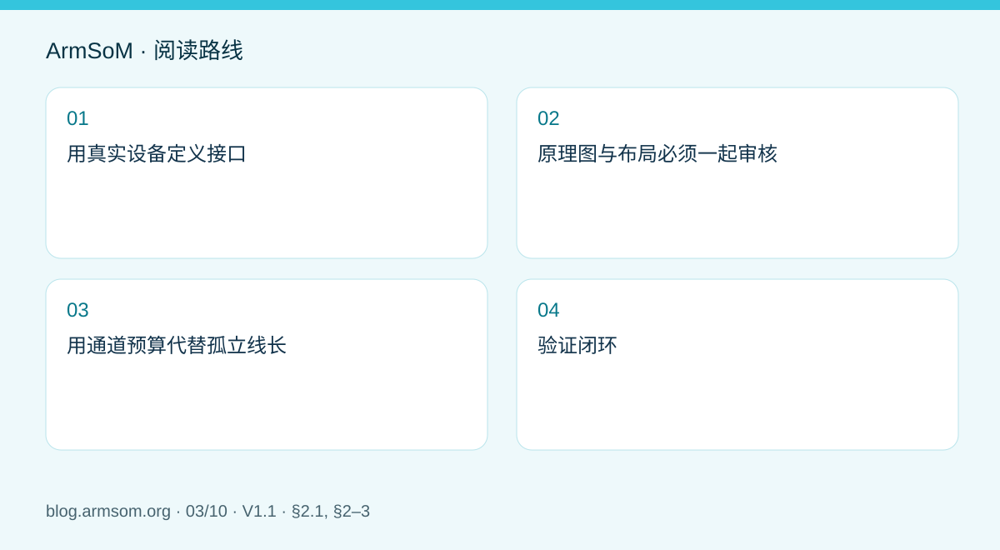
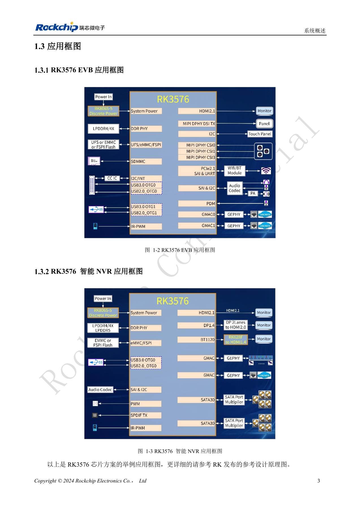
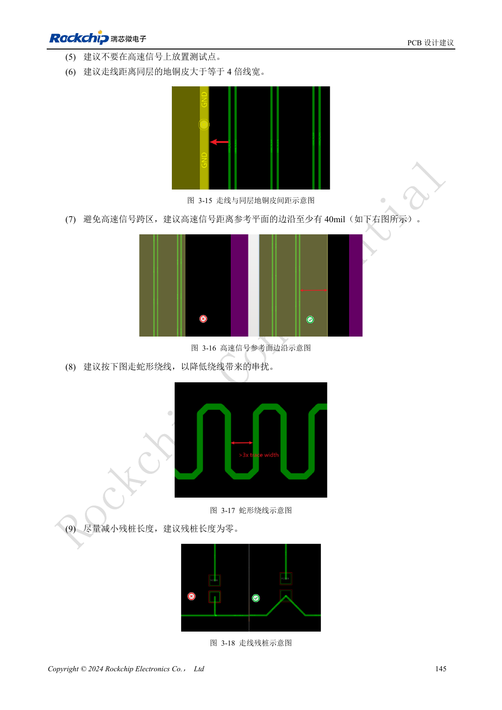
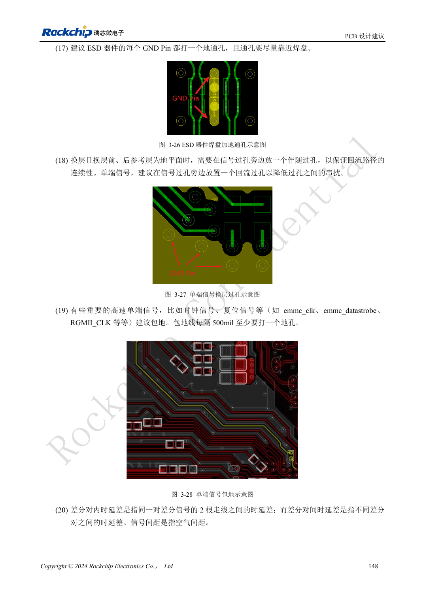

# RK3576 高速接口设计：原理图与 PCB 如何配合检查

## 适用范围与资料

本篇为围绕工程问题编写的专题导读，不是整本 PDF 的逐页翻译。原文示例不代表 ArmSoM 实测；具体电压、引脚、SDK/BSP 和内核应按实际板卡版本核对。

**Rockchip:** `RK3576_Hardware_Design_Guide_V1.1_20240528_CN.pdf` · V1.1 · §2.1, §2–3

## 用真实设备定义接口

原稿 §2.3 描述接口电路，§3.4 讨论 8GT/s 及以上信号，§3.5 给出各模块 PCB 建议。正确的起点是外设型号、目标模式、连接器和线缆，而不是先给所有差分线设置同一个规则。芯片框图列出的资源也不等于模块上全部引出且可同时使用。

规划摄像头、显示、存储和网络时，先列出 PHY 复用、控制总线、电源及软件依赖。使用 CM5 应以模块引脚表核对可用资源；使用 Sige5 应以板卡接口和硬件修订号为准。

## 原理图与布局必须一起审核

| 项目 | 原理图检查 | PCB 检查 |
| --- | --- | --- |
| 差分通道 | 收发方向、耦合位置、保护器件 | 阻抗、参考平面、过孔与焊盘不连续 |
| 外设控制 | 复位、使能、控制总线、电压域 | 与高速线隔离、测试点可达性 |
| 连接器 | 完整料号、引脚和屏蔽接地 | 焊盘、回流路径、插接方向 |
| 供电 | 峰值电流、启动和掉电次序 | 去耦位置、电源回路、热路径 |

原稿特别讨论 BGA 焊盘、玻纤编织效应、差分过孔、耦合电容、ESD 和连接器焊盘优化。这里的挖参考层建议是针对局部寄生参数的设计措施，不是任意切割高速信号下方地平面的通用指令。

## 用通道预算代替孤立线长

从发送端到接收端绘制完整链路，把模块走线、连接器、载板、线缆与外围板一起纳入评估。线长匹配只是其中一项；过孔残桩、参考平面切换和保护器件电容也可能限制裕量。阻抗与长度数值应从对应模式的原文和制造商叠层计算获得，不能跨接口套用。

## 验证闭环

先验证单接口的目标速率与错误日志，再测试相邻接口和真实业务并发。若只在组合负载下失败，同时检查电源瞬态、散热、带宽和驱动配置。保留线缆、外设、BSP 和板卡版本；降低速率可以帮助定位问题，但不能冒充目标速率验收通过。

在 CM5 或 Sige5 上形成可复现的测试组合后，再迁移到定制设备，并重新验证其实际传输通道。

## 原文配图

中文稿原图。 参考设计，不是 ArmSoM 板卡原理图。

`RK3576_Hardware_Design_Guide_V1.1_20240528_CN.pdf` · PDF p. 23.

## 相关产品与开发资料

- **CM5** — [产品页面](https://www.armsom.org/cm5) · [开发文档](https://docs.armsom.org/armsom-cm5)
- **Sige5** — [产品页面](https://www.armsom.org/sige5) · [开发文档](https://docs.armsom.org/armsom-sige5)

## 继续阅读本系列

- [RK3576 硬件设计入门：最小系统与首次上电检查](/zh/articles/rk3576-hardware-bringup/)
- [ArmSoM CM5 载板设计检查表：供电、启动与接口规划](/zh/articles/019-cm5-carrier-production/)
- [RK3588S 硬件设计指南：从芯片参考设计到 CM7s 载板](/zh/articles/rk3588s-cm7s-carrier-design/)
- [RK3588 边缘 AI 设备设计：供电、散热与扩展接口规划](/zh/articles/rk3588-edge-ai-hardware-design/)
- [RK3588 高速 PCB 设计：叠层、阻抗与布线检查](/zh/articles/rk3588-high-speed-pcb-review/)
- [RK3506 工业 HMI 硬件设计：结合 CM1 与 Forge1 选择开发路径](/zh/articles/rk3506-industrial-hmi-hardware/)
- [RK3308 系列芯片差异与兼容检查：P2 Pro 音频项目参考](/zh/articles/rk3308-hardware-variant-compatibility/)
- [RK3588S 与 RK3588S2 有什么区别？改版前需要核对什么](/zh/articles/rk3588s-rk3588s2-hardware-differences/)
- [Rockchip 设备从样机到量产：工艺要求与测试清单](/zh/articles/rockchip-hardware-production-checklist/)

<!-- rk3576-hardware-v11-rest-20261109 -->

## RK3576 高速接口设计：阻抗、回流、残桩与整链路检查

本文基于 RK3576 Hardware Design Guide V1.1（2024-05-28）的中英文原稿，面向芯片主板设计。CM5 载板请以模块接口定义为准；Sige5 可用于建立软件和外设基线。指南没有限定一个可通用于所有产品的 SDK/BSP 或内核版本，实际适配需逐板核对。参数为原稿参考，不是 ArmSoM 实测。

**RK3576_Hardware_Design_Guide_V1.1_20240528_CN.pdf** · §3.3–3.4

## 同样叫差分线，规则也可能不同

PCIe 数据参考 85Ω、PCIe REFCLK 100Ω、eDP 90Ω，DP 专用 100Ω而共享 USB 时参考 95Ω。约束必须按网络类型建立，不能全板设成统一 100Ω。线长统计包含过孔与封装，差分对内匹配和不同对之间匹配是两项不同约束。W 指对应线宽，间距指空气间距，不是中心距。

## 回流连续比漂亮蛇形更重要

高速信号不要跨参考面裂缝，通用建议距参考面边沿至少 40mil；换层时提供伴随地过孔。测试点、连接器和器件焊盘都可能形成残桩或阻抗突变。大焊盘下的局部挖空必须按图和仿真处理，不能误解为把整条差分线下面的地删除。超过 12mil 的过孔尾桩，指南建议评估其 SI 影响。

## 把原理图和 PCB 审核关联起来

串联阻尼按具体接口的信号源方向放置，不能仅凭 TX/RX 名称套统一规则。ESD 靠近入口，并有短而直接的泄放路径。按链路记录 SoC、封装、PCB、保护、连接器、线缆与接收端，完成阻抗计算、必要仿真及样板测试。本文补充已有高速接口文章，原有设计内容保留。

## 设计参数与检查表

| 项目 | 原稿参考值 |
| --- | --- |
| 距参考面边沿 | ≥40mil |
| 过孔尾桩评估条件 | >12mil |
| 时钟串阻距离参考 | ≤400mil |
| Data / REFCLK PCIe | 85Ω / 100Ω |

## 参考原图

下图为原稿参考页，包含对应电路图或时序图；点击可查看大图。位号和元件值属于参考设计，不是 ArmSoM 产品原理图。

中文原稿 · PDF 165 · 3-16

中文原稿 · PDF 168 · 3-27

## ArmSoM 开发路径

CM5 可用于定制载板，减少计算核心的重复设计；Sige5 可作为软件与外设验证起点。接口是否引出、连接器针脚、电平和镜像支持必须查对应板卡资料，不能从芯片功能直接推断。

- [ArmSoM CM5](https://www.armsom.org/cm5) · [CM5 Docs](https://docs.armsom.org/armsom-cm5)
- [ArmSoM Sige5](https://www.armsom.org/sige5) · [Sige5 Docs](https://docs.armsom.org/armsom-sige5)

## 继续阅读

- [RK3576 硬件设计系列：30 个主题](/zh/articles/rk3576-hardware-design-series/)
- [RK3576 PCB 叠层与扇出：六层、八层和混合球距 BGA](/zh/articles/rk3576-pcb-stackup-fanout/)
- [RK3576 电源 PCB 与 PDN：RK806S-5、反馈和大电流回路](/zh/articles/rk3576-power-pcb-pdn-design/)
