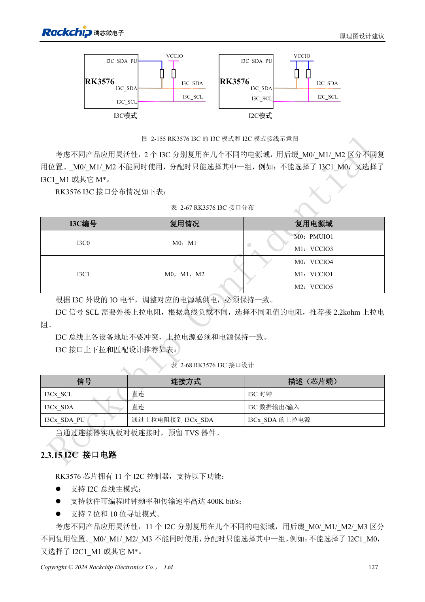
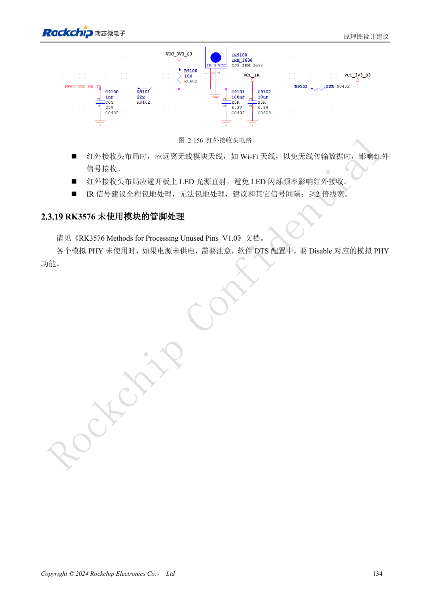

<!-- rk3576-hardware-v11-rest-20261109 -->

# RK3576 工业控制接口：UART、I2C/I3C、SPI、CAN 与 PWM

本文基于 RK3576 Hardware Design Guide V1.1（2024-05-28）的中英文原稿，面向芯片主板设计。CM5 载板请以模块接口定义为准；Sige5 可用于建立软件和外设基线。指南没有限定一个可通用于所有产品的 SDK/BSP 或内核版本，实际适配需逐板核对。参数为原稿参考，不是 ArmSoM 实测。

**RK3576_Hardware_Design_Guide_V1.1_20240528_CN.pdf** · §2.3.13–2.3.18

## 数量之外先检查复用与物理层

指南列出 12 组 UART、5 组通用 SPI、两组 CAN FD 和两组 I3C。UART0_M0 是默认调试口，UART0 不带流控；其它组的 RTS/CTS 也需查具体复用。UART 不是 RS232/RS485 电气接口，CAN TX/RX 也不是可直接接总线的 CAN_H/CAN_L，必须匹配外部收发器和电平。

## I3C 与 I2C 的上拉不同

混合 I3C 使用 SCL、SDA、SDA_PU 三个引脚，SDA 的上拉接 SDA_PU，而不是机械接固定电源；仅作 I2C 使用时采用普通双线外部上拉。参考 I2C 上拉 2.2kΩ，仍需按总线电容验证上升时间。I2C1 用于 PMIC，不应随意挪作外设；SPI 的时钟、数据与片选必须使用同一组复用。

## 控制输出要覆盖开机与休眠

CAN TX 参考外接 4.7kΩ 上拉。PWM 总计 16 通道，但 LOGIC 断电后的红外唤醒限于 PWM0_CH0/1。检查上电默认输出、外设未供电时的反灌和休眠后的恢复。工业端口验收还包括现场线缆、收发器终端和保护，不把控制器可工作等同于整机抗干扰通过。

## 设计参数与检查表

| 项目 | 原稿参考值 |
| --- | --- |
| UART / SPI | 12 / 5 |
| I3C | 2; 12.5Mbit/s |
| I2C 参考 | 400kbit/s; 2.2kΩ |
| CAN TX 上拉 | 4.7kΩ |
| PWM | 2 + 6 + 8 channels |

## 参考原图

下图为原稿参考页，包含对应电路图或时序图；点击可查看大图。位号和元件值属于参考设计，不是 ArmSoM 产品原理图。

中文原稿 · PDF 147 · 2-155

中文原稿 · PDF 154 · 2-156

## ArmSoM 开发路径

CM5 可用于定制载板，减少计算核心的重复设计；Sige5 可作为软件与外设验证起点。接口是否引出、连接器针脚、电平和镜像支持必须查对应板卡资料，不能从芯片功能直接推断。

- [ArmSoM CM5](https://www.armsom.org/cm5) · [CM5 Docs](https://docs.armsom.org/armsom-cm5)
- [ArmSoM Sige5](https://www.armsom.org/sige5) · [Sige5 Docs](https://docs.armsom.org/armsom-sige5)

## 继续阅读

- [RK3576 硬件设计系列：30 个主题](/zh/articles/rk3576-hardware-design-series/)
- [RK3576 GPIO 与 SARADC：电源域、反向供电和按键采样](/zh/articles/rk3576-gpio-saradc-hardware/)
- [RK3576 FlexBus 与 DSMC：FPGA、PSRAM 和并行接口布线](/zh/articles/rk3576-flexbus-dsmc-hardware/)
