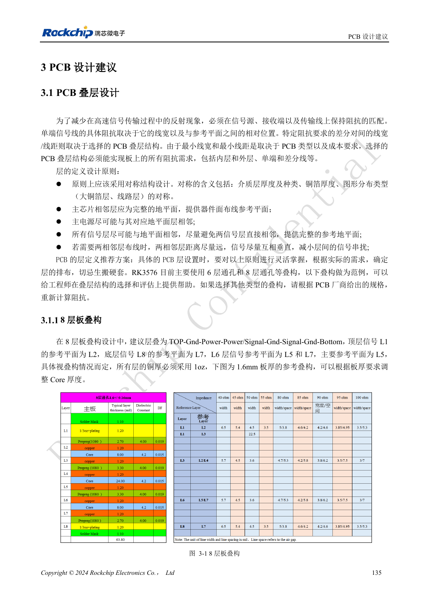
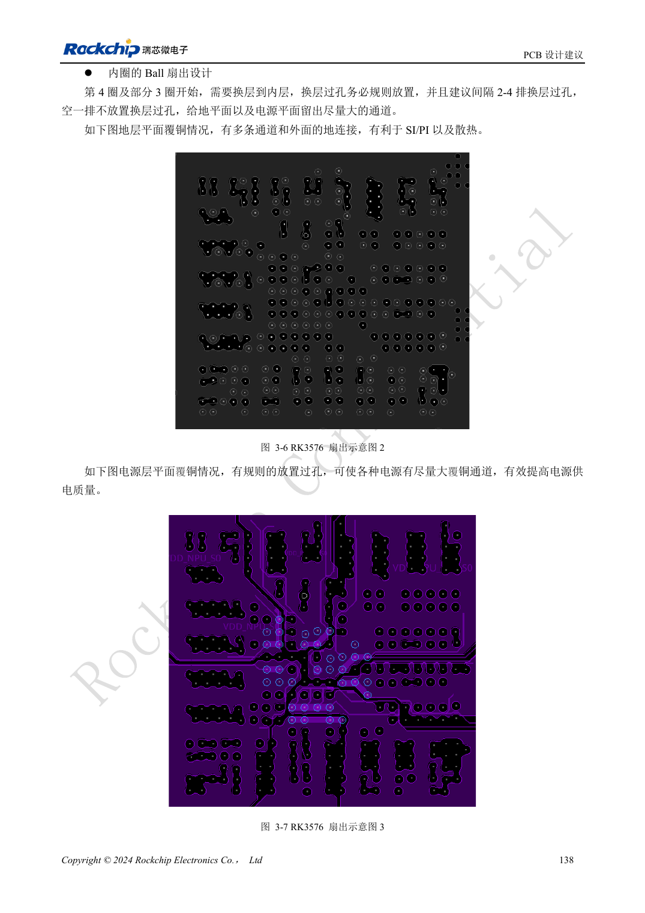

<!-- rk3576-hardware-v11-rest-20261109 -->

# RK3576 PCB 叠层与扇出：六层、八层和混合球距 BGA

本文基于 RK3576 Hardware Design Guide V1.1（2024-05-28）的中英文原稿，面向芯片主板设计。CM5 载板请以模块接口定义为准；Sige5 可用于建立软件和外设基线。指南没有限定一个可通用于所有产品的 SDK/BSP 或内核版本，实际适配需逐板核对。参数为原稿参考，不是 ArmSoM 实测。

**RK3576_Hardware_Design_Guide_V1.1_20240528_CN.pdf** · §3.1–3.2

## 先让叠层满足所有阻抗

指南提供六层、假八层六层与八层参考，不是所有产品都必须复制同一个板厚。介质、铜厚与层分布保持对称，器件面邻层优先完整地，主电源与地相邻。不同板厂材料或板厚会改变线宽线距，必须重新计算内外层单端和差分阻抗，不能直接照搬截图尺寸。

## 混合球距要求局部扇出

RK3576 为 698 ball，混合 0.55/0.60/0.65mm pitch。外侧两圈和部分第三圈可用最小 3.5mil 局部扇出，然后尽快恢复目标阻抗线宽。内圈过孔规则排列，每隔 2–4 排留通道，有利于地与电源连续性。最小线宽是局部制造约束，不是整条高速线的推荐宽度。

## 制造审查与电气审查一起做

八层参考为 TOP-GND-POWER-POWER/SIGNAL-GND-SIGNAL-GND-BOTTOM，1.6mm 和全层 1oz 属于该参考条件。六层方案应比较实际成本与回流质量，而不是只追求层数少。投板前让板厂确认钻孔、阻焊桥、铜厚与阻抗，并检查电源平面是否被扇出过孔切成细颈。

## 设计参数与检查表

| 项目 | 原稿参考值 |
| --- | --- |
| BGA | 698 balls |
| 球距 | 0.55 / 0.60 / 0.65mm |
| 局部扇出线宽 | ≥3.5mil |
| 参考层数 | 6 / 8 layers |
| 参考铜厚 | 1oz |

## 参考原图

下图为原稿参考页，包含对应电路图或时序图；点击可查看大图。位号和元件值属于参考设计，不是 ArmSoM 产品原理图。

中文原稿 · PDF 155 · 3-1

中文原稿 · PDF 158 · 3-6

## ArmSoM 开发路径

CM5 可用于定制载板，减少计算核心的重复设计；Sige5 可作为软件与外设验证起点。接口是否引出、连接器针脚、电平和镜像支持必须查对应板卡资料，不能从芯片功能直接推断。

- [ArmSoM CM5](https://www.armsom.org/cm5) · [CM5 Docs](https://docs.armsom.org/armsom-cm5)
- [ArmSoM Sige5](https://www.armsom.org/sige5) · [Sige5 Docs](https://docs.armsom.org/armsom-sige5)

## 继续阅读

- [RK3576 硬件设计系列：30 个主题](/zh/articles/rk3576-hardware-design-series/)
- [RK3576 FlexBus 与 DSMC：FPGA、PSRAM 和并行接口布线](/zh/articles/rk3576-flexbus-dsmc-hardware/)
- [RK3576 高速接口设计：阻抗、回流、残桩与整链路检查](/zh/articles/rk3576-high-speed-interface-design/)
