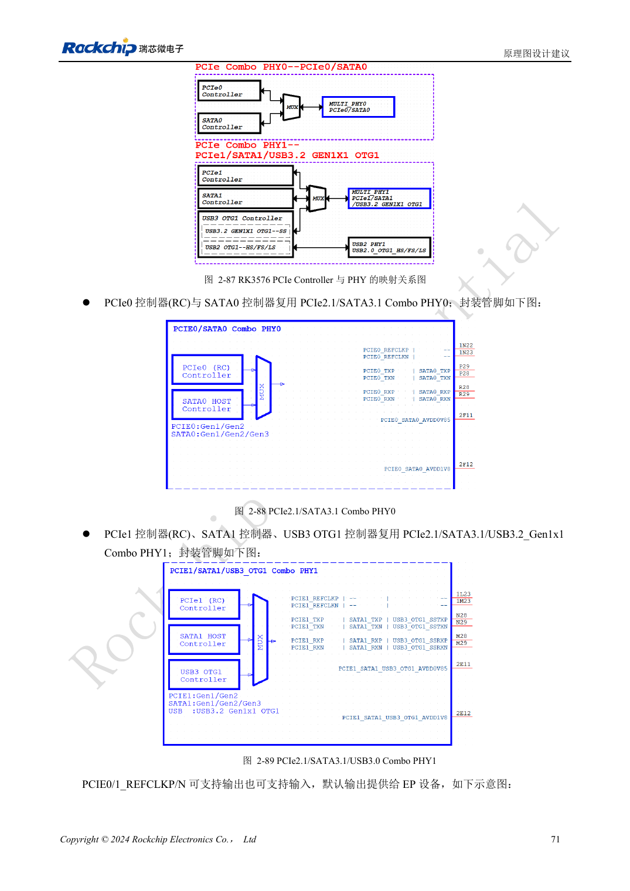
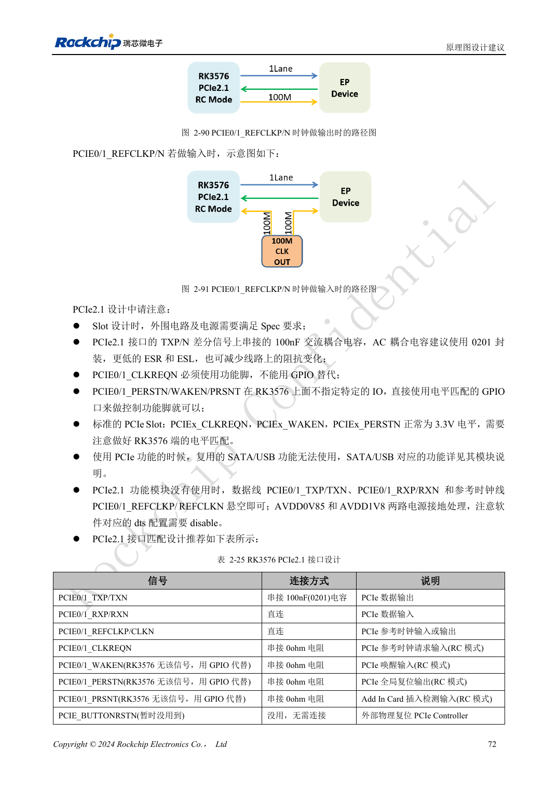

<!-- rk3576-hardware-v11-rest-20261109 -->

# RK3576 PCIe 设计：RC 模式、共享 PHY 与端点供电

本文基于 RK3576 Hardware Design Guide V1.1（2024-05-28）的中英文原稿，面向芯片主板设计。CM5 载板请以模块接口定义为准；Sige5 可用于建立软件和外设基线。指南没有限定一个可通用于所有产品的 SDK/BSP 或内核版本，实际适配需逐板核对。参数为原稿参考，不是 ArmSoM 实测。

**RK3576_Hardware_Design_Guide_V1.1_20240528_CN.pdf** · §2.3.6; PCIe PCB

## 先建立接口资源表

RK3576 提供两组 PCIe 2.1 x1，作为 Root Complex 使用，不支持 Endpoint 模式。PCIe0 与 SATA0 共享 Combo PHY0；PCIe1 与 SATA1、USB3 OTG1 共享 Combo PHY1。先确定产品选择哪种功能，再画连接器、分配时钟并设置设备树，不能把共享功能相加为同时可用接口。

## 控制脚与耦合电容

TX 串联 100nF，RX 直连，REFCLK 按参考电路直连并确认输出方向。CLKREQN 必须使用对应功能脚，不能用普通 GPIO 代替；PERSTN、WAKEN、PRSNT 可按指南选择匹配 GPIO。标准插槽控制信号为 3.3V，必须检查 SoC 所选 IO 域的电平。只有确认整个 PHY 未用时，才按指南处理未用电源和设备树。

## 把枚举成功与可靠工作分开

数据差分阻抗 85Ω，而参考时钟为 100Ω，不应使用一条统一阻抗规则。检查端点上电、复位释放、参考时钟和低功耗恢复，再做持续 DMA 负载。记录实际链路宽度、速率与错误；一次枚举成功不能证明存储或网络端点长期稳定。

## 设计参数与检查表

| 项目 | 原稿参考值 |
| --- | --- |
| Data Zdiff | 85Ω ±10% |
| REFCLK Zdiff | 100Ω ±10% |
| 数据差分对内差 | <6mil |
| REFCLK 对内差 | <12mil |
| 走线长度 | <6inch |
| TX AC | 100nF ±20% |

## 参考原图

下图为原稿参考页，包含对应电路图或时序图；点击可查看大图。位号和元件值属于参考设计，不是 ArmSoM 产品原理图。

中文原稿 · PDF 91 · 2-87

中文原稿 · PDF 92 · 2-90

## ArmSoM 开发路径

CM5 可用于定制载板，减少计算核心的重复设计；Sige5 可作为软件与外设验证起点。接口是否引出、连接器针脚、电平和镜像支持必须查对应板卡资料，不能从芯片功能直接推断。

- [ArmSoM CM5](https://www.armsom.org/cm5) · [CM5 Docs](https://docs.armsom.org/armsom-cm5)
- [ArmSoM Sige5](https://www.armsom.org/sige5) · [Sige5 Docs](https://docs.armsom.org/armsom-sige5)

## 继续阅读

- [RK3576 硬件设计系列：30 个主题](/zh/articles/rk3576-hardware-design-series/)
- [RK3576 SD 卡与 SDIO Wi-Fi：电压切换、供电控制和射频布局](/zh/articles/rk3576-sdio-wifi-hardware/)
- [RK3576 SATA 硬件：PHY 复用、耦合与硬盘供电](/zh/articles/rk3576-sata-hardware-design/)
