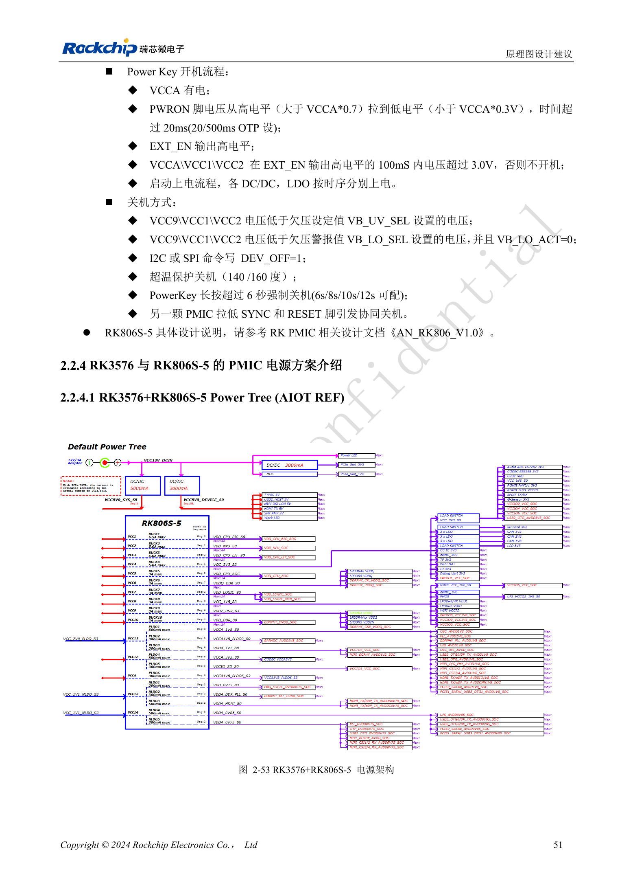

<!-- rk3576-hardware-v11-deep-20261109 -->

# RK3576 电源域与去耦：CPU、GPU、NPU 和 LOGIC 供电规划

电源树应把工作电压、瞬态电流、去耦位置和待机状态放在一起审查。下面的数值是指南参考设计要求或厂商样例，不是 CM5 输入电源规格，也不是 ArmSoM 实测功耗。

本文基于 RK3576 Hardware Design Guide V1.1（2024-05-28）的中英文原稿，面向芯片主板设计。CM5 载板请以模块接口定义为准；Sige5 可用于建立软件和外设基线。指南没有限定一个可通用于所有产品的 SDK/BSP 或内核版本，实际适配需逐板核对。参数为原稿参考，不是 ArmSoM 实测。

**RK3576_Hardware_Design_Guide_V1.1_20240528_CN.pdf** · §2.2.1–2.2.4

## 不能按应用名称直接关闭电源域

首次上电需要 NPU 域，即使应用不运行 AI；指南允许 GPU 按条件关闭。启动介质决定必须供电的 IO：eMMC/FSPI0 使用 VCCIO0，SDMMC0/FSPI1_M0 使用 VCCIO1，FSPI1_M1 使用 VCCIO3，UFS 还涉及 VCCIO7、振荡器和 PHY。PMUIO0/1 必须供电。关闭其他域必须满足完整时序、唤醒与外设条件。

## 电容应服务于负载

CPU 大核总电容应大于 130μF，小核大于 88μF；GPU 主去耦大于 66μF，NPU 大于 90μF，LOGIC 总电容大于 88μF。按原图区分 PMIC 输出电容与靠近 SoC 的去耦，不能把全部容值集中在电源芯片旁。还需评估直流偏压降容、回路、电流瞬态和探测方法。LOGIC_MEM 默认与 LOGIC 合供，独立供电需同时检查 DVFS 软件支持。

## 不要把各模块峰值相加当作整板功耗

表 2-19 的厂商样例在 25℃、裸板无散热片、稳定运行 15 分钟后记录，每个模块采用自己的极限负载。不同项目并不等于同时发生的整板条件。电源和散热选型应补充实际并发负载测量，并区分峰值电流、持续电流与输入功率。

## 设计参数与检查表

| 项目 | 数值或网络 | 核对说明 |
| --- | --- | --- |
| 大核 | BUCK1; >4A; >130μF | 默认参考电压 0.85V |
| 小核 | BUCK3; >2A; >88μF | 总去耦容量 |
| 图形 | BUCK5; 3A; >66μF | 主去耦靠近 SoC |
| 神经网络 | BUCK2; >4A; >90μF | 不因未使用 AI 就省略上电供电 |
| 逻辑 | BUCK7; >2A; >88μF | LOGIC_MEM 合供方案需一致 |

## 参考电路与原图

下图为原稿参考页，包含对应电路图或时序图；点击可查看大图。位号和元件值属于参考设计，不是 ArmSoM 产品原理图。

中文原稿 · PDF 71 · 2-53

## ArmSoM 产品与开发路径

CM5 适合把已集成的计算模块用于定制载板，Sige5 适合先验证 Linux 软件和外设。芯片具备某接口，不代表两款产品都把该接口引出；购买或布板前按连接器定义、板卡版本与系统镜像核对。

- [ArmSoM CM5](https://www.armsom.org/cm5) · [CM5 Docs](https://docs.armsom.org/armsom-cm5)
- [ArmSoM Sige5](https://www.armsom.org/sige5) · [Sige5 Docs](https://docs.armsom.org/armsom-sige5)

## 系列阅读顺序

- [RK3576 硬件设计系列：从最小系统到 DDR 与 USB](/zh/articles/rk3576-hardware-design-series/)
- [RK3576 最小系统与首次上电：从原理图检查到可重复启动](/zh/articles/rk3576-hardware-bringup/)
- [RK3576 时钟电路设计：24MHz 晶体、32kHz 待机与外设时钟](/zh/articles/rk3576-clock-circuit-design/)
- [RK3576 复位设计：NPOR、RK806S-5、看门狗与过温保护](/zh/articles/rk3576-reset-watchdog-design/)
- [RK3576 启动与调试设计：Boot 配置、Maskrom、UART 和 JTAG](/zh/articles/rk3576-boot-debug-design/)
- [RK3576 与 RK806S-5：PMIC 选型、控制引脚和反馈设计](/zh/articles/rk3576-rk806s5-pmic-design/)
- [RK3576 电源时序与待机：复位释放、保留电源和唤醒路径](/zh/articles/rk3576-power-sequencing-standby/)
- [RK3576 DDR 电路与供电：LPDDR4、LPDDR4X 和 LPDDR5 的区别](/zh/articles/rk3576-ddr-circuit-power/)
- [RK3576 DDR PCB 布线：阻抗、长度、回流与 PDN 检查](/zh/articles/rk3576-ddr-pcb-routing/)
- [RK3576 USB 与 Type-C 硬件补充：复用、下载入口和保护器件](/zh/articles/168-rockchip-rk3576-usb/)
