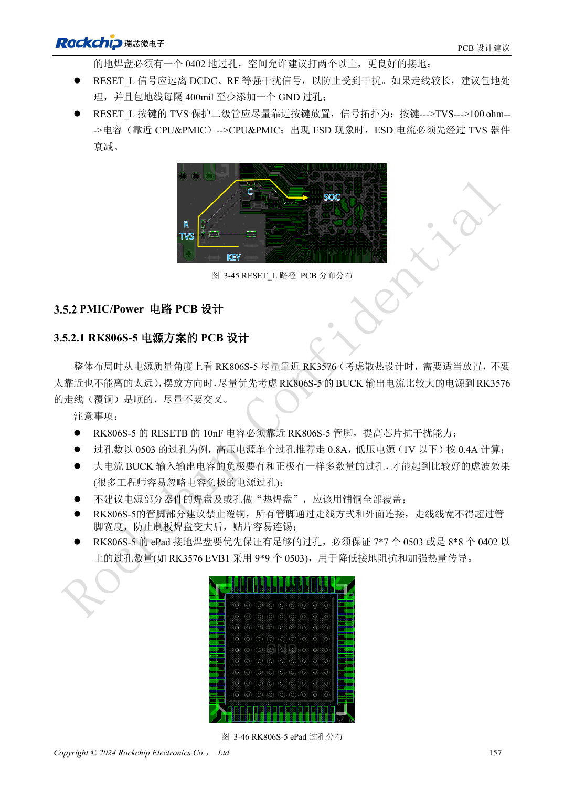
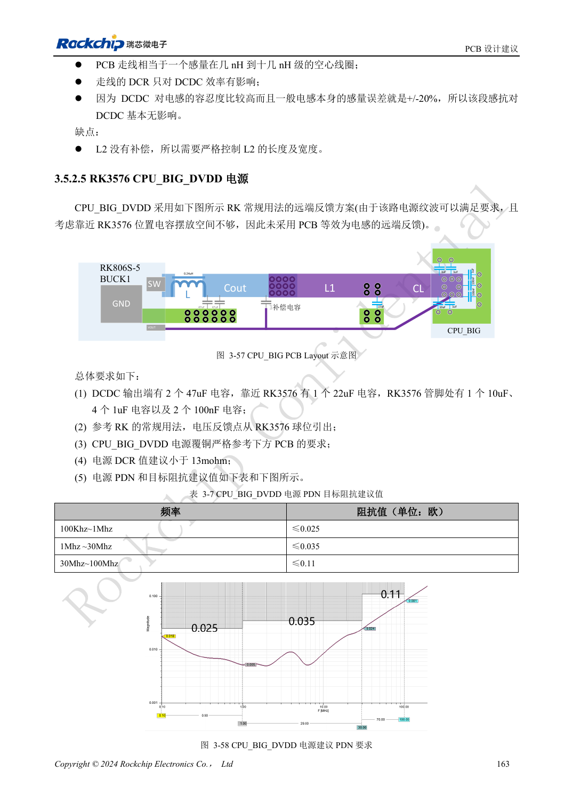

<!-- rk3576-hardware-v11-rest-20261109 -->

# RK3576 电源 PCB 与 PDN：RK806S-5、反馈和大电流回路

本文基于 RK3576 Hardware Design Guide V1.1（2024-05-28）的中英文原稿，面向芯片主板设计。CM5 载板请以模块接口定义为准；Sige5 可用于建立软件和外设基线。指南没有限定一个可通用于所有产品的 SDK/BSP 或内核版本，实际适配需逐板核对。参数为原稿参考，不是 ArmSoM 实测。

**RK3576_Hardware_Design_Guide_V1.1_20240528_CN.pdf** · §3.5.2

## 先保证输入和地回路

RK806S-5 布局优先让大电流 BUCK 到 SoC 的路径顺畅，避免绕行与交叉。输入电容紧靠芯片，正负两端都需要足够过孔；只给正端增加过孔不能形成低阻抗回路。ePad 参考至少 7×7 个 0503 或 8×8 个 0402 过孔，RESETB 的 10nF 紧靠 PMIC。孔型与电流承载仍需按实际制板工艺确认。

## 反馈方案不可随意混搭

近端反馈、常规远端反馈以及利用 PCB 等效电感的远端方案有不同电容位置和补偿要求。后者把主电容移到负载端，不能只删除 DCDC 输出电容而不重做回路。CPU_BIG 的原稿方案仍采用常规远端反馈，建议 DCR 小于 13mΩ；CPU_LIT 小于 20mΩ。不同电源按各自模板审查，不能把 NPU 方案直接复制给所有 BUCK。

## 用瞬态负载验证 PDN

CPU_BIG 参考 PDN 目标按频段分别为 0.025/0.035/0.11Ω，见下表，属于指南设计目标而非 ArmSoM 实测。检查电源铜皮细颈、过孔压降、去耦地回流与负载突变。示波器测量点应在负载附近，记录探头方式、带宽和负载条件，不能只看 PMIC 输出端稳态电压。

## 设计参数与检查表

| 项目 | 原稿参考值 |
| --- | --- |
| CPU_BIG DCR | <13mΩ |
| CPU_LIT DCR | <20mΩ |
| CPU_BIG 100kHz–1MHz | ≤0.025Ω |
| CPU_BIG 1–30MHz | ≤0.035Ω |
| CPU_BIG 30–100MHz | ≤0.11Ω |

## 参考原图

下图为原稿参考页，包含对应电路图或时序图；点击可查看大图。位号和元件值属于参考设计，不是 ArmSoM 产品原理图。

中文原稿 · PDF 177 · 3-46

中文原稿 · PDF 183 · 3-57

## ArmSoM 开发路径

CM5 可用于定制载板，减少计算核心的重复设计；Sige5 可作为软件与外设验证起点。接口是否引出、连接器针脚、电平和镜像支持必须查对应板卡资料，不能从芯片功能直接推断。

- [ArmSoM CM5](https://www.armsom.org/cm5) · [CM5 Docs](https://docs.armsom.org/armsom-cm5)
- [ArmSoM Sige5](https://www.armsom.org/sige5) · [Sige5 Docs](https://docs.armsom.org/armsom-sige5)

## 继续阅读

- [RK3576 硬件设计系列：30 个主题](/zh/articles/rk3576-hardware-design-series/)
- [RK3576 高速接口设计：阻抗、回流、残桩与整链路检查](/zh/articles/rk3576-high-speed-interface-design/)
- [RK3576 散热设计：热阻、PCB 导热与持续负载验证](/zh/articles/rk3576-thermal-hardware-design/)
