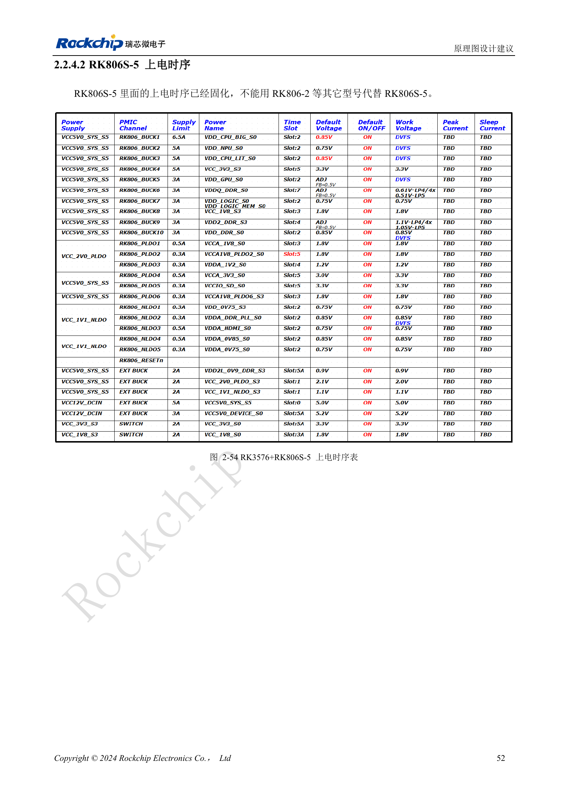
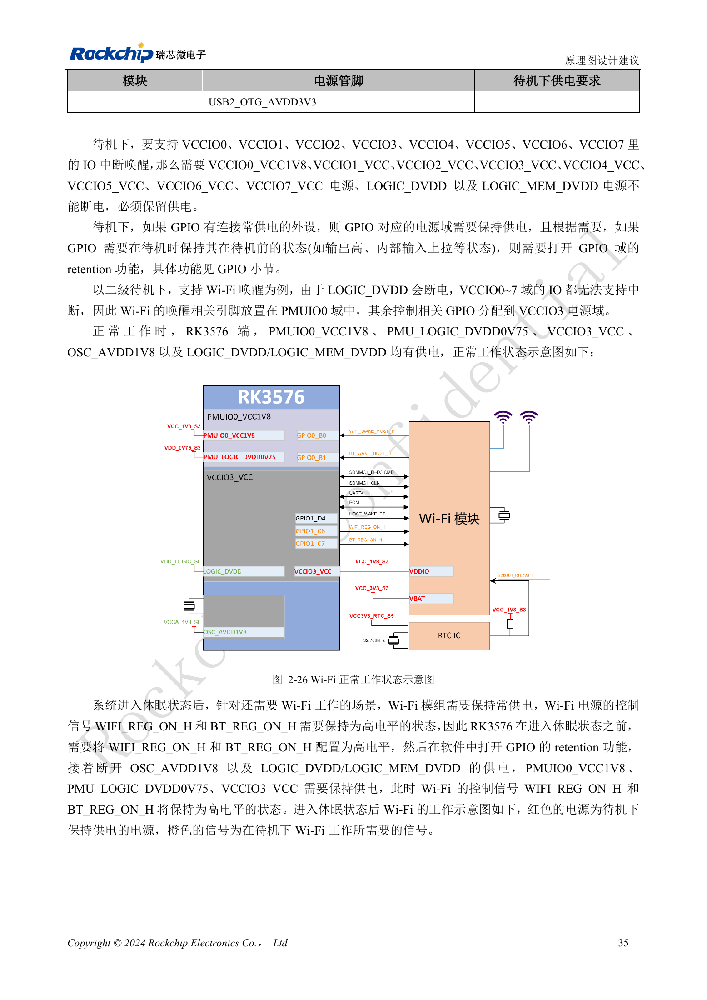

<!-- rk3576-hardware-v11-deep-20261109 -->

# RK3576 电源时序与待机：复位释放、保留电源和唤醒路径

“低电压先上电”不能替代各 PHY 的具体约束。先建立每个电源域的依赖关系，再分别审核冷启动、关机和每一种待机唤醒方式。

本文基于 RK3576 Hardware Design Guide V1.1（2024-05-28）的中英文原稿，面向芯片主板设计。CM5 载板请以模块接口定义为准；Sige5 可用于建立软件和外设基线。指南没有限定一个可通用于所有产品的 SDK/BSP 或内核版本，实际适配需逐板核对。参数为原稿参考，不是 ArmSoM 实测。

**RK3576_Hardware_Design_Guide_V1.1_20240528_CN.pdf** · §2.2.1; §2.2.4

## 时序的例外与复位释放

DDRPHY 应按 DVDD→CKE_VDDQ→VDDQ/CK_VDDQ；USB2 为 0.75→1.8→3.3V，UFS 和 USB3/DP 为 0.85→1.8V。MIPIDCPHY 有低压→1.8→1.2V 的特殊顺序，不能按数值从小到大排序。最后一路稳定后至少延迟 1ms 释放 RESET_L，指南给出的实用延时范围为 5–200ms，仍须匹配外部器件。

## 保留哪些电源取决于唤醒方式

最小待机保留 DDRPHY_CKE_VDDQ、PMU_LOGIC_DVDD0V75、PMUIO0_VCC1V8 和 PMUIO1_VCC，主要使用 PMUIO 中断唤醒。USB HID 唤醒还需要振荡器与 USB2 PHY 电源。若使用 VCCIO0–7 的中断，还需相应 IO、LOGIC 与 LOGIC_MEM；不能把最小待机电源表直接用于所有产品。

## GPIO 保持与掉电验证

Wi-Fi 例子先置 WIFI_REG_ON_H/BT_REG_ON_H 为高并启用 GPIO retention，再关闭相应主逻辑和振荡器电源，同时保留相关外设电源与 IO。该例子不能证明任意 BSP 已完成此配置。关机先拉低 RESET_L；GPIO3.3V 与 PMUIO0_1.8V、USB3.3V 与 USB1.8V 的差值均应按指南限制在 2V 以内。还应检查外设持续供电造成的反向灌电。

## 设计参数与检查表

| 项目 | 数值或网络 | 核对说明 |
| --- | --- | --- |
| 最后电源至复位 | ≥1ms | 实用参考 5–200ms |
| 关机首步 | RESET_L = LOW | 再按电源域要求掉电 |
| PMIC 时序 | RK806S-5 | 固定配置，不以 RK806-2 替换 |

## 参考电路与原图

下图为原稿参考页，包含对应电路图或时序图；点击可查看大图。位号和元件值属于参考设计，不是 ArmSoM 产品原理图。

中文原稿 · PDF 72 · 2-54

中文原稿 · PDF 55 · 2-26 / 2-27

## ArmSoM 产品与开发路径

CM5 适合把已集成的计算模块用于定制载板，Sige5 适合先验证 Linux 软件和外设。芯片具备某接口，不代表两款产品都把该接口引出；购买或布板前按连接器定义、板卡版本与系统镜像核对。

- [ArmSoM CM5](https://www.armsom.org/cm5) · [CM5 Docs](https://docs.armsom.org/armsom-cm5)
- [ArmSoM Sige5](https://www.armsom.org/sige5) · [Sige5 Docs](https://docs.armsom.org/armsom-sige5)

## 系列阅读顺序

- [RK3576 硬件设计系列：从最小系统到 DDR 与 USB](/zh/articles/rk3576-hardware-design-series/)
- [RK3576 最小系统与首次上电：从原理图检查到可重复启动](/zh/articles/rk3576-hardware-bringup/)
- [RK3576 时钟电路设计：24MHz 晶体、32kHz 待机与外设时钟](/zh/articles/rk3576-clock-circuit-design/)
- [RK3576 复位设计：NPOR、RK806S-5、看门狗与过温保护](/zh/articles/rk3576-reset-watchdog-design/)
- [RK3576 启动与调试设计：Boot 配置、Maskrom、UART 和 JTAG](/zh/articles/rk3576-boot-debug-design/)
- [RK3576 电源域与去耦：CPU、GPU、NPU 和 LOGIC 供电规划](/zh/articles/rk3576-power-domain-design/)
- [RK3576 与 RK806S-5：PMIC 选型、控制引脚和反馈设计](/zh/articles/rk3576-rk806s5-pmic-design/)
- [RK3576 DDR 电路与供电：LPDDR4、LPDDR4X 和 LPDDR5 的区别](/zh/articles/rk3576-ddr-circuit-power/)
- [RK3576 DDR PCB 布线：阻抗、长度、回流与 PDN 检查](/zh/articles/rk3576-ddr-pcb-routing/)
- [RK3576 USB 与 Type-C 硬件补充：复用、下载入口和保护器件](/zh/articles/168-rockchip-rk3576-usb/)
