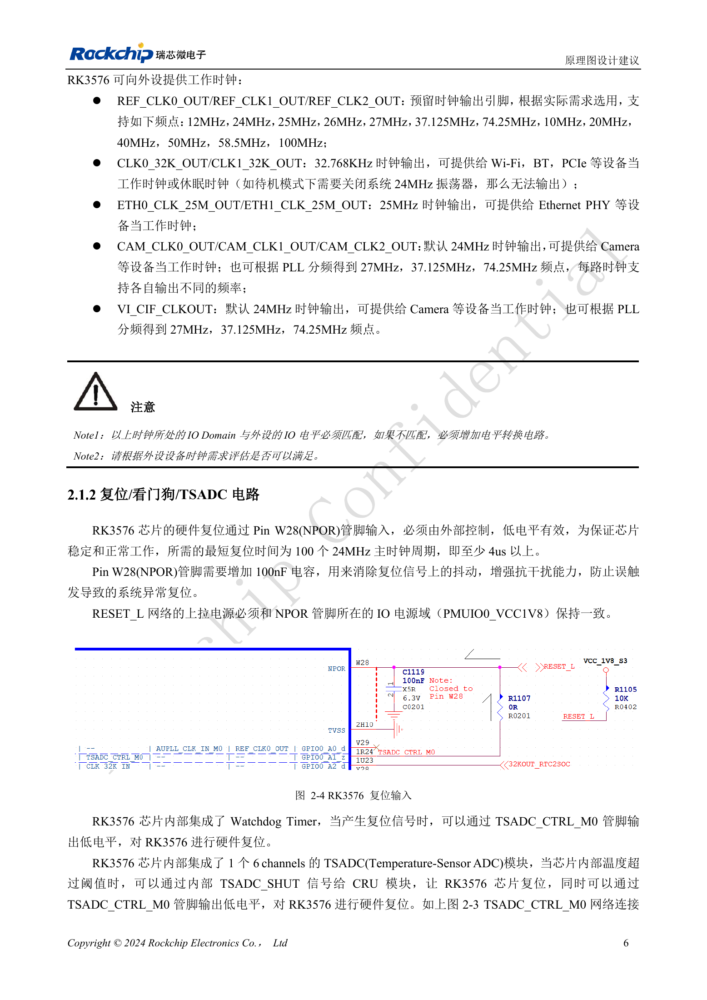

<!-- rk3576-hardware-v11-deep-20261109 -->

# RK3576 复位设计：NPOR、RK806S-5、看门狗与过温保护

复位网络把 SoC、PMIC、看门狗和温度保护连接在一起。审查的重点是信号方向、电源域、低电平持续时间和整个网络的电容，而不是简单增加一个复位按钮。

本文基于 RK3576 Hardware Design Guide V1.1（2024-05-28）的中英文原稿，面向芯片主板设计。CM5 载板请以模块接口定义为准；Sige5 可用于建立软件和外设基线。指南没有限定一个可通用于所有产品的 SDK/BSP 或内核版本，实际适配需逐板核对。参数为原稿参考，不是 ArmSoM 实测。

**RK3576_Hardware_Design_Guide_V1.1_20240528_CN.pdf** · §2.1.2; §2.2.3

## NPOR 的时间要求

NPOR（Pin W28）为低有效输入。原稿要求至少 100 个 24MHz 周期，同时写“至少 4μs”。100/24MHz≈4.167μs，因此本文保留 100 周期作为设计依据，并记录 4μs 为近似表述，不能把精确 4.000μs 视为满足 100 周期。最后一路电源稳定到释放 RESET_L 至少 1ms，是另一项不同的上电要求。

## PMIC 的 RESETB 会改变角色

RK806S-5 在初次上电期间保持 RESETB 为低，电源稳定且延时结束后释放，由外部上拉形成高电平。运行或睡眠时再拉低 RESETB 会触发 PMIC 重启，重新执行上电时序。RESET_L 上拉应接 PMUIO0_VCC1V8。指南建议 NPOR/RESETB 网络使用 100nF，但 PMIC 要求总电容不超过 0.3μF，不能在每个分支重复堆叠。

## 看门狗和温度保护

TSADC1 有 6 个通道，达到配置阈值可通过内部 TSADC_SHUT 通知 CRU，并通过 TSADC_CTRL_M0 输出低电平。外接看门狗若与该信号连接，必须使用开漏输出以避免驱动冲突。验证时同时观察复位、电源重启和串口日志，并核对 BSP 中阈值、看门狗路由及恢复策略；本文不提供未核实的通用阈值。

## 设计参数与检查表

| 项目 | 数值或网络 | 核对说明 |
| --- | --- | --- |
| 外部复位 | NPOR / W28 | 低有效，至少 100×24MHz 周期 |
| 上拉电源 | PMUIO0_VCC1V8 | 禁止随意接到 3.3V |
| 网络总电容 | ≤0.3μF | 包括 SoC、PMIC 与外部复位分支 |

## 参考电路与原图

下图为原稿参考页，包含对应电路图或时序图；点击可查看大图。位号和元件值属于参考设计，不是 ArmSoM 产品原理图。

中文原稿 · PDF 26 · 2-4

## ArmSoM 产品与开发路径

CM5 适合把已集成的计算模块用于定制载板，Sige5 适合先验证 Linux 软件和外设。芯片具备某接口，不代表两款产品都把该接口引出；购买或布板前按连接器定义、板卡版本与系统镜像核对。

- [ArmSoM CM5](https://www.armsom.org/cm5) · [CM5 Docs](https://docs.armsom.org/armsom-cm5)
- [ArmSoM Sige5](https://www.armsom.org/sige5) · [Sige5 Docs](https://docs.armsom.org/armsom-sige5)

## 系列阅读顺序

- [RK3576 硬件设计系列：从最小系统到 DDR 与 USB](/zh/articles/rk3576-hardware-design-series/)
- [RK3576 最小系统与首次上电：从原理图检查到可重复启动](/zh/articles/rk3576-hardware-bringup/)
- [RK3576 时钟电路设计：24MHz 晶体、32kHz 待机与外设时钟](/zh/articles/rk3576-clock-circuit-design/)
- [RK3576 启动与调试设计：Boot 配置、Maskrom、UART 和 JTAG](/zh/articles/rk3576-boot-debug-design/)
- [RK3576 电源域与去耦：CPU、GPU、NPU 和 LOGIC 供电规划](/zh/articles/rk3576-power-domain-design/)
- [RK3576 与 RK806S-5：PMIC 选型、控制引脚和反馈设计](/zh/articles/rk3576-rk806s5-pmic-design/)
- [RK3576 电源时序与待机：复位释放、保留电源和唤醒路径](/zh/articles/rk3576-power-sequencing-standby/)
- [RK3576 DDR 电路与供电：LPDDR4、LPDDR4X 和 LPDDR5 的区别](/zh/articles/rk3576-ddr-circuit-power/)
- [RK3576 DDR PCB 布线：阻抗、长度、回流与 PDN 检查](/zh/articles/rk3576-ddr-pcb-routing/)
- [RK3576 USB 与 Type-C 硬件补充：复用、下载入口和保护器件](/zh/articles/168-rockchip-rk3576-usb/)
