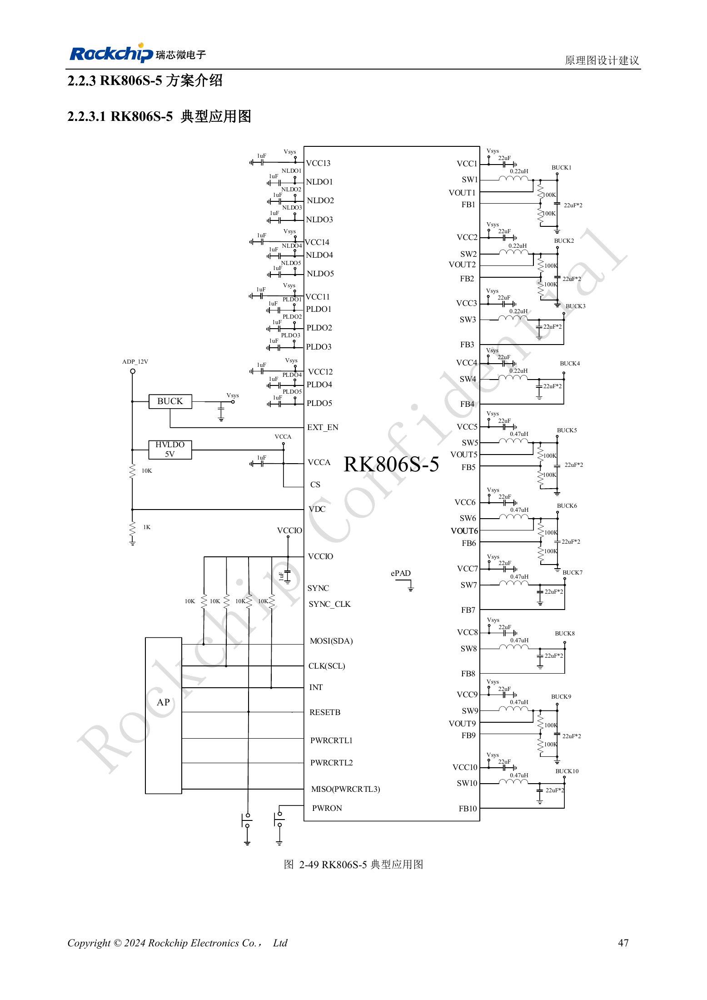
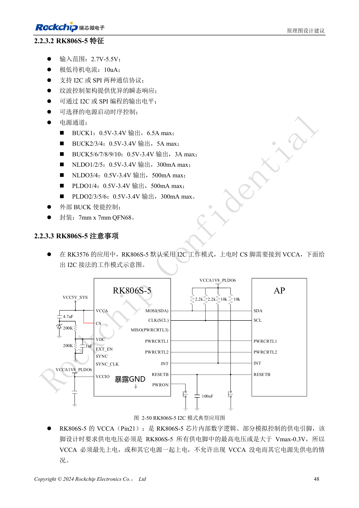

<!-- rk3576-hardware-v11-deep-20261109 -->

# RK3576 与 RK806S-5：PMIC 选型、控制引脚和反馈设计

相同封装不代表相同启动行为。RK806S-5 的固定电源时序与 RK3576 配套，不能直接用 RK806-2 替换。先确认完整型号、OTP 配置和参考电路，再审查外围参数。

本文基于 RK3576 Hardware Design Guide V1.1（2024-05-28）的中英文原稿，面向芯片主板设计。CM5 载板请以模块接口定义为准；Sige5 可用于建立软件和外设基线。指南没有限定一个可通用于所有产品的 SDK/BSP 或内核版本，实际适配需逐板核对。参数为原稿参考，不是 ArmSoM 实测。

**RK3576_Hardware_Design_Guide_V1.1_20240528_CN.pdf** · §2.2.3–2.2.4

## 通信与电源输入

参考方案使用 I2C，CS 在上电时连接 VCCA。VCCA（Pin21）必须最高，或大于其他最高电源 Vmax−0.3V，并且先于或同时于其他输入上电。PLDO6 为通信 IO 供电，应与 AP 电平域匹配。2.7–5.5V 是 PMIC 输入范围，并不覆盖所有开机条件：VDC 启动说明还要求 VCCA/VCC1/VCC2 大于 3.0V。

## 开关机与复位不能分开设计

VDC 阈值为 0.8V，设计建议大于 1V 且不超过 VCCA；持续拉高可能阻止正常关机，自动开机应使用原稿 RC 方案并验证。PWRON 内部约 45kΩ 上拉，默认低 20ms 开机，默认长按 6s 强制关机，可配置 6/8/10/12s。EXT_EN 拉高后 VCCA/VCC1/VCC2 应在 100ms 内超过 3V。RESETB 总电容应不超过 0.3μF。

## 反馈与电感存在需要核对的原稿差异

FB 与 VOUT 的选择受具体 BUCK/OTP 配置影响，不能统一改接。外部分压示例为 Vout=(R1/R2+1)×0.5V，电阻范围 10kΩ–1MΩ。图 2-49 的 BUCK1–4 电感画为 0.22μH，正文却写 0.24μH；本文并列保留，需按现行参考 BOM、PMIC 规格与厂商确认选型，不擅自把其中一个当成正确值。COT 反馈对布局和纹波敏感，应一起审查。

## 设计参数与检查表

| 项目 | 数值或网络 | 核对说明 |
| --- | --- | --- |
| 输入/封装 | 2.7–5.5V; QFN68 7×7mm | 芯片规格，不是整板输入规格 |
| BUCK 能力 | 1:6.5A; 2–4:5A; 5–10:3A | 最大能力不等于设计持续负载 |
| 默认接口 | I2C / CS→VCCA | 与 OTP、AP 电平和上电配置对应 |

## 参考电路与原图

下图为原稿参考页，包含对应电路图或时序图；点击可查看大图。位号和元件值属于参考设计，不是 ArmSoM 产品原理图。

中文原稿 · PDF 67 · 2-49

中文原稿 · PDF 68 · 2-50

## ArmSoM 产品与开发路径

CM5 适合把已集成的计算模块用于定制载板，Sige5 适合先验证 Linux 软件和外设。芯片具备某接口，不代表两款产品都把该接口引出；购买或布板前按连接器定义、板卡版本与系统镜像核对。

- [ArmSoM CM5](https://www.armsom.org/cm5) · [CM5 Docs](https://docs.armsom.org/armsom-cm5)
- [ArmSoM Sige5](https://www.armsom.org/sige5) · [Sige5 Docs](https://docs.armsom.org/armsom-sige5)

## 系列阅读顺序

- [RK3576 硬件设计系列：从最小系统到 DDR 与 USB](/zh/articles/rk3576-hardware-design-series/)
- [RK3576 最小系统与首次上电：从原理图检查到可重复启动](/zh/articles/rk3576-hardware-bringup/)
- [RK3576 时钟电路设计：24MHz 晶体、32kHz 待机与外设时钟](/zh/articles/rk3576-clock-circuit-design/)
- [RK3576 复位设计：NPOR、RK806S-5、看门狗与过温保护](/zh/articles/rk3576-reset-watchdog-design/)
- [RK3576 启动与调试设计：Boot 配置、Maskrom、UART 和 JTAG](/zh/articles/rk3576-boot-debug-design/)
- [RK3576 电源域与去耦：CPU、GPU、NPU 和 LOGIC 供电规划](/zh/articles/rk3576-power-domain-design/)
- [RK3576 电源时序与待机：复位释放、保留电源和唤醒路径](/zh/articles/rk3576-power-sequencing-standby/)
- [RK3576 DDR 电路与供电：LPDDR4、LPDDR4X 和 LPDDR5 的区别](/zh/articles/rk3576-ddr-circuit-power/)
- [RK3576 DDR PCB 布线：阻抗、长度、回流与 PDN 检查](/zh/articles/rk3576-ddr-pcb-routing/)
- [RK3576 USB 与 Type-C 硬件补充：复用、下载入口和保护器件](/zh/articles/168-rockchip-rk3576-usb/)
