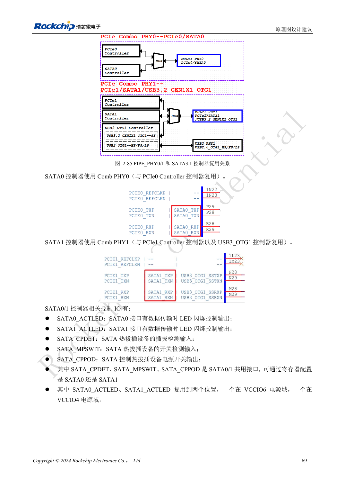
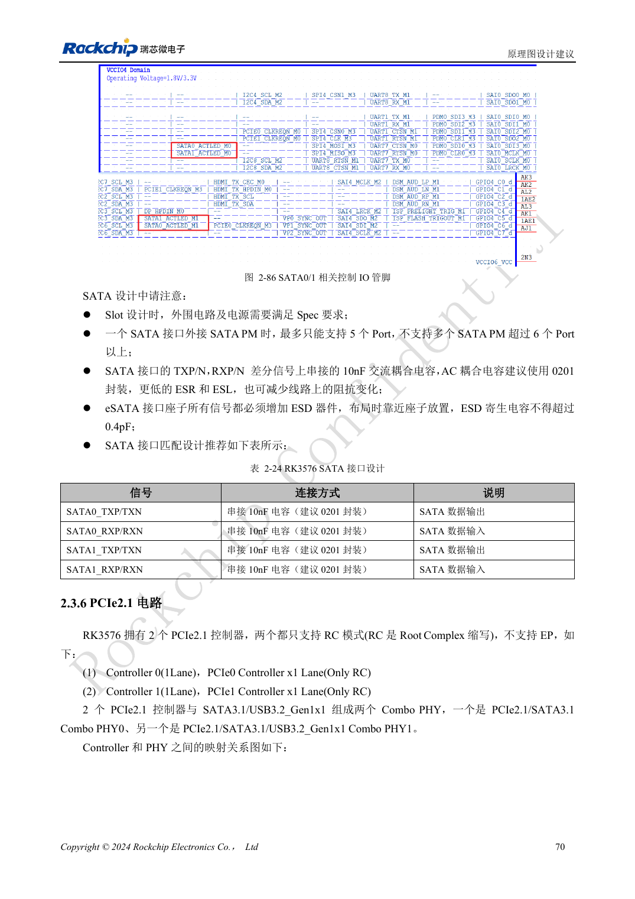

<!-- rk3576-hardware-v11-rest-20261109 -->

# RK3576 SATA 硬件：PHY 复用、耦合与硬盘供电

本文基于 RK3576 Hardware Design Guide V1.1（2024-05-28）的中英文原稿，面向芯片主板设计。CM5 载板请以模块接口定义为准；Sige5 可用于建立软件和外设基线。指南没有限定一个可通用于所有产品的 SDK/BSP 或内核版本，实际适配需逐板核对。参数为原稿参考，不是 ArmSoM 实测。

**RK3576_Hardware_Design_Guide_V1.1_20240528_CN.pdf** · §2.3.5; SATA PCB

## SATA 控制器不是完整硬盘接口

两组 SATA 3.1 控制器支持 1.5/3/6Gbps，指南列出端口倍增器最多五设备的能力；实际软件、器件和带宽仍需验证。SATA0 与 PCIe0 共享 PHY0，SATA1 与 PCIe1/USB3 OTG1 共享 PHY1。硬盘供电、启动电流和连接器不由 SATA 信号线提供。

## 不要照搬 PCIe 的 RX 接法

本指南 SATA 的 TX 和 RX 都使用 10nF 耦合电容，推荐 0201。eSATA ESD 器件电容不大于 0.4pF。CPDET/MPSWIT/CPPOD 为可选择的共享控制资源，不能理解为两个端口各有一套独立控制。ACTLED 还要核对 IO 域和外围驱动方式。

## 验证包含线缆与最坏供电

PCB 优先 100Ω 差分；指南在叠层无法满足时提出不低于 90Ω±10% 的条件，必须结合线缆和接收端评估。保持完整地、短过孔与连接器附近保护。测试冷启动、双盘并发、长时间写入及恢复，测量硬盘启动时的电源跌落。

## 设计参数与检查表

| 项目 | 原稿参考值 |
| --- | --- |
| 接口速率 | 1.5 / 3 / 6Gbps |
| TX + RX AC | 10nF |
| 差分对内长度差 | <6mil |
| 走线长度 | <6inch |
| 空气间距 | ≥4W |
| 过孔数量建议 | ≤2 |

## 参考原图

下图为原稿参考页，包含对应电路图或时序图；点击可查看大图。位号和元件值属于参考设计，不是 ArmSoM 产品原理图。

中文原稿 · PDF 89 · 2-85

中文原稿 · PDF 90 · 2-86

## ArmSoM 开发路径

CM5 可用于定制载板，减少计算核心的重复设计；Sige5 可作为软件与外设验证起点。接口是否引出、连接器针脚、电平和镜像支持必须查对应板卡资料，不能从芯片功能直接推断。

- [ArmSoM CM5](https://www.armsom.org/cm5) · [CM5 Docs](https://docs.armsom.org/armsom-cm5)
- [ArmSoM Sige5](https://www.armsom.org/sige5) · [Sige5 Docs](https://docs.armsom.org/armsom-sige5)

## 继续阅读

- [RK3576 硬件设计系列：30 个主题](/zh/articles/rk3576-hardware-design-series/)
- [RK3576 PCIe 设计：RC 模式、共享 PHY 与端点供电](/zh/articles/rk3576-pcie-hardware-design/)
- [RK3576 摄像头硬件：CSI 分组、DCPHY 模式与电源时序](/zh/articles/rk3576-camera-hardware-design/)
