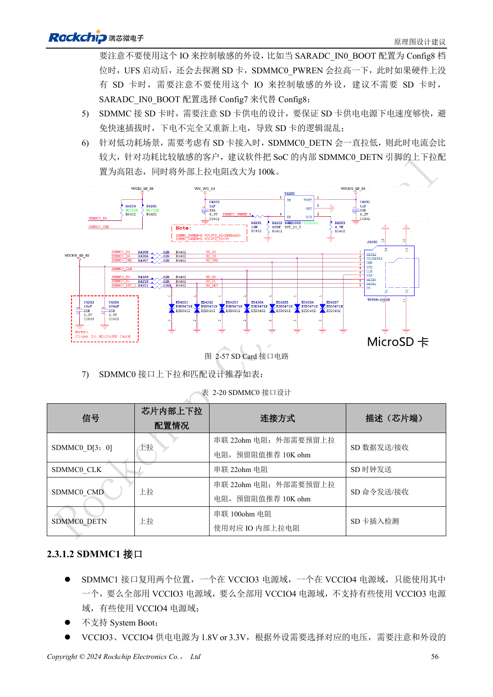
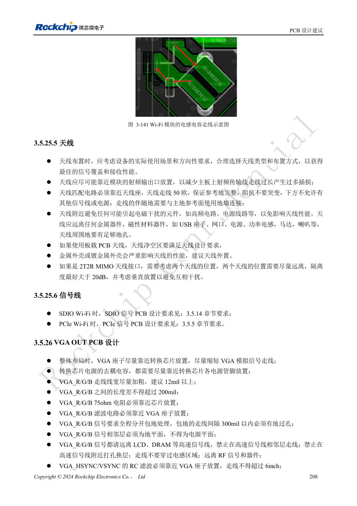

<!-- rk3576-hardware-v11-rest-20261109 -->

# RK3576 SD 卡与 SDIO Wi-Fi：电压切换、供电控制和射频布局

本文基于 RK3576 Hardware Design Guide V1.1（2024-05-28）的中英文原稿，面向芯片主板设计。CM5 载板请以模块接口定义为准；Sige5 可用于建立软件和外设基线。指南没有限定一个可通用于所有产品的 SDK/BSP 或内核版本，实际适配需逐板核对。参数为原稿参考，不是 ArmSoM 实测。

**RK3576_Hardware_Design_Guide_V1.1_20240528_CN.pdf** · §2.3.1; SDMMC/SDIO PCB; §3.5.25

## 区分可启动 SDMMC0 与 SDMMC1

两组控制器支持四位 SDIO 3.0/MMC 4.51，SDR104 时钟最高 200MHz。SDMMC0 位于 VCCIO1，可用于启动；SDMMC1 位于 VCCIO3 或 VCCIO4，不能当作同等启动口。SD 卡电源保持 3.3V，SD 3.0 协商后切换的是 IO 电压，不是把卡供电直接改成 1.8V。

## 电源开关与插拔

参考电路 D/CMD/CLK 串联 22Ω，DETN 串联 100Ω；SD 3.0 的 ESD 器件电容小于 1pF。GPIO0_B6/PWREN 在启动探测时会拉高，电源开关采用同相控制，并为重新插入提供快速放电路径。低功耗时 DETN 内部可能高阻，外部上拉是否需要常开电源应按唤醒方案确认。

## Wi-Fi 还需要射频与峰值电流验证

匹配模组 VDDIO、32.768kHz 时钟电平与 UART/PCM 方向。模组远离 DDR、HDMI、功率电感，射频线按 50Ω、无分支并预留匹配网络；天线净空由天线厂商规定。供电按具体模组峰值电流设计，不以平均电流代替。验证时同时运行 Wi-Fi 与邻近高速外设，记录吞吐、丢包、掉线与电源跌落。

## 设计参数与检查表

| 项目 | 原稿参考值 |
| --- | --- |
| SD Z | 50Ω ±10% |
| CLK ↔ DATA | <120mil |
| 走线长度 | <4inch |
| RF Z | 50Ω ±10% |
| SD3 ESD | <1pF |

## 参考原图

下图为原稿参考页，包含对应电路图或时序图；点击可查看大图。位号和元件值属于参考设计，不是 ArmSoM 产品原理图。

中文原稿 · PDF 76 · 2-57

中文原稿 · PDF 228 · 3-141

## ArmSoM 开发路径

CM5 可用于定制载板，减少计算核心的重复设计；Sige5 可作为软件与外设验证起点。接口是否引出、连接器针脚、电平和镜像支持必须查对应板卡资料，不能从芯片功能直接推断。

- [ArmSoM CM5](https://www.armsom.org/cm5) · [CM5 Docs](https://docs.armsom.org/armsom-cm5)
- [ArmSoM Sige5](https://www.armsom.org/sige5) · [Sige5 Docs](https://docs.armsom.org/armsom-sige5)

## 继续阅读

- [RK3576 硬件设计系列：30 个主题](/zh/articles/rk3576-hardware-design-series/)
- [RK3576 FSPI 启动电路：NOR/NAND、电压与片选默认状态](/zh/articles/rk3576-fspi-boot-hardware/)
- [RK3576 PCIe 设计：RC 模式、共享 PHY 与端点供电](/zh/articles/rk3576-pcie-hardware-design/)
