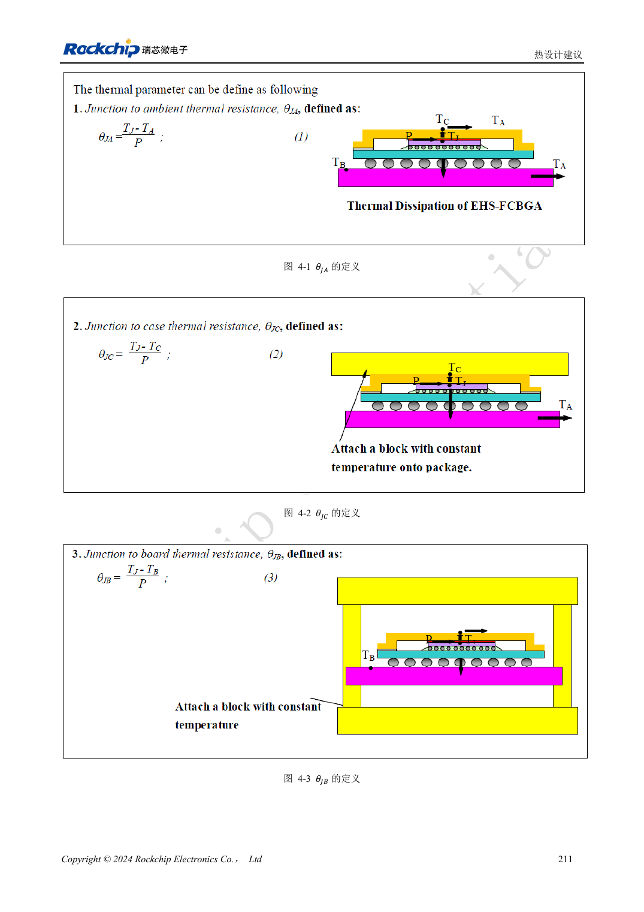

<!-- rk3576-hardware-v11-rest-20261109 -->

# RK3576 散热设计：热阻、PCB 导热与持续负载验证

本文基于 RK3576 Hardware Design Guide V1.1（2024-05-28）的中英文原稿，面向芯片主板设计。CM5 载板请以模块接口定义为准；Sige5 可用于建立软件和外设基线。指南没有限定一个可通用于所有产品的 SDK/BSP 或内核版本，实际适配需逐板核对。参数为原稿参考，不是 ArmSoM 实测。

**RK3576_Hardware_Design_Guide_V1.1_20240528_CN.pdf** · Chapter 4

## 热阻有明确测试边界

指南针对 JEDEC 2S2P 板、自然对流、无散热片给出仿真结果，不能直接代表 CM5、Sige5 或定制外壳。θJA、θJB、θJC 与 ψJT 代表不同热路径或表征条件，不能混用。尤其不能用 θJC 乘整机功耗就当作结温到环境的温升。

## 散热与供电布局共同优化

RK806S-5 与 SoC 的距离参考 20–50mm，需要同时权衡铜损和热耦合。电源/地铜、热过孔及接触材料都属于散热路径，不能只增加一块金属片。模块载板还要按模块机械结构、器件高度和安装孔设计，避免让散热压力作用到不允许承力的器件。

## 记录稳态和降频过程

使用最终外壳、安装方向和环境温度，分别验证 CPU、NPU、视频及真实组合负载。记录温度、频率、功耗和任务吞吐的时间曲线，直至趋于稳定；短时峰值不能代表持续性能。保留内核热管理，不通过关闭保护来宣传更高跑分。本文没有新增 ArmSoM 硬件实测结果。

## 设计参数与检查表

| 项目 | 原稿参考值 |
| --- | --- |
| θJA | 15.84°C/W |
| θJB | 6.96°C/W |
| θJC | 0.67°C/W |
| ψJT | 0.031°C/W |
| PMIC 与 SoC 间距参考 | 20–50mm |

## 参考原图

下图为原稿参考页，包含对应电路图或时序图；点击可查看大图。位号和元件值属于参考设计，不是 ArmSoM 产品原理图。

中文原稿 · PDF 231 · 4-1

## ArmSoM 开发路径

CM5 可用于定制载板，减少计算核心的重复设计；Sige5 可作为软件与外设验证起点。接口是否引出、连接器针脚、电平和镜像支持必须查对应板卡资料，不能从芯片功能直接推断。

- [ArmSoM CM5](https://www.armsom.org/cm5) · [CM5 Docs](https://docs.armsom.org/armsom-cm5)
- [ArmSoM Sige5](https://www.armsom.org/sige5) · [Sige5 Docs](https://docs.armsom.org/armsom-sige5)

## 继续阅读

- [RK3576 硬件设计系列：30 个主题](/zh/articles/rk3576-hardware-design-series/)
- [RK3576 电源 PCB 与 PDN：RK806S-5、反馈和大电流回路](/zh/articles/rk3576-power-pcb-pdn-design/)
- [RK3576 ESD 与 EMI：接口泄放、复位抗扰和量产检查](/zh/articles/rk3576-esd-emi-reliability-design/)
