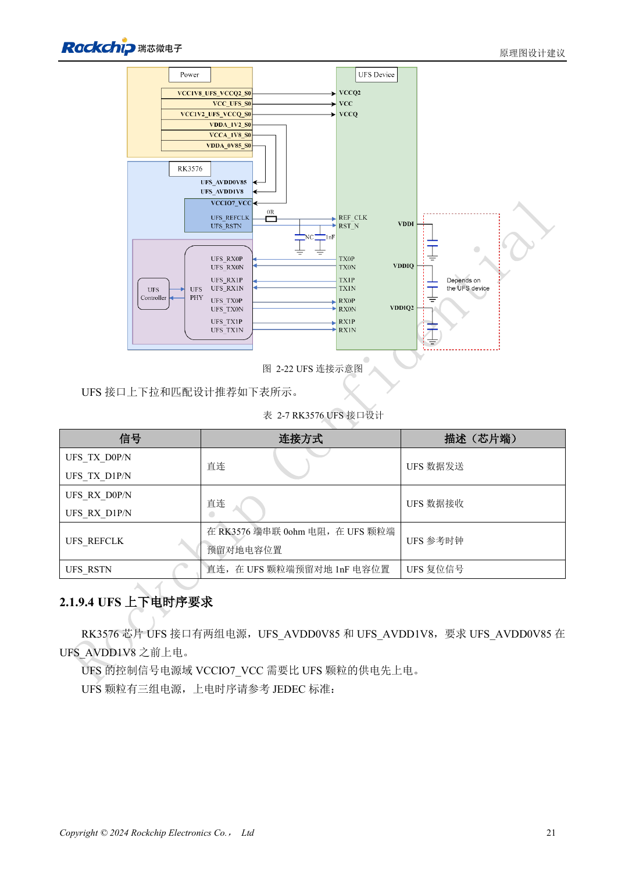
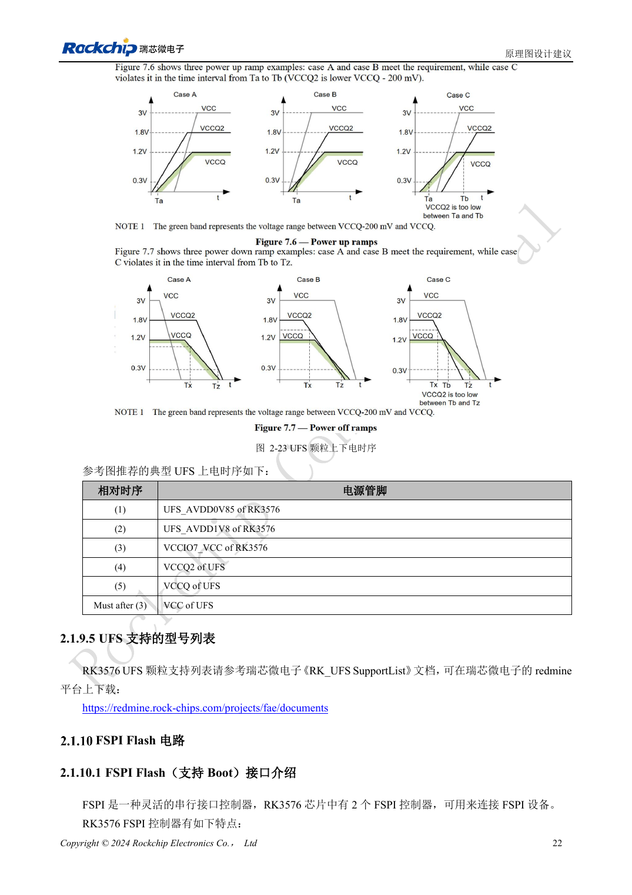

<!-- rk3576-hardware-v11-rest-20261109 -->

# RK3576 UFS 硬件设计：颗粒兼容、电源顺序与高速差分线

本文基于 RK3576 Hardware Design Guide V1.1（2024-05-28）的中英文原稿，面向芯片主板设计。CM5 载板请以模块接口定义为准；Sige5 可用于建立软件和外设基线。指南没有限定一个可通用于所有产品的 SDK/BSP 或内核版本，实际适配需逐板核对。参数为原稿参考，不是 ArmSoM 实测。

**RK3576_Hardware_Design_Guide_V1.1_20240528_CN.pdf** · §2.1.9; UFS PCB

## 版本号不能替代工作模式

RK3576 控制器为 UFS 2.0，提供两条最高 5.8Gbps 的通道。指南列出可配合使用的 UFS 2.0/2.1/2.2/3.0/3.1 颗粒，不支持 UFS 4.0。使用较新颗粒不意味着控制器升级为 UFS 3.x 速率，也不能把通道标称速率当成文件读写速度。

## 根据颗粒重新核对电源

RSTN、REFCLK 控制信号为 1.2V，使用 UFS 时 VCCIO7 也为 1.2V。UFS 2.0 的 VCCQ/VCCQ2/VCC 为 1.2/1.8/3.3V；2.1/2.2 为 NC/1.8/3.3V；3.0/3.1 为 1.2/NC/2.5 或 3.3V，最终以具体颗粒为准。指南顺序为 AVDD0V85→AVDD1V8→VCCIO7→VCCQ2→VCCQ；颗粒 VCC 在 VCCIO7 之后。不存在的电源不能机械照接。

## 差分链路与恢复验证

TX/RX 直连；REFCLK 在 SoC 端串接 0Ω，并在颗粒端预留电容；RSTN 直连并预留 1nF。差分线保持完整参考地，REFCLK 单独检查回流，地过孔距离按参考要求控制在 25mil 内。验证断电重启、低功耗恢复和持续写入，先排查供电顺序再盲目替换存储驱动。

## 设计参数与检查表

| 项目 | 原稿参考值 |
| --- | --- |
| Zdiff | 100Ω ±10% |
| 差分对内长度差 | <6mil |
| 差分对间长度差 | <100mil |
| 走线长度 | <4inch |
| 空气间距 | ≥4W; other ≥5W |
| 过孔数量建议 | ≤2 |

## 参考原图

下图为原稿参考页，包含对应电路图或时序图；点击可查看大图。位号和元件值属于参考设计，不是 ArmSoM 产品原理图。

中文原稿 · PDF 41 · 2-22

中文原稿 · PDF 42 · 2-23

## ArmSoM 开发路径

CM5 可用于定制载板，减少计算核心的重复设计；Sige5 可作为软件与外设验证起点。接口是否引出、连接器针脚、电平和镜像支持必须查对应板卡资料，不能从芯片功能直接推断。

- [ArmSoM CM5](https://www.armsom.org/cm5) · [CM5 Docs](https://docs.armsom.org/armsom-cm5)
- [ArmSoM Sige5](https://www.armsom.org/sige5) · [Sige5 Docs](https://docs.armsom.org/armsom-sige5)

## 继续阅读

- [RK3576 硬件设计系列：30 个主题](/zh/articles/rk3576-hardware-design-series/)
- [RK3576 eMMC 硬件设计：供电、上拉与 HS400 布线](/zh/articles/rk3576-emmc-hardware-design/)
- [RK3576 FSPI 启动电路：NOR/NAND、电压与片选默认状态](/zh/articles/rk3576-fspi-boot-hardware/)
