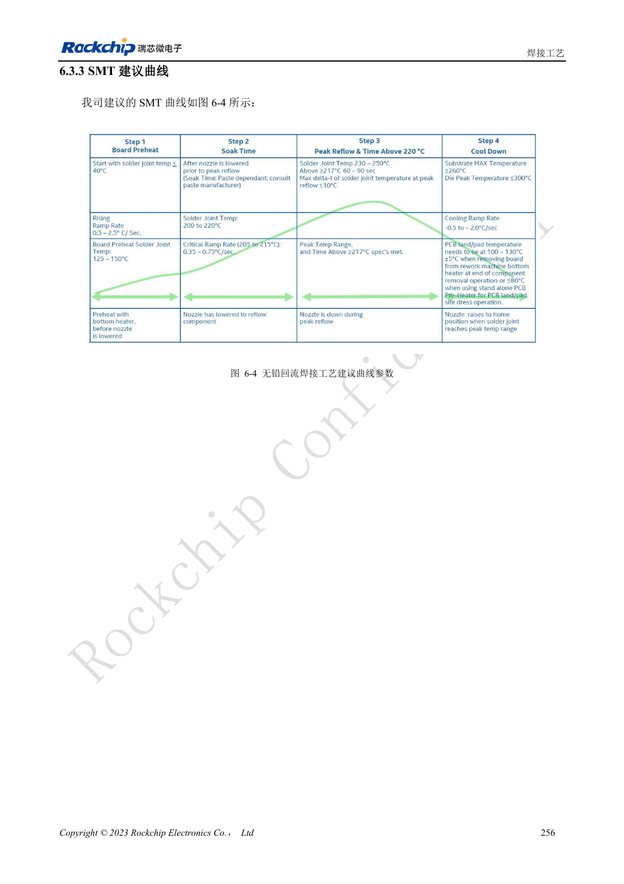
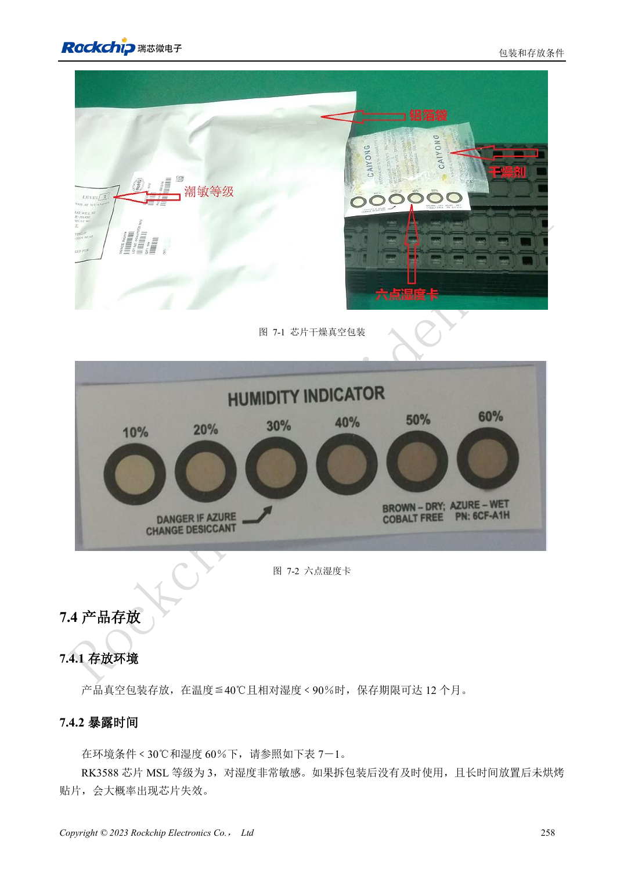

<!-- rk3588-hardware-v13-20261109 -->

# RK3588 焊接与存储：回流曲线、MSL3 和烘烤记录

本文依据 RK3588 Hardware Design Guide V1.3（2023-02-13）中英文原稿整理，面向芯片主板和载板设计审查。AIM7、LM7 载板须遵循模块接口定义；Sige7 可作为软件与外设验证起点。芯片能力不等于板卡接口清单，SDK/BSP、内核、板卡版本及固件需逐项核对。数值为原稿参考，未经 ArmSoM 硬件实测。

**RK3588 Hardware Design Guide V1.3 (2023-02-13), CN** · §6–7

## 工艺参数属于芯片与封装

指南的回流曲线针对 RK3588 芯片，不是整块 ArmSoM 模块的通用焊接许可。锡膏参考冷藏 2–10℃、常温回温 3–4 小时并记录；实际合金、助焊剂、PCB 热容量及器件耐热要求应由生产工艺统一确认。LM7 LGA 装配需要另查模块级曲线。

## 以累计暴露时间管理湿敏器件

RK3588 标为 MSL3，在 ≤30℃/60%RH 条件下暴露寿命 168 小时。开袋后记录湿度卡、时间和保存环境，不能每次重新装袋就把计时归零。表 7-2 烘烤时间按超时是否超过 72 小时及温度分别列出，且限定封装厚度 ≤1.4mm。原表 MSL1 行“300℃”疑似错误，本篇不将其作为生产条件。

## 设计参数与检查表

| 项目 | 原稿参考值 |
| --- | --- |
| MSL3 暴露寿命 | 168h，≤30°C /60%RH |
| 烘烤 125°C +10/-0°C（超时 >72h / ≤72h） | 9h /7h |
| 烘烤 90°C +8/-0°C（超时 >72h / ≤72h） | 33h /23h |
| 烘烤 40°C +5/-0°C（超时 >72h / ≤72h） | 13 天 /9 天 |
| 烘烤表封装限制 | 厚度 ≤1.4mm |

## 参考原图

下图为原稿参考页，包含对应电路图或时序图；点击可查看大图。位号和元件值属于参考设计，不是 ArmSoM 产品原理图。

中文原稿 · PDF 273 · 6-4

中文原稿 · PDF 275 · 7-2

## ArmSoM 开发路径

AIM7 适合基于计算模块设计载板；LM7 面向 LGA 模块集成；Sige7 可用于开发前期的软件与外设评估。使用模块时先检查哪些电源、DDR 与启动电路已在模块内完成，不应把芯片参考电路重复放到载板上。实际连接器、可用接口、电平与系统支持以对应产品资料为准。

- [ArmSoM AIM7](https://www.armsom.org/aim7) · [AIM7 Docs](https://docs.armsom.org/armsom-aim7)
- [ArmSoM Sige7](https://www.armsom.org/sige7) · [Sige7 Docs](https://docs.armsom.org/armsom-sige7)
- [ArmSoM LM7](https://www.armsom.org/lm7) · [LM7 Docs](https://docs.armsom.org/armsom-lm7)

## 继续阅读

- [RK3588 硬件设计系列：30 个主题](/zh/articles/rk3588-hardware-design-series/)
- [RK3588 ESD 与 EMI：接口保护和整机回流](/zh/articles/rk3588-esd-emi-hardware-design/)
