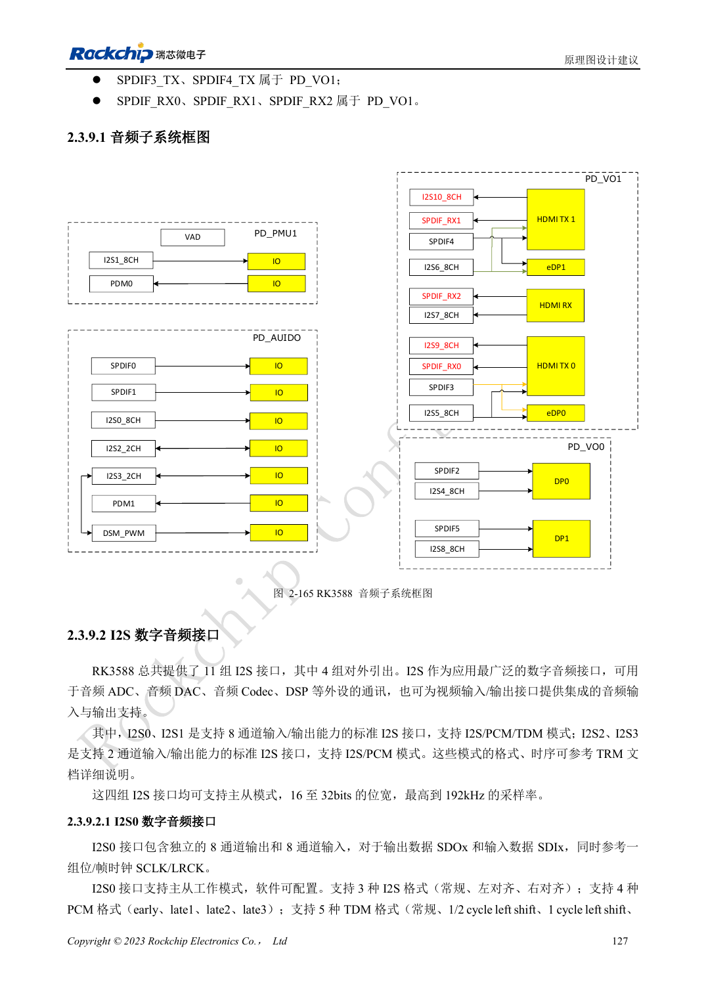
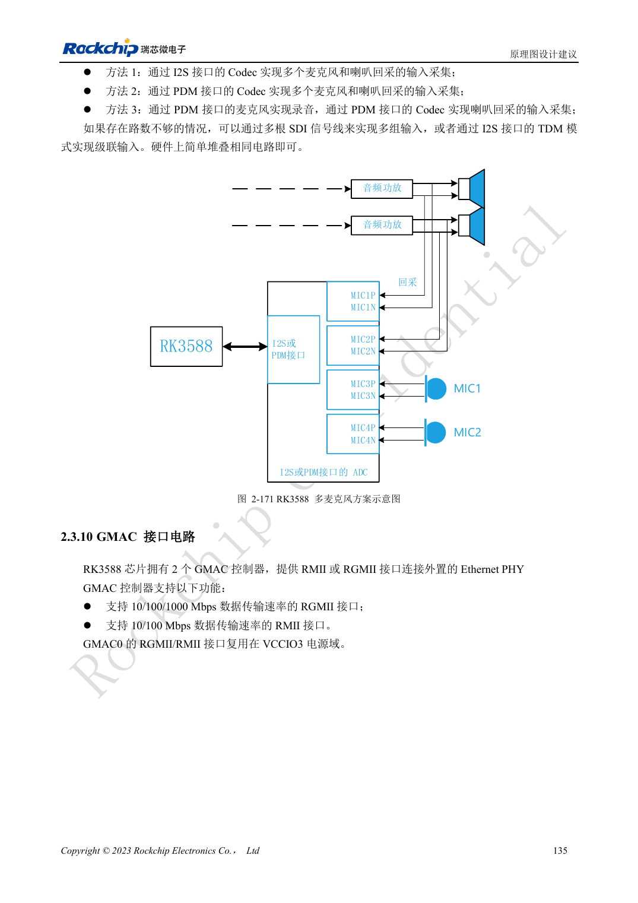

<!-- rk3588-hardware-v13-20261109 -->

# RK3588 音频硬件：I2S、PDM 与多麦克风

本文依据 RK3588 Hardware Design Guide V1.3（2023-02-13）中英文原稿整理，面向芯片主板和载板设计审查。AIM7、LM7 载板须遵循模块接口定义；Sige7 可作为软件与外设验证起点。芯片能力不等于板卡接口清单，SDK/BSP、内核、板卡版本及固件需逐项核对。数值为原稿参考，未经 ArmSoM 硬件实测。

**RK3588 Hardware Design Guide V1.3 (2023-02-13), CN** · §2.3.9; §3.4.20

## 区分内部与外部音频接口

11 组 I2S 中只有 4 组对外引出，其余用于视频配套。I2S0/1 支持 8 通道与 I2S/PCM/TDM，I2S2/3 为 2 通道 I2S/PCM。不能把内部接口数作为载板可用接口数。选择 Codec/ADC/DAC 后确定主从、MCLK、SCLK/LRCK、位宽与采样率。

## 时钟分配和模拟路径一起检查

多设备 I2S/PDM 时钟采用菊花链，避免长支路；时钟建议在 SoC 端串 22Ω且分开包地。模拟麦克风和功放线路远离 DDR、显示、RF 与电感。多麦克风加回采还要验证通道同步与软件映射，不只检查是否录到声音。

## 设计参数与检查表

| 项目 | 原稿参考值 |
| --- | --- |
| 外部 I2S | 4 组 |
| I2S0/1; I2S2/3 | 8 通道; 2 通道 |
| 原稿位宽/采样率 | 16–32bit / 最高 192kHz |
| 时钟串阻参考 | 22Ω |

## 参考原图

下图为原稿参考页，包含对应电路图或时序图；点击可查看大图。位号和元件值属于参考设计，不是 ArmSoM 产品原理图。

中文原稿 · PDF 144 · 2-165

中文原稿 · PDF 152 · 2-171

## ArmSoM 开发路径

AIM7 适合基于计算模块设计载板；LM7 面向 LGA 模块集成；Sige7 可用于开发前期的软件与外设评估。使用模块时先检查哪些电源、DDR 与启动电路已在模块内完成，不应把芯片参考电路重复放到载板上。实际连接器、可用接口、电平与系统支持以对应产品资料为准。

- [ArmSoM AIM7](https://www.armsom.org/aim7) · [AIM7 Docs](https://docs.armsom.org/armsom-aim7)
- [ArmSoM Sige7](https://www.armsom.org/sige7) · [Sige7 Docs](https://docs.armsom.org/armsom-sige7)
- [ArmSoM LM7](https://www.armsom.org/lm7) · [LM7 Docs](https://docs.armsom.org/armsom-lm7)

## 继续阅读

- [RK3588 硬件设计系列：30 个主题](/zh/articles/rk3588-hardware-design-series/)
- [RK3588 DP 与 eDP：PHY 复用、AUX 与耦合](/zh/articles/rk3588-dp-edp-hardware-design/)
- [RK3588 以太网硬件：GMAC、PHY 与时钟方向](/zh/articles/rk3588-gmac-hardware-design/)
