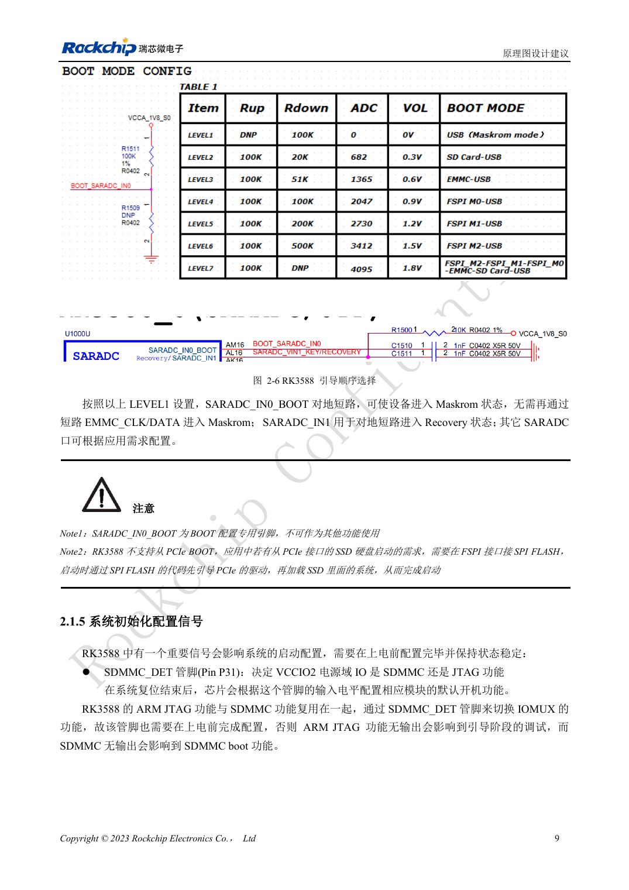
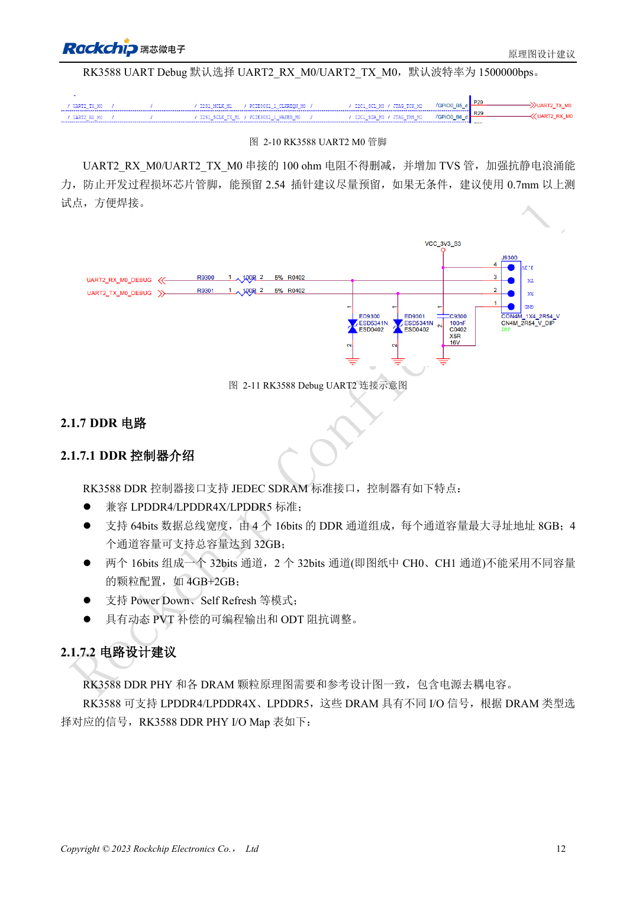

<!-- rk3588-hardware-v13-20261109 -->

# RK3588 启动与恢复：Maskrom、JTAG 和 UART

本文依据 RK3588 Hardware Design Guide V1.3（2023-02-13）中英文原稿整理，面向芯片主板和载板设计审查。AIM7、LM7 载板须遵循模块接口定义；Sige7 可作为软件与外设验证起点。芯片能力不等于板卡接口清单，SDK/BSP、内核、板卡版本及固件需逐项核对。数值为原稿参考，未经 ArmSoM 硬件实测。

**RK3588 Hardware Design Guide V1.3 (2023-02-13), CN** · §2.1.4–2.1.6; §2.3.2

## 留下可用的恢复路径

SARADC_IN0_BOOT（AM16）专用于启动选择，LEVEL1 用于 Maskrom。下载必须预留 USB2.0 OTG0。Boot ROM 不直接从 PCIe SSD 启动，参考路径是先由 FSPI Flash 的代码初始化 PCIe，再加载 SSD 系统。系统位于 NVMe 不等于 ROM 原生支持 NVMe 启动。

## 保留调试与默认上拉

SDMMC_DET 在复位前稳定：低为 SDMMC，高为 ARM JTAG。日志默认 UART2_M0、1500000bps，RX/TX 的 100Ω 串阻和 TVS 应保留。SARADC_IN1 的 10kΩ 上拉避免悬空导致下载状态异常。模块用户先查连接器针脚与电平，不能把 SoC 球位当载板针脚。

## 设计参数与检查表

| 项目 | 原稿参考值 |
| --- | --- |
| 启动引脚 | SARADC_IN0_BOOT / AM16 |
| 调试 | UART2_M0 / 1500000bps |
| SDMMC_DET | 0: SDMMC; 1: ARM JTAG |
| 恢复上拉 | SARADC_IN1: 10kΩ |

## 参考原图

下图为原稿参考页，包含对应电路图或时序图；点击可查看大图。位号和元件值属于参考设计，不是 ArmSoM 产品原理图。

中文原稿 · PDF 26 · 2-6

中文原稿 · PDF 29 · 2-10

## ArmSoM 开发路径

AIM7 适合基于计算模块设计载板；LM7 面向 LGA 模块集成；Sige7 可用于开发前期的软件与外设评估。使用模块时先检查哪些电源、DDR 与启动电路已在模块内完成，不应把芯片参考电路重复放到载板上。实际连接器、可用接口、电平与系统支持以对应产品资料为准。

- [ArmSoM AIM7](https://www.armsom.org/aim7) · [AIM7 Docs](https://docs.armsom.org/armsom-aim7)
- [ArmSoM Sige7](https://www.armsom.org/sige7) · [Sige7 Docs](https://docs.armsom.org/armsom-sige7)
- [ArmSoM LM7](https://www.armsom.org/lm7) · [LM7 Docs](https://docs.armsom.org/armsom-lm7)

## 继续阅读

- [RK3588 硬件设计系列：30 个主题](/zh/articles/rk3588-hardware-design-series/)
- [RK3588 复位、看门狗与过温保护](/zh/articles/rk3588-reset-watchdog-hardware/)
- [RK3588 电源域：首次供电与未用 PHY](/zh/articles/rk3588-power-rail-planning/)
