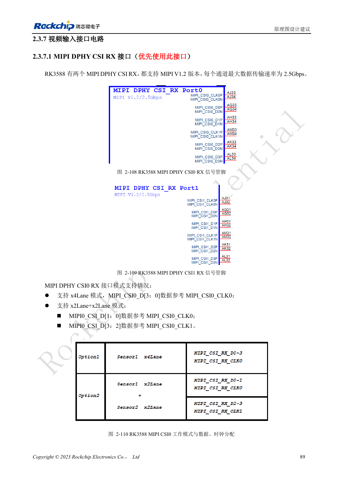
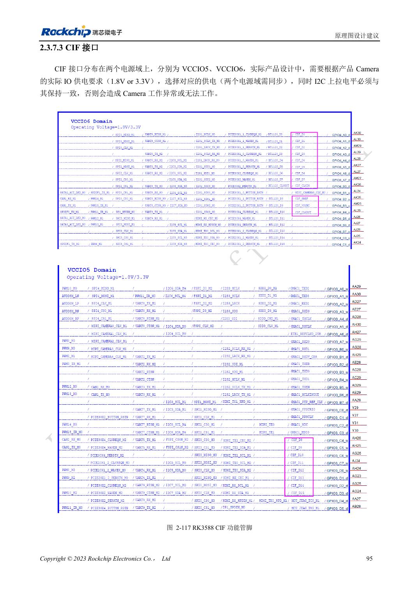

<!-- rk3588-hardware-v13-20261109 -->

# RK3588 摄像头：CSI、D/C PHY 与 CIF 接口规划

本文依据 RK3588 Hardware Design Guide V1.3（2023-02-13）中英文原稿整理，面向芯片主板和载板设计审查。AIM7、LM7 载板须遵循模块接口定义；Sige7 可作为软件与外设验证起点。芯片能力不等于板卡接口清单，SDK/BSP、内核、板卡版本及固件需逐项核对。数值为原稿参考，未经 ArmSoM 硬件实测。

**RK3588 Hardware Design Guide V1.3 (2023-02-13), CN** · §2.3.7.1–2.3.7.3; §3.4.12; §3.4.24

## 按传感器和 PHY 分配

指南建议优先使用专用 MIPI DPHY CSI RX；两组接口支持四 Lane，或拆成两组两 Lane，拆分后各组必须使用正确时钟。D/C Combo PHY 另有模式限制，不能因为针数足够就任意组合。核对传感器数据格式、速率、供电、复位、MCLK 和 I2C，再确定连接器。

## CIF 电平与系统验证

CIF 分布在 VCCIO5、VCCIO6，两域供电需要同步且与传感器 IO 相符，I2C 上拉也要匹配。MIPI 接线不代表 BSP 已支持传感器：还需驱动、设备树和 ISP 配置。验证从单路采集开始，再测试目标多路模式、持续运行、丢帧、时钟稳定和温升。

## 设计参数与检查表

| 项目 | 原稿参考值 |
| --- | --- |
| 专用 DPHY RX 原稿速率 | 2.5Gbps/lane |
| DPHY 目标阻抗 | 100Ω ±10%; 备选 95Ω ±10% |
| DPHY 对内/时钟数据差 | <6mil / <12mil |

## 参考原图

下图为原稿参考页，包含对应电路图或时序图；点击可查看大图。位号和元件值属于参考设计，不是 ArmSoM 产品原理图。

中文原稿 · PDF 106 · 2-110

中文原稿 · PDF 112 · 2-117

## ArmSoM 开发路径

AIM7 适合基于计算模块设计载板；LM7 面向 LGA 模块集成；Sige7 可用于开发前期的软件与外设评估。使用模块时先检查哪些电源、DDR 与启动电路已在模块内完成，不应把芯片参考电路重复放到载板上。实际连接器、可用接口、电平与系统支持以对应产品资料为准。

- [ArmSoM AIM7](https://www.armsom.org/aim7) · [AIM7 Docs](https://docs.armsom.org/armsom-aim7)
- [ArmSoM Sige7](https://www.armsom.org/sige7) · [Sige7 Docs](https://docs.armsom.org/armsom-sige7)
- [ArmSoM LM7](https://www.armsom.org/lm7) · [LM7 Docs](https://docs.armsom.org/armsom-lm7)

## 继续阅读

- [RK3588 硬件设计系列：30 个主题](/zh/articles/rk3588-hardware-design-series/)
- [RK3588 PCIe：通道分配、参考时钟与电源](/zh/articles/rk3588-pcie-hardware-design/)
- [RK3588 HDMI RX：采集输入、CEC 与 DDC 电平](/zh/articles/rk3588-hdmi-rx-hardware-design/)
